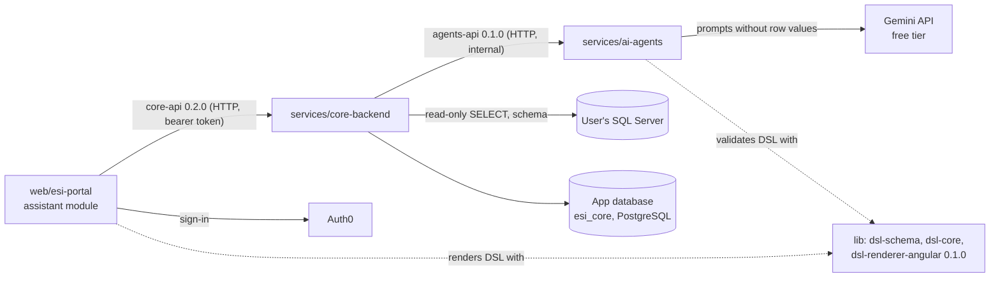

# Feature documentation: BI AI assistant (UR-1)

Official description of what the ESI BI assistant does today, feature by feature: user flow, API operations, rules and guarantees, errors, configuration and verification. The requirements and decisions behind them are in [UR-1](../requirements/UR-1-bi-ai-assistant-web-application.md) and the [ADRs](../architecture/README.md); this folder describes the implemented behavior. Verified against `develop` at `c746f99` (up to ESI-109) on 2026-10-23.

## Features

| # | Feature | What the user gets | core | agents | portal | Doc |
|---|---------|--------------------|------|--------|--------|-----|
| 1 | Connections and consent | Add, test and manage own SQL Server connections after accepting consent terms; withdraw or grant consent per database | Done (ESI-15) | - | Done (ESI-19) | [connections-and-consent](./connections-and-consent.md) |
| 2 | Schema discovery | The assistant knows the database's tables, columns, keys and procedure definitions; the user sees them in a Schema tab with an ERD | Done (ESI-16) | consumes (views as context only, ESI-105) | Done (ESI-107) | [schema-discovery](./schema-discovery.md) |
| 3 | Chat and SQL generation | Ask questions in natural language; get reviewable SQL or a stored-procedure script | Done (ESI-17) | Done (ESI-18); Gemini model (ESI-89) | Done (ESI-19) | [chat-and-sql-generation](./chat-and-sql-generation.md) |
| 4 | Read-only query execution | Run an approved SELECT explicitly and page through live results | Done (ESI-16) | - | Done (ESI-19) | [query-execution](./query-execution.md) |
| 5 | Script library | Generated stored-procedure scripts are kept per database and can be deleted | Done (ESI-17) | Done (ESI-18) | Done (ESI-19) | [chat-and-sql-generation](./chat-and-sql-generation.md#script-library) |
| 6 | Visualizations (DSL) | Turn a result into a validated table or KPI described in A2UI DSL | Done (ESI-17) | Done (ESI-18) | Done (ESI-20) | [visualizations](./visualizations.md) |
| 7 | Saved artifacts and dashboards | Save visualizations and arrange them on personal dashboards with live data | Done (ESI-17) | - | Done (ESI-20) | [artifacts-and-dashboards](./artifacts-and-dashboards.md) |
| - | Security and privacy (cross-cutting) | Encryption, owner isolation, consent enforcement, logging, Auth0 sign-in (Oidc) | Done (ESI-86) | Done | Done (ESI-87) | [security-and-privacy](./security-and-privacy.md) |

End-to-end integration (phase 5): one scripted scenario from connection to dashboard passes with `infra/e2e/run.sh` (real portal, core, agents, Postgres app database and SQL Server; the model is scripted), see [infra/e2e](../../infra/e2e/README.md). Not started: the rest of the production release checklist (phase 6) and charts (ESI-10, ESI-11, ESI-12, phase 7, [ADR-0009](../architecture/ADR-0009-chart-component-and-library.md) accepted).

## Components and how they talk

- The portal talks only to core; agents are internal to core. Contracts come from the published package `@dtnam0899/esi-contracts` (`services/contracts`; core pins 0.2.0, agents and the portal's generated client 0.1.0), the DSL from `@dtnam0899/dsl-schema` / `dsl-core` / `dsl-renderer-angular` 0.1.0 (`lib`). No project reads another project's files.
- Errors are RFC 9457 `application/problem+json` with `type: urn:esi:problem:<name>`; see [Problem types](#problem-types).

## Release status

| Where | Content |
|-------|---------|
| `main` (production line) | Phases 0 to 4 and phase 5: contracts 0.1.0 and 0.2.0, lib 0.1.0 (`lib-dsl-schema`, `lib-dsl-core`, `lib-dsl-renderer-angular`), `core@v0.1.0` and `agents@v0.1.0` (images on GHCR, ESI-78); portal ESI-19 and ESI-20 (no portal release tag). |
| `develop` (not released) | Oidc authentication with Auth0 (core, portal), app database on PostgreSQL, Gemini model client, agents reading only tables, schema ERD in the portal, local customer databases with demo data. Release core 0.2.0 and agents 0.2.0 before deploying them. |
| Demo hosting | Free tier only ([ADR-0005](../architecture/ADR-0005-hosting-target.md)): portal on Vercel (deployed by CI from `develop` once the Vercel project is set up), core and agents on Azure Container Apps, app database on Neon Postgres, model Gemini free tier, sign-in Auth0. Setup: `infra/azure/README.md`, `infra/vercel/README.md`, `infra/auth0/README.md`. |
| Local | Every project runs with Docker; core's compose has Postgres (`esi_core`) and SQL Server with `esi_target` (tests) and `esi_customer` (demo data, read-only login). |

## Problem types

All are `urn:esi:problem:<name>`. Details never contain connection strings, passwords or keys.

| Name | Status | Meaning |
|------|--------|---------|
| `unauthenticated` | 401 | No bearer token, or an invalid or expired one (Oidc mode, contract 0.2.0). |
| `invalid-request` | 400 | A field is missing or invalid (`errors[]` names the field). |
| `consent-required` | 403 | The current consent terms are not accepted (or changed since). |
| `consent-withdrawn` | 403 | Consent for this connection was withdrawn; everything tied to it is hidden. |
| `not-found` | 404 | Does not exist or belongs to another user. |
| `terms-version-outdated` | 409 | Tried to accept a terms version that is not the current one. |
| `artifact-unavailable` | 409 | The artifact's connection was deleted or its consent withdrawn. |
| `connection-failed` | 422 | A connection test failed; `detail` is a fixed, non-secret reason. |
| `sql-rejected` | 422 | The statement is not a single read-only SELECT on user tables; `issues[]` explains why. |
| `execution-failed` | 422 | SQL Server returned an error for the user's statement. |
| `invalid-result-columns` | 422 | The result has empty or duplicate column names. |
| `dsl-validation-failed` | 422 | Generated DSL stayed invalid after the retries, or saved DSL is invalid; `issues[]` with JSON pointers. |
| `visualization-not-supported` | 422 | Charts, forms or other unsupported visualizations. |
| `agents-unavailable` | 503 | The AI agents service is unreachable, has no model, is rate limited by the model or timed out (documented since contract 0.2.0). |
| `execution-timeout` | 504 | The statement exceeded the command timeout. |
