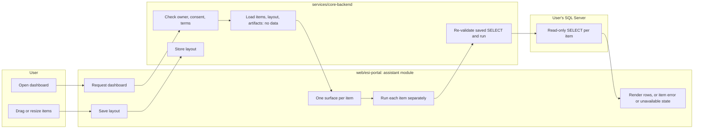
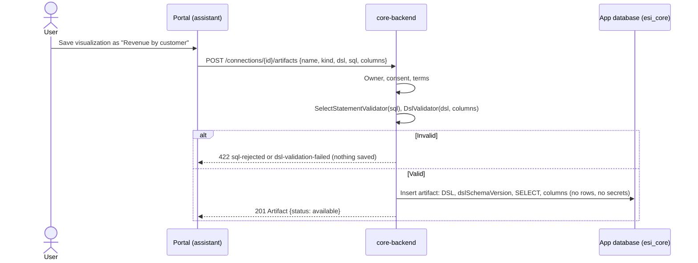
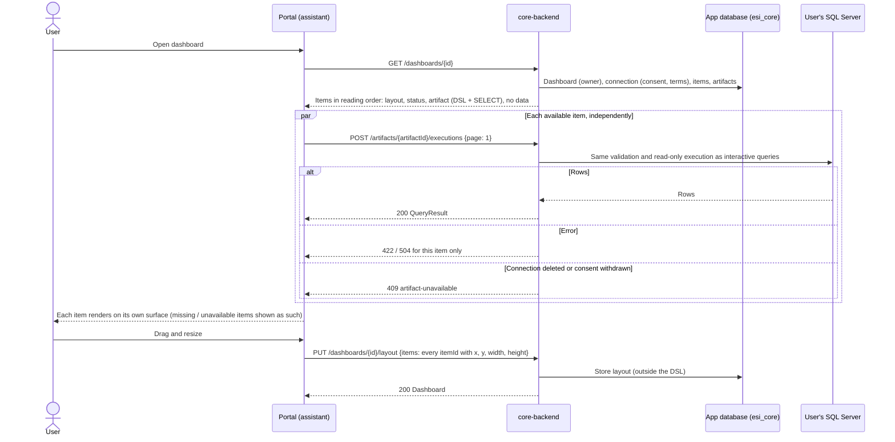

# Saved artifacts and dashboards

A user saves a validated visualization as an artifact and arranges artifacts on personal dashboards. Dashboards always show live data: each item runs its saved SELECT when the dashboard is opened. Requirements: SR-7 and SR-8 in [UR-1](../requirements/UR-1-bi-ai-assistant-web-application.md); storage model: [ADR-0002](../architecture/ADR-0002-a2ui-dsl-adoption-and-storage.md).

## User flow (portal)

1. In a database's workspace the tabs are Chat, Dashboards, Saved visualizations (artifacts) and Scripts (`?tab=chat|dashboards|artifacts|scripts`).
2. A visualization preview from chat is saved explicitly under a name; it then appears under Saved visualizations, where it can be opened (its own page renders live data) or deleted.
3. Dashboards are created, renamed and deleted from the Dashboards tab; a dashboard page shows its items on a 12-column grid.
4. Saved visualizations are added as items. Each item renders in its own surface inside a wrapper that can be dragged (Angular CDK), resized with the pointer, or moved and resized with the arrow and Shift+arrow keys.
5. Each item loads its data separately, so an item with a SQL error, a missing column or a deleted artifact shows its own state while the others render. The layout is saved after each change and restored when the dashboard is reopened.

## Diagrams

### Swimlane: open a dashboard with live data

### Sequence: save an artifact

### Sequence: open a dashboard and save its layout

## API (core-api 0.1.0)

| Operation | Method and path | Notes |
|-----------|-----------------|-------|
| `listArtifacts` | `GET /connections/{id}/artifacts` | Own artifacts with `kind` and `status` |
| `createArtifact` | `POST /connections/{id}/artifacts` | `name`, `kind` (`table`, `kpi`), `dsl`, `sql`, `columns` |
| `getArtifact` | `GET /artifacts/{artifactId}` | DSL, SELECT, columns, `status` |
| `deleteArtifact` | `DELETE /artifacts/{artifactId}` | Dashboard items that used it become `missing` |
| `executeArtifact` | `POST /artifacts/{artifactId}/executions` | Runs the saved SELECT on live data; same result as [query execution](./query-execution.md) |
| `listDashboards` | `GET /connections/{id}/dashboards` | With item counts |
| `createDashboard` | `POST /connections/{id}/dashboards` | Empty dashboard |
| `getDashboard` | `GET /dashboards/{dashboardId}` | Items with layout, status and artifact; no data |
| `renameDashboard` | `PUT /dashboards/{dashboardId}` | |
| `deleteDashboard` | `DELETE /dashboards/{dashboardId}` | Artifacts stay |
| `addDashboardItem` | `POST /dashboards/{dashboardId}/items` | An own artifact of the same connection, with a layout |
| `removeDashboardItem` | `DELETE /dashboards/{dashboardId}/items/{itemId}` | |
| `saveDashboardLayout` | `PUT /dashboards/{dashboardId}/layout` | Every item exactly once, with `x`, `y` (0 or more), `width`, `height` (1 or more) |

## Rules and guarantees

- **Validated before saving.** The SELECT must pass the execution validator and the DSL must pass core's DSL validator against the given columns; otherwise 422 `sql-rejected` or `dsl-validation-failed`, and nothing is saved.
- **No data, no secrets stored.** An artifact stores the DSL (with its `dslSchemaVersion`), the SELECT and the expected column definitions, and a reference to the connection. Never rows or connection strings.
- **Live data, same policy.** `executeArtifact` re-validates and runs the saved SELECT through the same read-only path, timeout and 20-row paging as interactive queries. Data is fetched when the user opens a dashboard; nothing is cached or scheduled.
- **Layout outside the DSL.** Position and size live with the dashboard; `getDashboard` lists items in reading order (top to bottom, left to right).
- **Independent items.** `getDashboard` returns artifacts without data; the client runs each item on its own, so one failing item does not block the others.
- **States instead of stale data.** A deleted connection: artifacts and items show `connection-unavailable`, and `executeArtifact` answers 409 `artifact-unavailable`. A deleted artifact: its item shows `missing`. A `dslSchemaVersion` this core cannot render: `migration-required`.
- **Consent and ownership.** Withdrawn consent or outdated terms hide artifacts and dashboards (403) until consent is granted again; deleting stays possible. Another user's artifacts and dashboards answer 404 on every operation, and their artifacts cannot be added to one's own dashboard.

## Data stored

`Artifacts` (owner, connection, name, kind, DSL JSON, DSL schema version, SELECT, columns JSON), `Dashboards` (owner, connection, name) and `DashboardItems` (artifact, x, y, width, height). There are deliberately no foreign keys from artifacts to connections or from items to artifacts, so the unavailable and missing states can exist.

## Verification

- portal: unit tests for the dashboard service (independent item loading, layout saved with every item once) and the grid; browser checks against the live core, including a runtime SQL error and a missing column next to working items, and a reload compared with the stored layout.
- core integration tests on the sample database: an artifact saved and run on live rows; invalid DSL and a write statement are not saved; a layout saved, renamed, reopened and restored, invalid layouts rejected, an item removed; a failing item and a good item run independently; owner isolation on 13 operations; withdrawn consent hiding and restoring; deleted artifact and deleted connection states.

## Status and open items

- Dashboards are private; sharing is out of scope for this version.
