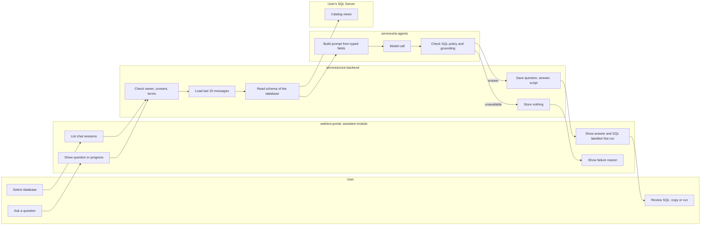
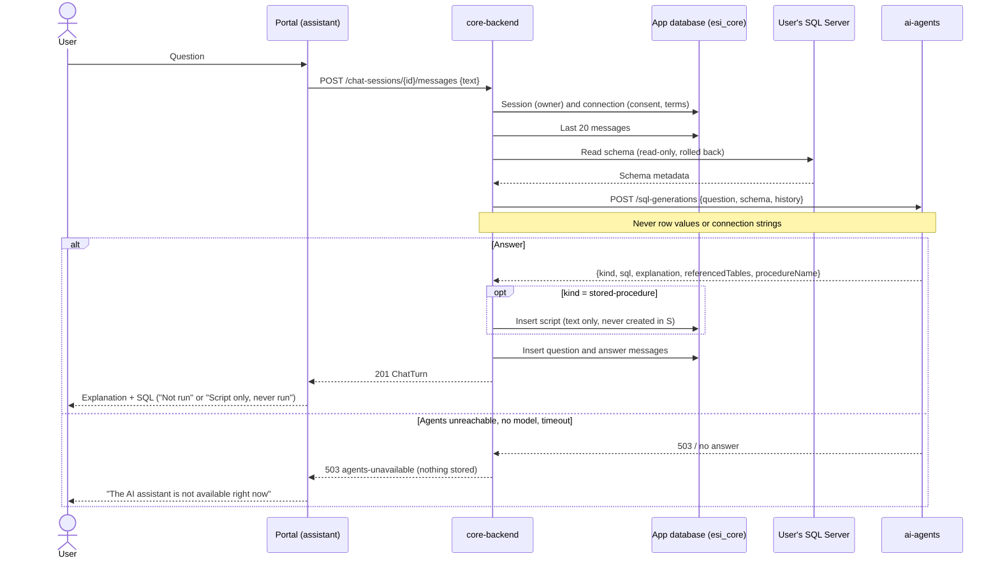

# Chat and SQL generation

The user asks questions about a selected database in natural language. The assistant answers with SQL Server SQL they can inspect, copy and, for queries, run explicitly; for statistics across several tables it can write a stored-procedure script, which is saved to the user's script library and never executed. Requirements: SR-2 and SR-3 in [UR-1](../requirements/UR-1-bi-ai-assistant-web-application.md).

## User flow (portal)

1. Selecting a connected database opens its workspace with the user's chat sessions for that database (newest activity first). A database with withdrawn consent cannot be opened.
2. A new session starts empty; its title becomes the first question.
3. While the assistant works the question shows as in progress; then the answer shows the explanation (assumptions, tables and joins used) and the generated SQL as copyable text.
4. Generated SQL is labelled **Not run** until it actually runs. "Run query" executes it (see [query execution](./query-execution.md)); the label then shows "Ran, page n" or "Run failed". A stored-procedure answer is labelled **Script only, never run** and has no run button.
5. Failures are shown as failures with a reason (for example "The AI assistant is not available right now, so no SQL was generated"), never as an empty answer.
6. Reopening a session shows all earlier messages.

## Diagrams

### Swimlane: ask a question

### Sequence: send a chat message

## API (core-api 0.2.0)

| Operation | Method and path | Notes |
|-----------|-----------------|-------|
| `listChatSessions` | `GET /connections/{id}/chat-sessions` | Own sessions of the connection |
| `createChatSession` | `POST /connections/{id}/chat-sessions` | Optional title (max 200) |
| `getChatSession` | `GET /chat-sessions/{sessionId}` | Session with messages, oldest first |
| `sendChatMessage` | `POST /chat-sessions/{sessionId}/messages` | Synchronous; returns the question and the answer (`ChatTurn`) |

An answer message has `generatedSql`: `kind` (`query`, `stored-procedure` or `none`), `sql`, `referencedTables` and, for a script, `savedScriptId`.

Internally core calls the agents service (agents-api 0.1.0, not reachable from the browser): `POST /sql-generations` with the question, the [schema](./schema-discovery.md) and the last 20 messages.

## Script library

| Operation | Method and path |
|-----------|-----------------|
| `listScripts` | `GET /connections/{id}/scripts` |
| `getScript` | `GET /scripts/{scriptId}` |
| `deleteScript` | `DELETE /scripts/{scriptId}` |

A `stored-procedure` answer is saved automatically with the procedure name, the SQL and the session it came from. The portal lists the scripts of the database and lets the user delete them. Scripts are text: the system never creates or runs them in the database.

## Rules and guarantees

- **Generation never executes.** No SQL runs and nothing changes in the database until the user explicitly runs a query.
- **What the model sees.** The question, the conversation history and the schema structure with procedure definitions (string literals masked). Never row values or connection strings: requests are built from typed contract fields only, so extra fields cannot leak. Prompts are never logged.
- **Agent-side SQL policy** ([ADR-0004](../architecture/ADR-0004-sql-validation-and-execution-policy.md)): a `query` must be a single SELECT; procedures are read-only scripts; requests for writes, DDL or executing procedures are refused with `kind: none` and an explanation; identifiers must exist in the schema, otherwise the missing information is stated instead of invented. These checks are a first line; core's validator is the enforced one when a query runs.
- **History and access.** Sessions and scripts belong to the user and the connection: another user gets 404; withdrawn consent hides history and scripts (403) until consent is granted again. A script can always be deleted.
- **Failures store nothing.** If the agent is unreachable, has no model or times out, the call returns 503 `agents-unavailable` and neither message is saved.

## Configuration

| Project | Variable | Default | Purpose |
|---------|----------|---------|---------|
| core | `ESI_CORE_Agents__BaseUrl` | compose: `http://host.docker.internal:8000/` | Agents service URL |
| core | `ESI_CORE_Agents__TimeoutSeconds` | 120 | Per-call timeout |
| agents | `ESI_AGENTS_SQL_MAX_RETRIES` | see `services/ai-agents/CLAUDE.md` | Retries when a candidate breaks the SQL policy |
| agents | `ESI_AGENTS_MODEL_TIMEOUT_SECONDS`, `ESI_AGENTS_MODEL_RETRIES`, `ESI_AGENTS_REQUEST_DEADLINE_SECONDS` | 60, 1, 80 | Model call limits and one deadline per request |
| agents | `ESI_AGENTS_MODEL_PROVIDER`, `ESI_AGENTS_GEMINI_API_KEY`, `ESI_AGENTS_GEMINI_MODEL` | `none`, -, `gemini-3.8-flash` | Model provider; `none` answers 503 `model-unavailable` (all settings: `services/ai-agents/CLAUDE.md`) |

## Verification

- agents: unit tests and evals with a scripted model (refusals for writes, DDL, EXEC, linked servers and procedure calls; grounding; procedure scripts read-only; no row values or connection strings in prompts).
- core integration tests with a fake agent: a stored turn, the agent receiving schema and history, no data change, a procedure answer saved as a script and not created in the database, owner isolation, withdrawn consent, unavailable agent storing nothing. A smoke test against the real agents image confirmed the HTTP path.
- portal: unit tests and browser checks against the live core API (create, list, ask, reopen, scripts; the unavailable-agent message).

## Status and open items

- **Model provider:** Gemini API free tier, demo data only ([ADR-0007](../architecture/ADR-0007-model-provider.md), ESI-89). Free-tier rate limits answer 503 (`agents-unavailable`) until the quota recovers; real-model evals run by hand, never in CI. With `MODEL_PROVIDER=none` (default) the agents service answers 503 and the portal shows the assistant as unavailable.
- **Views are context only** (ESI-105): generated queries read only tables, matching core's execution policy; a candidate that reads a view is retried with the finding `view-not-allowed`.
- **Streaming answers:** needed, but planned for the next version (product owner, 2026-10-23). Answers stay synchronous in this version.
