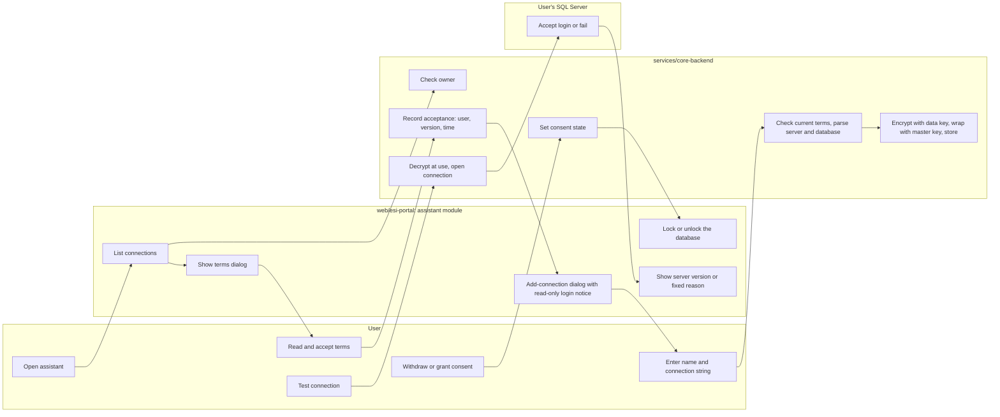
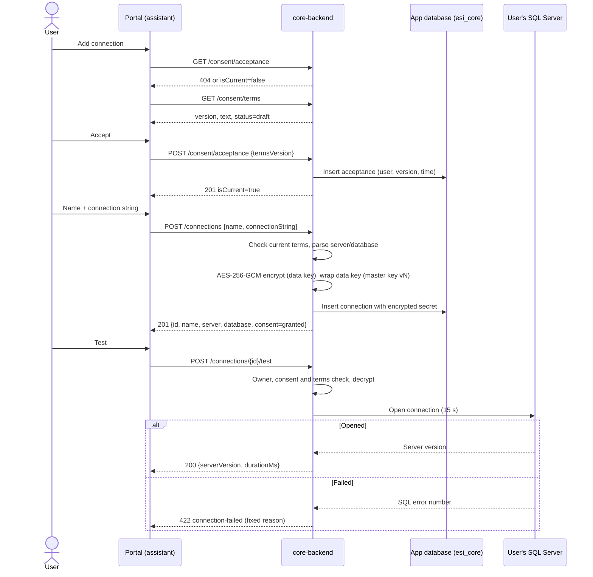
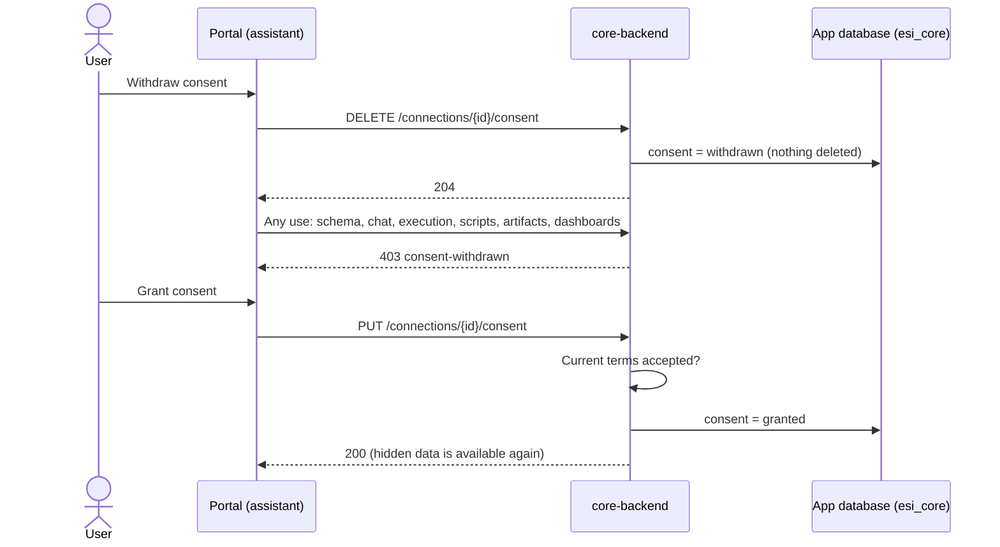

# Connections and consent

A user connects the assistant to their own SQL Server databases. Before the first connection they accept the security and consent terms; afterwards they can test, rename, replace the connection string of, delete, and withdraw or grant consent for each connection. Requirements: SR-1 and SR-9 in [UR-1](../requirements/UR-1-bi-ai-assistant-web-application.md); key management: [ADR-0003](../architecture/ADR-0003-connection-secret-key-management.md).

## User flow (portal, assistant module)

1. The assistant home lists the user's connections with their consent state.
2. Adding the first connection opens the consent terms dialog (the text, its version and a "draft" badge while not yet approved). Accepting records the acceptance; the add-connection dialog follows.
3. The add/edit dialog takes a name and a SQL Server connection string. A notice recommends a database login with read-only permissions. The connection string is never shown again; editing leaves it unchanged unless a new one is entered.
4. "Test" opens the connection and shows the server version, or a fixed reason such as "Login failed: check the user name and password."
5. Withdrawing consent locks the database at once: its chat history, scripts and other features become unavailable. Granting consent again restores everything. Deleting removes the connection.
6. When the terms change, the user is asked to accept the new version before any connection can be used again.

## Diagrams

### Swimlane: accept terms, add and test a connection, withdraw consent

### Sequence: add and test a connection

### Sequence: withdraw and grant consent again

## API (core-api 0.1.0)

| Operation | Method and path | Notes |
|-----------|-----------------|-------|
| `getConsentTerms` | `GET /consent/terms` | Current version, Markdown text, `draft` or `approved` |
| `getConsentAcceptance` | `GET /consent/acceptance` | Latest acceptance with `isCurrent`; 404 if none |
| `acceptConsentTerms` | `POST /consent/acceptance` | Only the current version (409 `terms-version-outdated` otherwise) |
| `listConnections` | `GET /connections` | Own connections, including withdrawn ones |
| `createConnection` | `POST /connections` | Requires current terms (403 `consent-required`) |
| `getConnection` | `GET /connections/{id}` | |
| `updateConnection` | `PUT /connections/{id}` | Rename; `connectionString` optional (kept when omitted); needs granted consent |
| `deleteConnection` | `DELETE /connections/{id}` | Artifacts and dashboards remain and show as unavailable |
| `testConnection` | `POST /connections/{id}/test` | 200 with server version, or 422 `connection-failed` |
| `grantConnectionConsent` | `PUT /connections/{id}/consent` | Requires current terms |
| `withdrawConnectionConsent` | `DELETE /connections/{id}/consent` | Hides the database's data, deletes nothing |

Responses contain `id`, `name`, `server`, `database` (taken from the connection string, without credentials), `consent` (`granted` or `withdrawn`) and timestamps. No response field ever holds the connection string.

## Rules and guarantees

- **Consent first.** A connection can be added, tested, updated or used only after the user accepted the current terms version; acceptance records user, version and time. A new terms version requires accepting again.
- **Per-database consent.** Withdrawn consent makes every connection-based operation answer 403 `consent-withdrawn` (schema, chat, execution, scripts, artifacts, dashboards). Listing, reading the connection itself, granting again and deleting still work.
- **Owner only.** Every operation on another user's connection answers 404, so its existence is not revealed.
- **Encryption at rest** ([ADR-0003](../architecture/ADR-0003-connection-secret-key-management.md)): each connection string is encrypted with AES-256-GCM under a fresh data key; the data key is wrapped with AES-256-GCM under a versioned master key. Associated data binds the ciphertext to the connection and owner. The plaintext exists only during a call and is never logged or returned.
- **Non-secret errors.** Test failures map SQL Server error numbers to fixed messages (login failed, database not found or not allowed, server unreachable); the driver's own message is never returned.

## Configuration (core)

| Variable | Purpose |
|----------|---------|
| `ESI_CORE_Encryption__MasterKeys__<version>` | Base64 of 32 random bytes per key version |
| `ESI_CORE_Encryption__ActiveKeyVersion` | Version used for new secrets; the API does not start without a valid active key |
| `ESI_CORE_Auth__Mode=LocalAdmin` | Required until real authentication exists (see [security-and-privacy](./security-and-privacy.md)) |

Losing the master key makes stored connections unrecoverable; users would have to re-enter them.

## Data stored

`ConsentAcceptances` (user, terms version, time) and `Connections` (owner, name, server, database, consent state, encrypted secret: ciphertext, nonce, tag, wrapped data key, key version, algorithm).

## Verification

- core unit tests: encryption round trip, tamper detection, binding to connection and owner, missing key version, key rotation re-wrap, key ring configuration, connection string parsing, error mapping.
- core integration tests (SQL Server): consent required and outdated version, full owner flow with the stored row checked to be encrypted, owner isolation on every operation, withdrawn consent blocking and restoring, wrong password giving a non-secret error, a terms change forcing re-acceptance, and no password or connection string in any response or log line.
- portal: unit tests for the consent and connection services and components; browser checks against the live core API.

## Status and open items

- The consent text `2026-10-18.1` is an AI-drafted draft; an administrator (with legal advice) must approve it before production.
- Master key backup and ownership, and moving to a managed key store, are open before production (ADR-0003).
