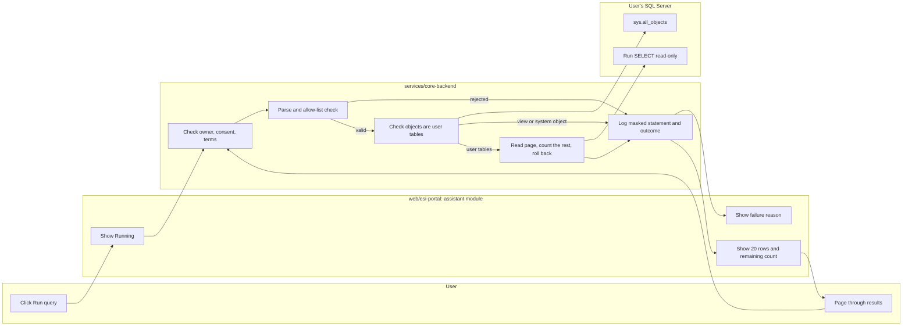
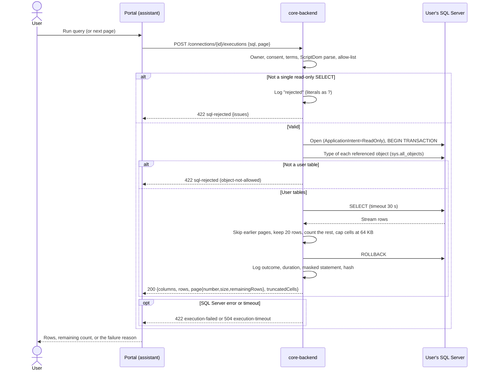

# Read-only query execution

After reviewing generated (or their own) SQL, the user explicitly runs it and sees live results 20 rows at a time. Only a single read-only SELECT can run; the backend enforces this before anything reaches the database. Requirement: SR-4 in [UR-1](../requirements/UR-1-bi-ai-assistant-web-application.md); policy: [ADR-0004](../architecture/ADR-0004-sql-validation-and-execution-policy.md).

## User flow (portal)

1. "Run query" on a generated query starts execution; a spinner shows "Running the query…".
2. The result shows the column headers, up to 20 rows and "n more rows after this page" (or "No more rows"); paging loads other pages. NULLs are shown as such, and cells cut at 64 KB are marked "truncated".
3. A query that ran but returned no rows says so. A failure shows the reason (for example "The statement was not run: only a single read-only SELECT can be executed", "SQL Server returned an error…", "The query timed out…"); it is never shown as an empty result.

## Diagrams

### Swimlane: run an approved SELECT

### Sequence: execute a page

## API (core-api 0.2.0)

`POST /connections/{connectionId}/executions` (`executeQuery`) with `{ "sql": "...", "page": 1 }` returns `QueryResult`:

| Field | Content |
|-------|---------|
| `columns` | Name, SQL type, nullability of each result column |
| `rows` | At most 20 objects keyed by column name |
| `page` | `number`, `size` (20), `remainingRows` after this page |
| `truncatedCells` | `rowIndex` and `column` of cells cut at 65,536 characters |
| `durationMs` | Server time |

Saved artifacts run through the same path (`executeArtifact`, see [artifacts and dashboards](./artifacts-and-dashboards.md)).

## Rules and guarantees

1. **Explicit request, usable connection.** Execution is its own request; the connection must be the user's, with granted consent and the current terms accepted.
2. **Statement validation (enforced, before the database).** The text is parsed with Microsoft's T-SQL parser (ScriptDom, SQL Server 2025 grammar). It must be one batch with one plain SELECT. Every syntax node must be on an explicit allow-list (unknown constructs are rejected by default), and functions must be allow-listed system functions. Rejected among others: INSERT/UPDATE/DELETE/MERGE, DDL, EXEC and dynamic SQL, multiple statements or `GO` batches, `SELECT … INTO`, OPENROWSET/OPENQUERY/OPENDATASOURCE, linked-server and cross-database names, variables and `@@` globals, `WAITFOR`, table and query hints, FOR XML/JSON, user-defined and table-valued functions.
3. **Only user tables.** Before running, every referenced object must be a user table; views, synonyms, table-valued functions and system objects are rejected (views may be allowed after a later review).
4. **Read-only execution.** `ApplicationIntent=ReadOnly`, inside a transaction that is always rolled back. Users are still advised to connect with a read-only login (shown in the portal and in the consent terms).
5. **Bounded work.** Command timeout (default 30 s, then 504). No row limit, because the user owns the database; each page re-runs the statement (stateless paging, live data may shift between pages) and the remaining rows are counted by streaming, never by loading the result.
6. **Usable columns.** Every result column needs a unique, non-empty name (aliases for computed columns).
7. **Inline log, no data.** Every attempt is logged with user, connection, outcome, duration, and the statement with literals replaced by `?` and comments removed, plus a SHA-256 of the original text. Results and literal values are never logged.

## Configuration (core)

| Variable | Default | Purpose |
|----------|---------|---------|
| `ESI_CORE_Execution__CommandTimeoutSeconds` | 30 | Timeout for schema reads and executions |

## Verification

- core unit tests: a corpus of valid SELECTs (joins, CTEs, TOP, OFFSET/FETCH, CASE, window and date functions, subqueries, UNION) and of bypass attempts (all constructs listed above plus comment and Unicode-whitespace tricks), literal masking, type names.
- core integration tests: rejected statements leave tables and data unchanged, a view and `sys.objects` are rejected, paging (27 rows give 20 + 7 + 0), errors and invalid columns are errors, a 64 KB cell is truncated and reported, owner and consent checks, masked logging, a timeout gives 504.
- portal: unit tests for the result and execution components; browser checks against the live core API.

## Status and open items

- Views and user-defined functions stay rejected until a review decides otherwise (ADR-0004).
