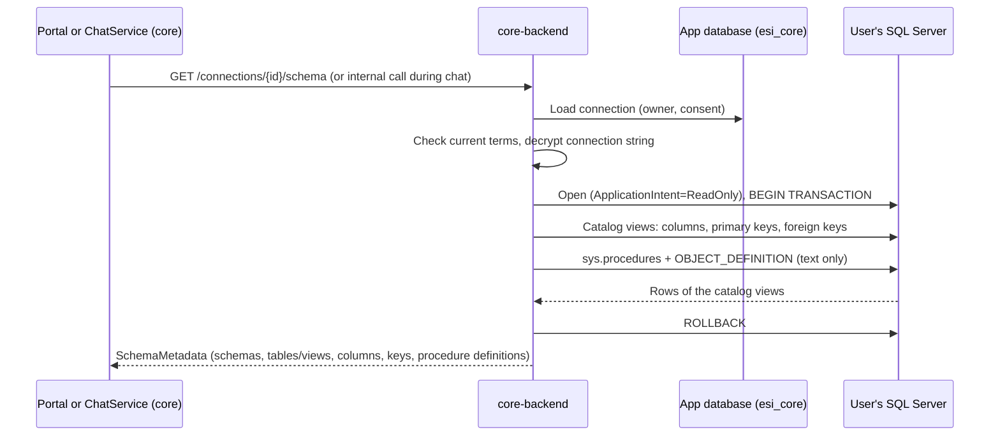

# Schema discovery

The assistant reads the structure of a connected database so that generated SQL is grounded in real tables and columns. Requirement: SR-1 in [UR-1](../requirements/UR-1-bi-ai-assistant-web-application.md).

## What is read

| Item | Content |
|------|---------|
| Schemas | Every schema with user objects |
| Tables and views | Name and `kind` (`table` or `view`) |
| Columns | Name, SQL type with length or precision (for example `nvarchar(200)`, `decimal(18,2)`, `datetime2(7)`), nullability |
| Primary keys | Column names in key order |
| Foreign keys | Name, columns, referenced schema, table and columns |
| Stored procedures | Name and definition text (`OBJECT_DEFINITION`) as context only |

Objects shipped by Microsoft are excluded. No row values are read.

## API (core-api 0.1.0)

`GET /connections/{connectionId}/schema` (`getConnectionSchema`) returns `SchemaMetadata`. It needs an owned connection with granted consent and the current terms accepted (404, 403 otherwise).

## Diagrams

### Sequence: read schema metadata

## How it is used

- **Chat:** for every question, core reads the schema and sends its structure, with procedure definitions, to the agent (`generateSql`). The agent grounds identifiers in it and masks string literals of procedure definitions in its prompt.
- **Users:** the portal does not show the schema as a separate screen in this version; it is context for generation.

## Rules and guarantees

- Read inside a transaction that is always rolled back, with `ApplicationIntent=ReadOnly` and the command timeout of [query execution](./query-execution.md).
- Stored procedures are never executed; their definitions are text.
- Views are listed (so the assistant can explain them), but executed SELECTs may read only user tables (see [query execution](./query-execution.md)).

## Verification

core integration tests on the sample `esi_target` database: tables and the view with their kind, composite primary key, foreign keys, column types, procedure definition present, and no row values in the response.
