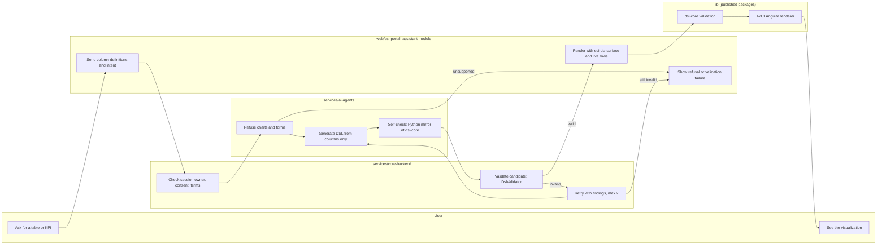
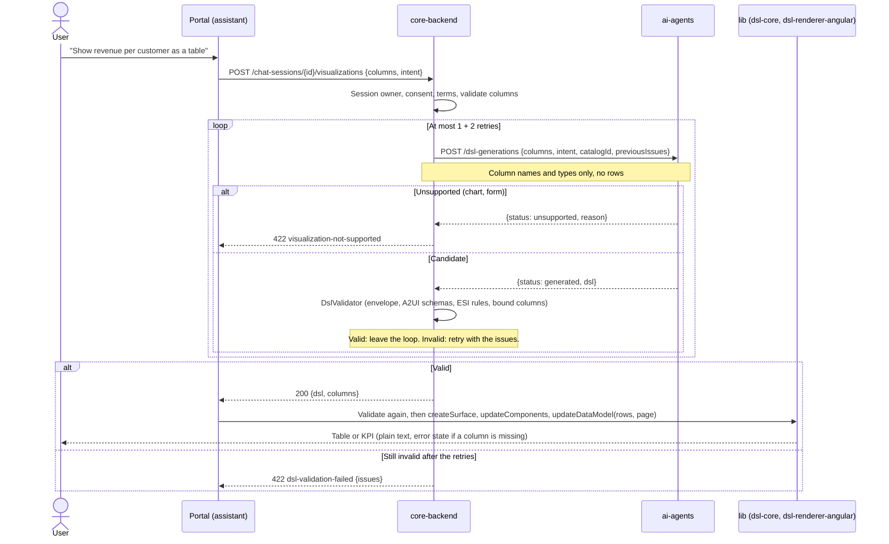

# Visualizations (UI DSL)

After a query ran, the user asks for a table or a KPI. The assistant produces a UI description in the A2UI v0.9.1 DSL that refers to result columns by name and carries no data; the portal binds the live rows to it when rendering. Requirements: SR-5 and SR-6 in [UR-1](../requirements/UR-1-bi-ai-assistant-web-application.md); design: [ADR-0002](../architecture/ADR-0002-a2ui-dsl-adoption-and-storage.md); DSL reference: [docs/dsl](../dsl/README.md).

## What is supported

| Visualization | Built from (A2UI basic catalog, used as is) |
|---------------|---------------------------------------------|
| Table | `Column` with a header `Row` and a `List` whose template `Row` iterates `/rows` with relative column paths |
| KPI | `Card` with `Text` bound to a value via `formatNumber` or `formatCurrency`, plus a label `Text` |

Charts and forms are not supported in this version; the assistant says so (`visualization-not-supported`) instead of producing something else. Charts are planned with a custom catalog component `EsiChart` on Chart.js ([ADR-0009](../architecture/ADR-0009-chart-component-and-library.md), proposed; ESI-10, ESI-11, ESI-12).

## Flow

1. The portal sends the result's column definitions and the intent (`table` or `kpi`, plus the user's wording) to core: `POST /chat-sessions/{sessionId}/visualizations` (`createVisualization`).
2. Core forwards column definitions only (never rows) to the agent (`POST /dsl-generations`), with the pinned catalog id.
3. Core validates the candidate itself. If it is invalid, core calls the agent again with the findings, at most 2 more times; then it answers 422 `dsl-validation-failed` with the findings. Only a valid document is returned.
4. The portal shows the preview: it maps the `DslDocument`, the SELECT and the column types to the renderer's artifact format, maps the query page to `/rows` and `/page`, and renders it with `<esi-dsl-surface>`. Refusals and validation failures are shown as messages that offer a table or KPI instead. The user can then save the preview as an artifact ([artifacts and dashboards](./artifacts-and-dashboards.md)).

## Diagrams

### Swimlane: create and render a visualization

### Sequence: create a visualization

## The document (`DslDocument`)

`catalogId` (`https://a2ui.org/specification/v0_9/catalogs/basic/catalog.json`), `protocolVersion` (`v0.9`), `dslSchemaVersion` (the `@dtnam0899/dsl-schema` version, `0.1.0`) and `components` (the A2UI `updateComponents` payload, exactly one with id `root`). Data paths: relative column names inside a `/rows` template, `/rows/<index>/<column>` for one row, `/page/<field>` for paging.

## Validation (the same rules everywhere)

In the order of ADR-0002: the envelope (catalog id, protocol and schema versions, no row-data keys such as `rows`), each component against its A2UI catalog schema, then the ESI rules: unique component ids, a `root`, only catalog components and functions, existing child references, no HTML or script URLs in text, bound paths valid and referring to the given columns.

| Implementation | Where | Used for |
|----------------|-------|----------|
| `@dtnam0899/dsl-core` 0.1.0 | `lib` (TypeScript) | Portal before rendering |
| Python mirror | `services/ai-agents` | Agent self-check before answering |
| `DslValidator` (.NET, JsonSchema.Net) | `services/core-backend` | Before returning a visualization and before saving an artifact |

All three must produce the same error codes on the shared fixtures published in `@dtnam0899/dsl-schema` (valid table and KPI; 16 invalid cases), which each project vendors at a pinned version.

## Rendering (lib, used by the portal)

`<esi-dsl-surface [artifact] [data]>` from `@dtnam0899/dsl-renderer-angular` 0.1.0 wraps the A2UI Angular renderer (`@a2ui/angular` 0.13.0, imported only from `@a2ui/angular/v0_9`). It validates before rendering and shows an error state (`role="alert"`) for an invalid document or a bound column that the live result no longer has; the user then starts over with a new prompt. All text is plain text: Markdown and HTML in DSL or row values are shown literally, never interpreted.

## Verification

- lib: behavior tests for the table and KPI fixtures, the exact catalog id, the missing-column error state and untrusted row values.
- agents: evals for valid table and KPI output, invalid DSL retries, chart and form refusals, and prompts containing column definitions only.
- core: `DslValidatorTests` (all shared fixtures, same codes as dsl-core); integration tests for a retry that succeeds, failure after the retries, and an unsupported request.
- portal: unit tests for the DSL adapter, preview, refusal and failure messages; browser checks against the live core with artifacts saved through the API (live generation needs the Gemini key, ADR-0007).

## Status and open items

- Charts (ADR-0009): `lib` validates and renders `EsiChart` since ESI-10 (not released yet); agents (ESI-11), contracts (ESI-113), core (ESI-114) and the portal (ESI-12) still refuse charts with `visualization-not-supported` until they pin the new versions.

- A `dslSchemaVersion` the portal does not know is shown as "migration required" and never rendered.
- Upgrades of the pinned A2UI versions need a dedicated issue with fixture tests (ADR-0002).
