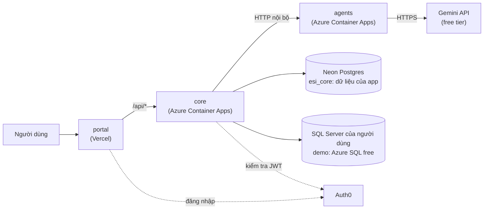
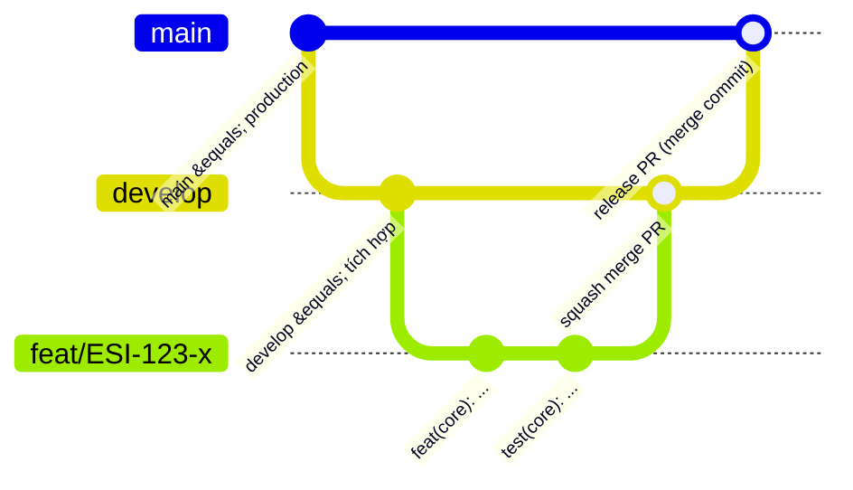
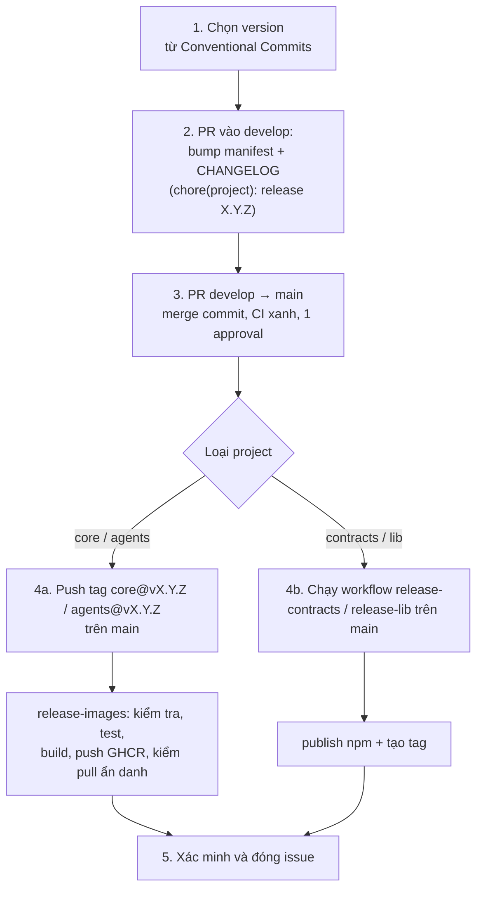

# ESI: tài liệu onboarding cho fresher (config → CI/CD → deployment)

Tài liệu này sắp xếp lại kiến thức của dự án theo **thứ tự nên học**, từ thiết lập máy tới đưa bản demo lên cloud. Nó là bản **tổng quan có dẫn đường**: chi tiết từng lệnh nằm ở các tài liệu gốc được liên kết ở mỗi phần. Khi tài liệu này và tài liệu gốc khác nhau, tài liệu gốc đúng.

> Số phiên bản, tên biến, tên workflow dưới đây lấy từ repo tại ngày `updated`. Hãy kiểm tra lại trong file nguồn trước khi dựa vào chúng.

## Lộ trình học

| Bước | Chủ đề | Bạn sẽ làm được gì | Thời gian gợi ý |
|------|--------|--------------------|-----------------|
| 0 | [Bức tranh tổng thể](#0-bức-tranh-tổng-thể) | Nói được ESI gồm những gì, chúng nối với nhau thế nào | 30 phút |
| 1 | [Chuẩn bị máy và cấu hình](#1-chuẩn-bị-máy-và-cấu-hình) | Có token, Docker, chạy được từng project ở máy | 1/2 ngày |
| 2 | [Quy trình làm việc hằng ngày](#2-quy-trình-làm-việc-hằng-ngày) | Tạo branch, commit, PR đúng quy ước | 1 giờ |
| 3 | [CI](#3-ci-github-actions-chạy-gì-khi-bạn-mở-pr) | Hiểu vì sao PR đỏ/xanh và đọc log | 1 giờ |
| 4 | [Versioning và release](#4-versioning-và-release-cd-phần-publish) | Biết một version đi từ `develop` tới registry thế nào | 2 giờ |
| 5 | [Deployment bản demo](./deployment.md) | Hiểu và dựng lại demo trên Vercel + Azure + Neon + Auth0 | 1-2 ngày |
| 6 | [Vận hành và xử lý sự cố](#6-vận-hành-hằng-ngày-và-xử-lý-sự-cố) | Bật/tắt demo, đọc log, tra lỗi thường gặp | 1 giờ |
| 7 | [Quyết định kiến trúc và tài liệu](#7-đọc-tiếp-ở-đâu) | Biết tìm "vì sao" ở đâu | tuỳ |

Cuối tài liệu có [checklist ngày đầu](#checklist-tuần-đầu-tiên) và [bảng thuật ngữ](#thuật-ngữ).

---

## 0. Bức tranh tổng thể

ESI là nền tảng BI có trợ lý AI: người dùng kết nối một database SQL Server, hỏi bằng ngôn ngữ tự nhiên, AI sinh câu `SELECT`, người dùng duyệt và chạy, rồi hiển thị bảng/KPI/biểu đồ và lưu vào dashboard. Mô tả giao diện được truyền dưới dạng **DSL** (JSON, dựa trên A2UI v0.9) và portal render nó.

Repo `edge-side-includes` chứa **5 project độc lập** (xem `CLAUDE.md` gốc):

| Project | Công nghệ | Vai trò | Mã `[PROJECT]` |
|---------|-----------|---------|----------------|
| `services/core-backend` | .NET 10, ASP.NET Core, EF Core | API chính, domain, auth, lưu dữ liệu app | `core` |
| `services/ai-agents` | Python 3.13, FastAPI, uv | Agent sinh SQL và DSL, gọi Gemini | `agents` |
| `services/contracts` | OpenAPI 3.0.3 | Hợp đồng API (core-api, agents-api), phát hành thành gói npm | `contracts` |
| `web/esi-portal` | Angular 21 | Web app quản trị, có module trợ lý AI | `portal` |
| `lib/` | TypeScript + Nx | `dsl-schema`, `dsl-core`, `dsl-renderer-angular`, `api-client`, `ui-tokens` | `lib` |

Ngoài ra: `docs/` (yêu cầu, kế hoạch, ADR), `infra/` (nối các image đã build: `vercel`, `azure`, `auth0`, `e2e`), `scripts/`, `.github/workflows/` (CI/CD), `.claude/` (skill, hook, command cho Claude Code).



### 5 quy tắc kiến trúc phải thuộc lòng

Đây là nguyên nhân của hầu hết cấu hình CI/CD bên dưới.

1. **Độc lập**: mỗi project tự cài, build, test, chạy trong thư mục của nó, chỉ dùng manifest và Docker của nó. Cấm import bằng đường dẫn (`../`, `file:`, `link:`, symlink) sang project khác. Không có build tool/workspace chung toàn repo; Nx chỉ tồn tại trong `lib/`.
2. **Chỉ tích hợp qua artifact và API**: project khác được dùng qua **phiên bản đã publish** (npm từ GitHub Packages, image từ GHCR) hoặc qua HTTP. Thay đổi cần 2 project thì phát hành theo thứ tự: producer trước, consumer nâng version sau.
3. **Docker ở mọi nơi**: mỗi project có `Dockerfile` nhiều stage, `.dockerignore`, `compose.yaml` cho dependency cục bộ; build context chỉ là thư mục project. CI chạy đúng các lệnh đó. `infra/` không bao giờ build từ source.
4. **SemVer riêng từng project**, lấy từ manifest gốc (`package.json`, `Directory.Build.props`, `pyproject.toml`) và có `CHANGELOG.md`. Tag release: `<project>@vX.Y.Z`. Version suy ra từ Conventional Commits; thay đổi phá vỡ cần `!`/`BREAKING CHANGE:` và một ADR nếu động tới contract hoặc DSL.
5. **Nx chỉ dùng trong `lib/`**.

Hệ quả thực tế: code sinh tự động (API client, model DSL) **không bao giờ sửa tay**; sinh lại từ version contract/schema đã pin.

---

## 1. Chuẩn bị máy và cấu hình

### 1.1 Công cụ

| Công cụ | Dùng để |
|---------|---------|
| Git, GitHub CLI (`gh`) | Mã nguồn, PR, lấy token, chạy workflow |
| Docker Desktop (BuildKit bật) | Cách chuẩn để build/test mọi project. SQL Server chỉ có image amd64: trên Apple silicon bật Rosetta và cấp VM từ 4 GB trở lên |
| Node.js 22 + npm | `portal`, `lib`, `contracts` nếu chạy ngoài Docker |
| .NET 10 SDK (10.0.402, pin trong `global.json`) | `core` nếu chạy ngoài Docker |
| `uv` (Python 3.13) | `agents` nếu chạy ngoài Docker |
| Azure CLI, tài khoản Vercel/Neon/Auth0 | Chỉ khi bạn làm phần deployment ([deployment.md](./deployment.md)) |

Nếu chưa cài SDK, dùng các lệnh Docker trong `CLAUDE.md` của từng project: kết quả giống CI.

### 1.2 Token GitHub Packages (bước hay vướng nhất)

Các gói `@dtnam0899/*` (contracts, lib) nằm ở GitHub Packages. Registry này **luôn cần token có `read:packages`**, kể cả gói public, và chỉ nhận **classic token** (OAuth token của `gh` hoặc classic PAT), không nhận fine-grained PAT.

```bash
gh auth refresh -h github.com -s read:packages     # một lần
export NODE_AUTH_TOKEN=$(gh auth token)           # mỗi shell mới
```

- Mỗi project có `.npmrc` chỉ chứa `//npm.pkg.github.com/:_authToken=${NODE_AUTH_TOKEN}`. **Không bao giờ commit token.** Phải viết đúng `${NAME}`: npm 10 không hỗ trợ `${NAME-}`, nếu viết sai sẽ gửi chính chuỗi đó làm token và nhận 401.
- Trong Docker, token đi qua **BuildKit secret**, không dùng `ARG`/`ENV` (để không lọt vào layer của image):
  ```bash
  docker build --secret id=npm_token,env=NODE_AUTH_TOKEN --target check .
  ```
- Trong CI, `NODE_AUTH_TOKEN` là `${{ secrets.GITHUB_TOKEN }}` với quyền job `packages: read` (hoặc `write` khi publish). Không cần secret nào của repo.

Chi tiết: [process/github-setup.md](../process/github-setup.md).

### 1.3 Chạy từng project ở máy

Luôn `cd` vào thư mục project rồi chạy lệnh trong `CLAUDE.md` của nó.

| Project | Cài đặt / chạy | Kiểm tra trước PR | Cổng |
|---------|----------------|-------------------|------|
| `core-backend` | `docker compose up` (Postgres 17, SQL Server, migration, API); hoặc `dotnet run --project src/Esi.Core.Api` | `dotnet test --project tests/Esi.Core.UnitTests`, `dotnet format --verify-no-changes ...` hoặc `docker build --target test .` | API `:8080`, `/health`, `/health/ready` |
| `ai-agents` | `uv sync --frozen`, `uv run python -m esi_agents` | `uv run pytest -q`, `uv run ruff check . && uv run ruff format --check .`, evals: `uv run python -m esi_agents.evals evals/cases` | `:8000`, `/health` |
| `contracts` | `npm ci` | `npm run check` (Spectral lint + kiểm version + bundle) | không chạy server |
| `lib` | `npm ci` | `npm run check` (Nx build/test/lint) và `npm run test:boundaries` | không chạy server |
| `esi-portal` | `npm ci`, `npm start` (proxy `/api` sang `localhost:8080`); hoặc `docker compose up --build` | `npm run check` (lint, boundary test, unit test, build) | dev `:4200`, container `:8080`, `/healthz` |

Lưu ý quan trọng:

- **`core` ở local** chạy với `ESI_CORE_Auth__Mode=LocalAdmin` và `ASPNETCORE_ENVIRONMENT=Development`: người dùng quản trị giả định, **chỉ được phép ở Development**. Môi trường deploy bắt buộc `Oidc`. `compose.yaml` đã điền sẵn khoá master giả và mật khẩu local; ghi đè bằng file `.env` (git-ignored, mẫu ở `.env.example`).
- **`agents`** mặc định `ESI_AGENTS_MODEL_PROVIDER=none` nên mọi lần sinh trả `503 model-unavailable`. Muốn dùng Gemini thật: `ESI_AGENTS_MODEL_PROVIDER=gemini` + `ESI_AGENTS_GEMINI_API_KEY=...` (shell hoặc `.env`). Test và eval CI dùng `StubModel`, không gọi model thật.
- **`portal`** đọc cấu hình **lúc chạy** từ `/config.json` (`apiBaseUrl`, `auth`), không bake lúc build. Không có `auth` thì tắt đăng nhập và làm việc với core ở `LocalAdmin`.
- Mỗi project có thể có `.esi-test-cmd` (lệnh test dùng cho pre-commit): ví dụ core là `docker build --target test .`, portal là `npm test`.

### 1.4 Quy ước cấu hình (biến môi trường)

Không có file cấu hình trung tâm; mỗi service đọc biến môi trường theo prefix riêng. Bí mật chỉ nằm ở môi trường chạy, không nằm trong repo.

| Prefix | Service | Ví dụ |
|--------|---------|-------|
| `ESI_CORE_` (dùng `__` cho cấp lồng) | core | `ESI_CORE_AppDb__ConnectionString`, `ESI_CORE_Auth__Mode`, `ESI_CORE_Auth__Authority`, `ESI_CORE_Auth__Audience`, `ESI_CORE_Encryption__MasterKeys__1`, `ESI_CORE_Agents__BaseUrl` |
| `ESI_AGENTS_` | agents | `ESI_AGENTS_MODEL_PROVIDER`, `ESI_AGENTS_GEMINI_API_KEY`, `ESI_AGENTS_GEMINI_MODEL`, `ESI_AGENTS_REQUEST_DEADLINE_SECONDS` |
| `ESI_PORTAL_` | portal (container, ghi vào `/config.json`) | `ESI_PORTAL_API_BASE_URL`, `ESI_PORTAL_AUTH_DOMAIN`, `ESI_PORTAL_AUTH_CLIENT_ID`, `ESI_PORTAL_AUTH_AUDIENCE` (phải đủ cả 3 hoặc không có cái nào) |
| `ESI_DEMO_*`, `VERCEL_*` | GitHub repository variables cho deploy portal | xem [deployment.md](./deployment.md#7-deploy-portal-lên-vercel-phần-cd-tự-động-duy-nhất) |

### 1.5 Cấu hình GitHub của repo

Người quản trị repo đặt một lần (thường bạn chỉ cần *biết*, không cần làm):

| Biến (Settings → Secrets and variables → Actions → Variables) | Giá trị | Dùng cho |
|------|---------|----------|
| `ESI_PACKAGE_REGISTRY_URL` | `https://npm.pkg.github.com` | publish/install gói npm |
| `ESI_IMAGE_REGISTRY` | `ghcr.io/dtnam0899` | tag image Docker |
| `ESI_RELEASE_TAG_FORMAT` | `<project>@v<version>` | kiểm tra tag release |

Bảo vệ nhánh (đã kiểm ngày 2026-10-18): `develop` và `main` chặn xoá và force-push, yêu cầu PR với 1 approval. **Chưa bắt buộc status check CI**: PR đỏ vẫn có thể merge được về mặt kỹ thuật, nên đây là kỷ luật của đội, đừng merge khi CI chưa xanh. Chi tiết và việc còn thiếu: [github-setup.md](../process/github-setup.md#branch-protection).

---

## 2. Quy trình làm việc hằng ngày

Tóm tắt từ `CLAUDE.md` gốc và skill `esi-workflow`.



| Việc | Quy ước |
|------|---------|
| Issue / PR | `ESI-<số> [PROJECT] <tiêu đề>`, ví dụ `ESI-123 [core] ...`; việc xuyên project dùng `[esi]` |
| Branch | `type/ESI-<số>-mô-tả-ngắn`, **luôn tạo từ `develop` mới nhất**, không bao giờ từ `main` |
| Commit | `type(project): subject` + footer `Refs: ESI-<số>`. `type`: `feat fix docs refactor test chore perf ci`. Breaking: thêm `!` và footer `BREAKING CHANGE:` |
| PR | Base là `develop`; nhỏ, tập trung một project; CI xanh; 1 approval; **squash merge** |
| Release | PR từ `develop` vào `main`, **merge commit** (không squash). PR tính năng không bao giờ trỏ vào `main` |

Commit type quyết định version sau này: `feat` → minor, `fix`/`perf` → patch, `!` → major. Vì vậy hãy đặt đúng type.

**Không được làm**: commit secret/`.env`; commit thẳng hoặc force-push `develop`/`main`; thêm import hay build chung giữa các project.

Quy trình từ yêu cầu tới task (UR → SR → ADR → issue → PR, các cổng G1-G7) nằm ở [process/README.md](../process/README.md). Fresher chỉ cần hiểu bước 7 "Execute" ở tuần đầu.

---

## 3. CI: GitHub Actions chạy gì khi bạn mở PR

Mỗi project có **một workflow riêng**, chỉ chạy khi file thuộc project đó (hoặc chính workflow) đổi, trên `pull_request` và `push` vào `develop`/`main`. Mọi bước build/test chạy **trong Docker**, cho nên "chạy được ở máy bạn bằng Docker" ≈ "CI xanh".

| Workflow | Kích hoạt khi đổi | CI làm gì |
|----------|-------------------|-----------|
| `core.yml` | `services/core-backend/**` | `docker build --target test` (format, build Release, unit test) → sinh mật khẩu DB tạm → integration test với Postgres + SQL Server bằng compose → `compose up` và gọi `/health`, `/health/ready` |
| `agents.yml` | `services/ai-agents/**` | `--target test` (ruff, pytest, evals bằng StubModel) → build image runtime → chạy container và poll `/health` |
| `contracts.yml` | `services/contracts/**` | Build image: lint spec, kiểm `info.version` khớp `package.json`, bundle, pack |
| `lib.yml` | `lib/**` | Build image: build/test/lint mọi package và kiểm ranh giới module |
| `portal.yml` | `web/esi-portal/**`, `infra/vercel/**` | `--target check` (lint, boundary test, unit test, build) → image runtime → kiểm `/healthz`, `/config.json`, từ chối cấu hình Auth0 thiếu → (nếu đã cấu hình Vercel) deploy, xem [deployment.md mục 7](./deployment.md#7-deploy-portal-lên-vercel-phần-cd-tự-động-duy-nhất) |

Điểm cần nhớ khi đọc CI:

- **Stage Docker** là đơn vị chính. Ví dụ agents: `deps → test → build → runtime` (và `published` chỉ dùng khi đồng bộ gói đã publish). `--target test` chính là "CI cục bộ".
- Workflow có path filter nên PR không đụng project nào thì workflow đó không chạy. Đây cũng là lý do chưa đặt được "required check" đơn giản (xem 1.5).
- Quyền workflow tối thiểu (`permissions:` ở cấp job); fork PR không nhận secret.
- Mật khẩu DB trong CI là giá trị ngẫu nhiên sinh lúc chạy, không phải secret của repo.
- Khi lỗi, bước `Logs on failure` của core in log compose. Với portal/agents đọc log của bước build.
- **Kịch bản end-to-end** (`infra/e2e/run.sh`): dựng gateway nginx + portal + core + agents (model giả dạng fixture) + Postgres + SQL Server, rồi Playwright chạy luồng "kết nối → hỏi → chạy → trực quan hoá → dashboard". Chạy tay sau khi build 4 image `:dev`; xem [infra/e2e/README.md](../../infra/e2e/README.md).

Khi bạn sửa contract hoặc DSL: thứ tự là sửa producer → release → consumer nâng version pin và sinh lại code trong cùng PR (agents dùng `published-packages.json` + `scripts/sync-published.sh`; portal dùng `npm run generate:api`).

---

## 4. Versioning và release (CD phần publish)

CD của ESI có hai nửa: **publish artifact** (mục này) và **deploy lên môi trường** ([deployment.md](./deployment.md)). Hiện chỉ portal tự deploy khi push `develop`; core/agents được deploy tay bằng `az` từ image đã publish.

### 4.1 Mỗi project phát hành cái gì

| Project | Nguồn version | Cách bắt đầu release | Tag | Kết quả |
|---------|---------------|----------------------|-----|---------|
| `contracts` | `package.json` + `info.version` mỗi spec (đặt bằng `node scripts/set-version.mjs x.y.z` trong PR đổi contract) | chạy tay workflow `release-contracts` trên `main` | `contracts@vX.Y.Z` | npm `@dtnam0899/esi-contracts` |
| `lib/*` | tag + Conventional Commits (`nx release`); `package.json` nguồn giữ `0.0.0`, không sửa tay | chạy tay `release-lib` trên `main` (input: `projects`, `version` tuỳ chọn, `dry_run`) | `lib-<pkg>@vX.Y.Z` | npm `@dtnam0899/<pkg>` |
| `core-backend` | `Directory.Build.props` `<Version>` + `CHANGELOG.md` | push tag lên commit merge trên `main` | `core@vX.Y.Z` | GHCR `esi-core`, `esi-core-migrator` |
| `ai-agents` | `pyproject.toml` + mục `esi-agents` trong `uv.lock` + `CHANGELOG.md` | push tag lên commit merge trên `main` | `agents@vX.Y.Z` | GHCR `esi-agents` |
| `esi-portal` | không phát hành | `portal.yml` deploy `develop` lên Vercel | không có | bản deploy Vercel |

Thứ tự khi nhiều project cùng đổi: **contracts → lib → core → agents**, sau đó consumer nâng version trong PR riêng.

### 4.2 Luồng release từng bước

Skill `esi-release` (`.claude/skills/esi-release/SKILL.md`) là bản đầy đủ; đây là bản rút gọn.



Ví dụ phát hành core (sau khi PR `develop → main` đã merge):

```bash
git fetch origin main
git log -1 --format='%h %s' origin/main        # phải là commit merge của release
git tag core@v0.2.0 origin/main && git push origin core@v0.2.0
```

Những điều workflow `release-images` tự kiểm và sẽ **làm đỏ** nếu sai:

- tag khớp `ESI_RELEASE_TAG_FORMAT` với `X.Y.Z` ổn định;
- version trong tag **bằng** version trong manifest (nên phải bump manifest trước, bước 2);
- commit được gắn tag **nằm trên `main`**;
- image `:<version>` chưa tồn tại (không ghi đè); chỉ gắn tag `<version>` và `sha-<short>`, **không bao giờ `latest`**;
- stage `test` của project pass;
- sau khi push: kéo từng image **ẩn danh** để chắc chắn đang public (Azure Container Apps kéo image không cần credential). Lần push đầu tiên của một image có thể private: chủ repo phải đặt Public một lần trong package settings.

`release-contracts` thêm bước **kiểm breaking change** bằng `oasdiff` so với bản đã publish gần nhất.

### 4.3 Prerelease để thử luồng

Workflow `prerelease` (chạy tay, từ `develop` hoặc `main`) publish `0.0.1-rc.0`-kiểu cho `esi-contracts` và `dsl-schema` với dist-tag `rc`, cài thử trong container sạch và trong portal, không tạo commit/tag. `mode=cleanup` xoá bản đó. Chỉ chấp nhận version có hậu tố prerelease.

### 4.4 Quy tắc an toàn khi release

- **Không** publish từ laptop; **không** xoá/di chuyển/force-push tag release; **không** unpublish. Nếu lỡ sai, phát hành patch mới.
- Các bước không hoàn tác được (merge release PR vào `main`, push tag, chạy `release-contracts`/`release-lib` thật) cần xác nhận rõ ràng của người có quyền trước khi làm, kể cả khi bạn dùng Claude Code.

---

## 5. Deployment bản demo (miễn phí)

Phần này đã được tách thành file riêng: **[deployment.md](./deployment.md)**.

ESI là dự án cá nhân, phi thương mại, nên bản demo chạy hoàn toàn trên free tier (ADR-0005). Nội dung của file đó:

1. Bản đồ dịch vụ: Vercel, Auth0, Azure Container Apps, Neon, Azure SQL, Gemini, GHCR.
2. Thứ tự dựng từ đầu (10 bước, kèm phụ thuộc giữa các bước).
3. Vì sao `esi-core` và `esi-core-migrator` là hai image.
4. Chạy agents, migration job và core trên Container Apps.
5. Auth0 và luồng đăng nhập.
6. Gemini, giới hạn và quyền riêng tư.
7. Deploy portal lên Vercel (phần CD tự động duy nhất).

---

## 6. Vận hành hằng ngày và xử lý sự cố

### 6.1 Bật / tắt demo

Demo mặc định ở trạng thái **tắt** giữa các lần dùng (ADR-0005).

```bash
# BẬT: mở ingress rồi đánh thức mọi thứ (URL không đổi)
az containerapp ingress enable --name esi-core --resource-group "$RG" --type external --target-port 8080 --transport auto
curl -s --max-time 120 "$CORE_URL/health/ready"

# TẮT: không còn traffic, core/agents scale về 0; Neon suspend sau 5 phút, Azure SQL sau 15 phút
az containerapp ingress disable --name esi-core --resource-group "$RG"
```

Trước khi trình diễn hãy chạy lệnh `curl` đánh thức (core từ 0, Neon vài giây, Azure SQL tới ~1 phút).

Cập nhật phiên bản: chạy migration job với image migrator mới (`az containerapp job update --image …` rồi `job start`) → `az containerapp update --name esi-core --image …:<mới>` → tương tự cho agents.

Theo dõi: `az containerapp logs show --name esi-core --resource-group "$RG" --follow`; `az containerapp replica list ...` (rỗng = đang scale 0, không tốn tiền). Phần dung lượng miễn phí còn lại: Neon Console → Usage; portal Azure → `esi_demo_target` → Overview; Cost analysis của `esi-demo` (phải ở 0.00).

### 6.2 Bảng tra lỗi thường gặp

| Triệu chứng | Nguyên nhân thường gặp | Cách xử lý |
|-------------|------------------------|------------|
| Request đầu timeout, request sau chạy | core đang khởi động từ 0, hoặc Azure SQL đang resume | bình thường; chạy `curl /health/ready` trước |
| `npm ci`/build trả 401 từ `npm.pkg.github.com` | thiếu/sai `NODE_AUTH_TOKEN`, token không có `read:packages`, dùng fine-grained PAT, hoặc `.npmrc` viết `${NAME-}` | mục 1.2 |
| Chat trả 503 `agents-unavailable` | agents không tới được, hoặc trả `model-unavailable` | kiểm `esi-agents` có ingress nội bộ; log: `400/403` = sai key/model, `rate limited` = hết quota free, `did not answer in time` = quá 50 s |
| Core không lên; log nói thiếu connection string hoặc master key không hợp lệ | gõ sai tên secret/biến | `az containerapp show ... --query properties.template.containers[0].env`, so với phần 6 của infra/azure |
| Migration hoặc `/health/ready` lỗi kết nối Postgres | sai host/mật khẩu Neon, dùng host `-pooler`, thiếu `SSL Mode=Require` | sửa secret `appdb` (cả app và job), restart |
| `/health/ready` hỏng giữa tháng dù không đổi gì | Neon Free hết CU-giờ hoặc băng thông; compute bị suspend tới tháng sau | kiểm Usage; giữ compute 0.25 CU; đóng SQL Editor/phiên rảnh |
| DB không bao giờ pause, lượng free tụt nhanh | còn kết nối mở (Query editor, SSMS, psql...) | đóng kết nối |
| `release-images` đỏ: `tag version != manifest version` | chưa bump manifest hoặc chưa merge về `main` | hoàn tất bước 2-3 mục 4.2, tag lại commit merge mới (không đụng tag sai, hỏi chủ repo) |
| `release-images` đỏ: `is not on main` | tag đặt trên commit `develop`/nhánh feature | không dời tag; tag đúng commit trên `main` với patch kế tiếp |
| `release-images` đỏ ở bước anonymous pull | image mới push lần đầu còn private | chủ repo đặt Public trong package settings rồi chạy lại job |
| Auth0 "Callback URL mismatch" | URL (ví dụ preview) chưa có trong Allowed Callback URLs | thêm URL, hoặc dùng wildcard `https://<prefix>-*.vercel.app` như hướng dẫn |
| Core trả 401 sau khi bật Oidc | audience/domain lệch giữa portal và core | so lại các biến theo [deployment.md mục 5](./deployment.md#5-auth0-và-luồng-đăng-nhập) |
| Chạy e2e hết bộ nhớ | SQL Server cần ~2 GB, còn container SQL Server khác đang chạy | dừng compose của core trước khi chạy `infra/e2e/run.sh` |

### 6.3 Tắt hẳn demo

```bash
az group delete --name "$RG" --yes
```

Xoá luôn project Neon (Settings → Delete project, xoá cả dữ liệu `esi_core`), xoá biến `ESI_DEMO_CORE_URL`, và quyết định giữ hay huỷ master key và các mật khẩu trong password manager. Auth0: xoá tenant và ba biến `ESI_DEMO_AUTH_*`.

---

## 7. Đọc tiếp ở đâu

| Cần biết | Đọc |
|----------|-----|
| Chỉ mục toàn bộ tài liệu | [docs/README.md](../README.md) |
| Vì sao chọn công nghệ/giải pháp này | [architecture/](../architecture/README.md): ADR-0001 (công nghệ nền), 0002 (A2UI/DSL), 0003 (mã hoá connection secret), 0004 (chính sách SQL), 0005 (hosting), 0006 (Auth0), 0007 (Gemini), 0008 (Postgres), 0009 (biểu đồ) |
| Lộ trình xây dựng, task kế tiếp | [plan/](../plan/README.md) |
| Chức năng đã làm và quy tắc nghiệp vụ | [features/](../features/README.md) |
| DSL | [dsl/](../dsl/README.md) |
| Dữ liệu test | [process/test-data.md](../process/test-data.md) |
| Việc dành cho Claude Code | `.claude/skills/` (đặc biệt `esi-workflow`, `esi-release`, `esi-project-standards`), `.claude/commands/` |

Mẹo tra cứu (theo quy ước của repo): `grep -rn "ADR-0003" docs`, `grep -rn "ESI-15" docs`.

---

## Checklist tuần đầu tiên

- [ ] Đọc mục 0 và `CLAUDE.md` gốc; thuộc 5 quy tắc kiến trúc.
- [ ] Cài Docker, `gh`; có `NODE_AUTH_TOKEN` hợp lệ (`npm view @dtnam0899/esi-contracts version` chạy được).
- [ ] Chạy thành công `docker build --target test .` (hoặc `check`) ở **hai** project khác nhau.
- [ ] Chạy `core` bằng `docker compose up` và gọi `http://localhost:8080/health/ready`.
- [ ] Chạy `portal` bằng `npm start`, mở `http://localhost:4200`.
- [ ] Tạo branch đúng quy ước từ `develop`, sửa một lỗi chính tả trong tài liệu, mở PR `ESI-<n> [esi] ...` và theo dõi CI.
- [ ] Đọc workflow `core.yml` và `release-images.yml` từ đầu tới cuối, giải thích được từng bước.
- [ ] Đọc ADR-0005 và [infra/azure](../../infra/azure/README.md) (chỉ đọc; không tạo tài nguyên cloud khi chưa hỏi chủ dự án).
- [ ] Giải thích được vì sao gói npm cần token kể cả khi public, và vì sao token không được là `ARG`.

## Thuật ngữ

| Từ | Nghĩa trong ESI |
|----|-----------------|
| UR / SR | User Requirement (yêu cầu người dùng) / System Requirement (UR đã phân tích thành tính năng kỹ thuật) |
| ADR | Architecture Decision Record: một quyết định kiến trúc/file, đánh số `ADR-NNNN` |
| DSL / A2UI | JSON mô tả giao diện (bảng, KPI, biểu đồ...) mà agent sinh ra và portal render |
| Contract | Đặc tả OpenAPI của core-api / agents-api, phát hành thành gói npm |
| Producer / consumer | Project tạo artifact / project dùng artifact theo version đã pin |
| GHCR | GitHub Container Registry, nơi chứa image `ghcr.io/dtnam0899/*` |
| GitHub Packages | Registry npm cho `@dtnam0899/*` |
| BuildKit secret | Cách đưa token vào bước build mà không lưu vào layer image |
| Container Apps | Dịch vụ chạy container serverless của Azure, scale về 0 được |
| Ingress | Cho phép traffic vào app, từ đâu (external = internet, internal = chỉ trong environment) |
| Neon | PostgreSQL managed miễn phí, tự suspend khi rảnh |
| Oidc / LocalAdmin | Hai chế độ xác thực của core: JWT từ Auth0 (deploy) / admin giả định (chỉ Development) |
| Migrator | Image chạy EF Core migration cho `esi_core` |
| Free tier / "demo" | Giới hạn miễn phí là ràng buộc thiết kế, không phải tuỳ chọn |
