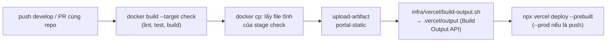

# ESI: deployment bản demo (miễn phí)

Phần tiếp theo của [onboarding](./README.md) (mục 5 trước đây). Cần đã đọc mục 1 (cấu hình, token) và mục 4 (release, image GHCR) của README trước khi dựng.

Đây là bản **tổng quan có dẫn đường**; từng lệnh đầy đủ nằm ở [infra/azure](../../infra/azure/README.md), [infra/vercel](../../infra/vercel/README.md), [infra/auth0](../../infra/auth0/README.md). Khi khác nhau, tài liệu gốc đúng. Vận hành sau khi dựng (bật/tắt demo, tra lỗi, xoá hết): [README mục 6](./README.md#6-vận-hành-hằng-ngày-và-xử-lý-sự-cố).

> UR-140 thay Auth0 bằng Keycloak tự host (ADR-0011, Proposed). Phần dựng IdP mới nằm ở [idp-setup.md](./idp-setup.md); phần Auth0 dưới đây còn đúng cho tới khi ESI-150 xong.

ESI là dự án cá nhân, phi thương mại; mục tiêu hiện tại là **demo trên free tier** (ADR-0005). Mọi lựa chọn hạ tầng phải miễn phí; nếu thứ gì có thể tốn tiền, phải ghi rõ trước khi đề xuất.

> Trạng thái ADR: ADR-0005 (hosting), ADR-0006 (Auth0), ADR-0008 (Postgres) vẫn là `Proposed` dù đã được triển khai; ADR-0007 (Gemini) đã `Accepted`. Xem [architecture/README.md](../architecture/README.md).

## 1. Bản đồ dịch vụ

| Thành phần | Chạy ở đâu | Gói miễn phí | Hướng dẫn gốc |
|------------|------------|--------------|----------------|
| `esi-portal` | Vercel Hobby | Hobby, deploy bằng `--prebuilt` từ GitHub Actions | [infra/vercel](../../infra/vercel/README.md) |
| Đăng nhập | Auth0 Free | tối đa 25.000 MAU, không cần thẻ | [infra/auth0](../../infra/auth0/README.md) |
| `esi-core` | Azure Container Apps (consumption, scale về 0) | grant miễn phí theo subscription | [infra/azure](../../infra/azure/README.md) |
| `esi-agents` | Azure Container Apps, ingress **nội bộ** | như trên | như trên |
| Database của app (`esi_core`) | Neon Free (PostgreSQL 17) | 100 CU-giờ/tháng, 1 GB, 5 GB truyền ra | phần 3 của infra/azure |
| Database mẫu (`esi_demo_target`) | Azure SQL free offer | tự pause khi hết lượng miễn phí | phần 4 của infra/azure |
| Model | Gemini API free tier (`gemini-3.8-flash`) | theo quota từng project AI Studio | ADR-0007 |
| Image Docker | GHCR (public) | miễn phí cho repo public | [github-setup.md](../process/github-setup.md#image-registry-ghcr) |

## 2. Thứ tự dựng từ đầu

Thứ tự dưới đây là **đề xuất của tài liệu này**, suy ra từ phụ thuộc giữa các hướng dẫn gốc (chưa chạy lại toàn bộ). Mỗi bước nói rõ nó cần gì từ bước trước.

| # | Việc | Cần gì từ trước | Cho ra |
|---|------|-----------------|--------|
| 1 | **GitHub**: đặt 3 biến repo ([README mục 1.5](./README.md#15-cấu-hình-github-của-repo)), bảo vệ nhánh | quyền admin repo | nền cho CI/CD |
| 2 | **Phát hành image** `core@v…` và `agents@v…` ([README mục 4](./README.md#4-versioning-và-release-cd-phần-publish)), đặt gói GHCR thành Public | bước 1; `core` hỗ trợ `Oidc` và Postgres (core ≥ 0.2.0 theo kế hoạch) | `ghcr.io/dtnam0899/esi-core`, `esi-core-migrator`, `esi-agents` |
| 3 | **Vercel**: tạo project `esi-portal` *không nối Git*, tạo token, lấy `VERCEL_ORG_ID`/`VERCEL_PROJECT_ID` | tài khoản Vercel | URL của portal (cần cho Auth0) |
| 4 | **Auth0**: tenant, API (audience), SPA application, tắt sign-up, tạo user | URL portal từ bước 3 | `domain`, `client id`, `audience` |
| 5 | **Azure**: tài khoản, `az login`, resource group `esi-demo`, **budget alert 1 USD** | thẻ để xác minh danh tính | môi trường làm việc |
| 6 | **Neon**: project `esi-demo`, cố định compute 0.25 CU, role `esi_core_app`, database `esi_core`, connection string (host trực tiếp, không `-pooler`, `SSL Mode=Require`) | không | `ESI_CORE_AppDb__ConnectionString` |
| 7 | **Azure SQL free**: server, firewall, `--use-free-limit ... AutoPause`, user `esi_demo_reader` chỉ đọc, nạp `demo-target.sql`, **gỡ IP của bạn khỏi firewall** | bước 5 | connection string demo cho người dùng nhập trong portal |
| 8 | **Container Apps environment** (`ConsumptionOnly`, không Log Analytics) và sinh **master key** `openssl rand -base64 32` | bước 5 | key mã hoá connection string (ADR-0003) |
| 9 | **Chạy app**: agents (secret Gemini) → migration job (`esi-core-migrate`) → core | 2, 4, 6, 8; khoá Gemini từ AI Studio (không bật billing) | URL của core |
| 10 | **Nối portal**: đặt `ESI_DEMO_CORE_URL` và 3 biến `ESI_DEMO_AUTH_*` rồi chạy lại workflow `portal` trên `develop` | 3, 4, 9 | demo hoạt động |

## 3. Vì sao image runtime và migrator là hai thứ khác nhau

`core` phát hành hai image: `esi-core` (API) và `esi-core-migrator` (áp dụng migration EF Core). Migrator chạy như **Container Apps Job** thủ công và phải chạy **trước mỗi lần cập nhật core**, để schema `esi_core` khớp với code.

## 4. Chạy agents, migrate, core (rút gọn)

Dạng lệnh (đủ tham số xem [infra/azure phần 6](../../infra/azure/README.md)):

```bash
# agents: chỉ nội bộ, scale 0..1, khoá Gemini lấy từ secret
az containerapp create --name esi-agents ... --ingress internal --target-port 8000 \
  --min-replicas 0 --max-replicas 1 --secrets "gemini-api-key=$GEMINI_API_KEY" \
  --env-vars ESI_AGENTS_MODEL_PROVIDER=gemini ESI_AGENTS_GEMINI_API_KEY=secretref:gemini-api-key ...

# migration (chạy trước mỗi lần cập nhật core)
az containerapp job start --name esi-core-migrate --resource-group "$RG"

# core: ingress ngoài, bắt buộc Oidc
az containerapp create --name esi-core ... --ingress external --target-port 8080 \
  --env-vars ESI_CORE_Auth__Mode=Oidc ESI_CORE_Auth__Authority=https://<tenant>/ \
             ESI_CORE_Auth__Audience=<audience> ESI_CORE_Agents__BaseUrl=http://esi-agents/ ...
```

Các nguyên tắc ở đây áp dụng cho mọi dịch vụ chạy trên Container Apps:

- Image luôn **ghim version** (`:0.2.0`), không `latest`.
- Bí mật dùng `--secrets` rồi tham chiếu `secretref:<tên>`; không dán thẳng vào `--env-vars`, không dán vào chat/commit. Nhập khoá bằng `read -rs` để không vào lịch sử shell.
- `--min-replicas 0` để scale về 0 khi không dùng (không tốn tiền); lần gọi đầu mất tới ~1 phút để khởi động từ 0.
- Giới hạn thời gian lồng nhau có chủ đích: mỗi câu hỏi chat của agents ≤ 50 s, core chờ agents 90 s, Vercel chờ core tối đa 120 s. Đổi một con số phải xem lại cả chuỗi.
- Core ở local dùng `LocalAdmin`, còn môi trường deploy **bắt buộc** `Oidc`.

## 5. Auth0 và luồng đăng nhập

Portal là SPA dùng Authorization Code + PKCE với Universal Login; token chỉ lưu trong bộ nhớ (reload sẽ hỏi lại Auth0, không cần nhập mật khẩu nếu còn phiên). Core kiểm tra issuer, audience, hạn và chữ ký của JWT. Những chỗ hay sai:

- **Audience** (`https://api.esi.demo` trong tài liệu) phải giống nhau ở Auth0 API, biến `ESI_DEMO_AUTH_AUDIENCE` của portal và `ESI_CORE_Auth__Audience` của core. Thiếu audience thì Auth0 cấp token dạng opaque, core không kiểm được.
- `ESI_CORE_Auth__Authority` có **dấu `/` cuối**; domain của portal thì **không** có `https://` lẫn `/` cuối.
- Callback/Logout/Web Origin URL phải khớp tuyệt đối với URL portal (và `http://localhost:4200` cho local). Sai thì Auth0 hiện "Callback URL mismatch".
- Tắt "Sign Ups" (invite-only), tắt social connection, bật Refresh Token Rotation; tạo user thủ công rồi bảo họ dùng "Forgot password".
- Ba biến `ESI_DEMO_AUTH_*` **đủ cả ba hoặc không có cái nào** (không có thì tắt đăng nhập; thiếu một phần thì deploy fail).

## 6. Gemini, giới hạn và quyền riêng tư

Key tạo trong một project AI Studio **mới chỉ dùng cho demo và không bật billing** để đảm bảo không phát sinh phí. Theo ADR-0007: chỉ dùng database mẫu `esi_demo_target`, không dùng dữ liệu thật; Google có thể dùng/đọc prompt (schema và câu hỏi), nên chỉ mời người lớn ngoài EEA/Thuỵ Sĩ/Anh và nói rõ họ không nhập dữ liệu cá nhân hay bí mật.

## 7. Deploy portal lên Vercel (phần CD tự động duy nhất)

Vercel **không build** portal. Luồng trong `portal.yml`:



| Sự kiện | Kết quả |
|---------|---------|
| push vào `develop` | Vercel production (URL demo) |
| PR từ cùng repo | Preview, sau Vercel Authentication |
| PR từ fork, push vào `main` | không deploy |

`build-output.sh` làm hai việc: (1) proxy `/api/*` tới `ESI_DEMO_CORE_URL` và bỏ tiền tố `/api` (giống `proxy.conf.json` ở dev và gateway nginx ở e2e, nên core không cần CORS; nếu chưa đặt biến, `/api/*` trả 503); (2) ghi lại `/config.json` với `apiBaseUrl` `/api` cùng cấu hình Auth0, `Cache-Control: no-store` nên đổi biến chỉ cần deploy lại.

Job `deploy-vercel` bị **bỏ qua** nếu chưa đặt `VERCEL_PROJECT_ID`, nên CI vẫn xanh khi chưa thiết lập Vercel. Cần: secret `VERCEL_TOKEN`; variables `VERCEL_ORG_ID`, `VERCEL_PROJECT_ID`, `ESI_DEMO_CORE_URL`, `ESI_DEMO_AUTH_DOMAIN`, `ESI_DEMO_AUTH_CLIENT_ID`, `ESI_DEMO_AUTH_AUDIENCE`. Không lưu npm token trên Vercel vì gói được cài trong GitHub workflow bằng `GITHUB_TOKEN`.

Thử cục bộ: lệnh mẫu ở [infra/vercel/README.md](../../infra/vercel/README.md#try-it-locally).

