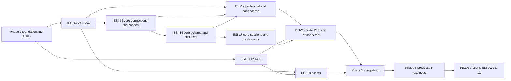

# Build plan for UR-1 (BI AI Assistant)

Derived from [UR-1](../requirements/UR-1-bi-ai-assistant-web-application.md) and its filed issues. Release rule from the root `CLAUDE.md`: **producer first, consumers bump the pinned version afterward**.

## Phases

| Phase | Goal | Issues / tasks | Needs | Exit gate |
|-------|------|----------------|-------|-----------|
| 0 | Foundation: decisions, project scaffolds, CI and publishing | [P0-01..P0-14](./phase-0-foundation.md) | none | Every project builds and tests in Docker; ADR-0001..0004 accepted; first publish works |
| 1 | Shared artifacts | ESI-13 `[contracts]`, ESI-14 `[lib]` (parallel) | Phase 0 | Contracts and lib packages published and pinnable |
| 2 | Core backend | ESI-15 -> ESI-16 -> ESI-17 `[core]` | ESI-13 | API works alone against a test SQL Server; security tests pass |
| 3 | AI agents | ESI-18 `[agents]` (parallel with phase 2) | ESI-13, ESI-14 | Evals pass for SQL safety and DSL output |
| 4 | Portal assistant module | ESI-19 -> ESI-20 `[portal]` | ESI-13, ESI-14, phase 2 | Chat, execute, render, save, dashboard work in the UI |
| 5 | Integration | end-to-end test of the full flow: [infra/e2e](../../infra/e2e/README.md) (ESI-64, done 2026-10-18) | phases 2-4 | One scripted scenario from connection to dashboard passes (met: `infra/e2e/run.sh`, scripted model) |
| 6 | Production readiness | no issues filed yet (real auth, consent text approval, key review, read-only login advice) | phase 5 | Release checklist in UR-1 "Open questions" closed |
| 7 | Charts | ESI-10 `[lib]`, ESI-11 `[agents]`, ESI-12 `[portal]` | phase 5, chart ADR | Chart renders with "first 20 of N rows" and view-as-table |

## Dependency graph

## How an agent picks the next task

1. Open the current phase table above and take the first task whose "Needs" are done.
2. Read the task in its phase file (scope, files, acceptance criteria, definition of done).
3. Read the ADRs it lists under "Decisions needed" and the UR-1 SR sections it covers.
4. Work inside one project directory; follow that project's `CLAUDE.md` and the `esi-workflow` skill for branch, commit and PR naming.

## Out of scope for UR-1 phase 1

Forms, charts (phase 7), shared dashboards, executing stored procedures, database engines other than SQL Server, snapshots of data (data is always live).
