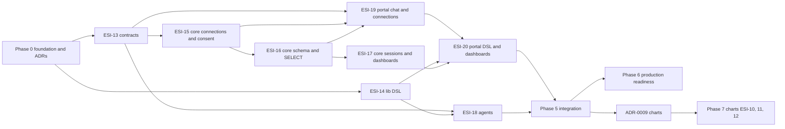

# Build plan for UR-1 (BI AI Assistant)

Derived from [UR-1](../requirements/UR-1-bi-ai-assistant-web-application.md) and its filed issues. Release rule from the root `CLAUDE.md`: **producer first, consumers bump the pinned version afterward**.

## Phases

| Phase | Goal | Issues / tasks | Needs | Exit gate |
|-------|------|----------------|-------|-----------|
| 0 | Foundation: decisions, project scaffolds, CI and publishing | [P0-01..P0-14](./phase-0-foundation.md) | none | Every project builds and tests in Docker; ADR-0001..0004 accepted; first publish works |
| 1 | Shared artifacts | ESI-13 `[contracts]`, ESI-14 `[lib]` (parallel) | Phase 0 | Contracts and lib packages published and pinnable |
| 2 | Core backend | ESI-15 -> ESI-16 -> ESI-17 `[core]` | ESI-13 | API works alone against a test SQL Server; security tests pass |
| 3 | AI agents | ESI-18 `[agents]` (parallel with phase 2) | ESI-13, ESI-14 | Evals pass for SQL safety and DSL output |
| 4 | Portal assistant module | ESI-19 -> ESI-20 `[portal]` | ESI-13, ESI-14, phase 2 | Chat, execute, render, save, dashboard work in the UI |
| 5 | Integration | end-to-end test of the full flow: [infra/e2e](../../infra/e2e/README.md) (ESI-64, done 2026-10-18) | phases 2-4 | One scripted scenario from connection to dashboard passes (met: `infra/e2e/run.sh`, scripted model) |
| 6 | Production readiness (demo first) | Done: demo hosting (ADR-0005, ESI-72, ESI-76, ESI-78), Auth0 sign-in (ADR-0006, ESI-85, ESI-86, ESI-87), Gemini model (ADR-0007, ESI-89), app database on Postgres (ADR-0008, ESI-94, ESI-97). Not filed: consent text approval, key review, read-only login advice in the release notes, required CI checks | phase 5 | Release checklist in UR-1 "Open questions" closed |
| 7 | Charts | ESI-10 `[lib]`, then `[contracts]` and `[core]` (not filed yet), ESI-11 `[agents]`, ESI-12 `[portal]` | phase 5, [ADR-0009](../architecture/ADR-0009-chart-component-and-library.md) accepted | Chart renders with "first 20 of N rows" and view-as-table |

## Current state (2026-10-23, `develop` at `c746f99`)

- Phases 0 to 5 are done and released to `main`. Phase 6 work for the free demo is merged into `develop` but not released: `develop` is 16 commits ahead of `main`.
- Released versions: `contracts@v0.2.0`, `core@v0.1.0`, `agents@v0.1.0`, `lib-dsl-schema@v0.1.0`, `lib-dsl-core@v0.1.0`, `lib-dsl-renderer-angular@v0.1.0`. The portal has no release tag; pushes to `develop` deploy it to Vercel once the Vercel project is set up (`infra/vercel/README.md`).
- Merged into `develop` since the last core and agents release: Oidc authentication in core (breaking: `LocalAdmin` only in Development) and the pin of contracts 0.2.0, the app database on PostgreSQL (breaking for deployments), the Gemini `ModelClient`, agents queries on tables only (ESI-105), the local customer databases with demo data (ESI-103, ESI-109), and the portal's Auth0 sign-in and Schema tab with an ERD (ESI-107).
- Next steps in order: release core 0.2.0, agents 0.2.0 and the portal (deferred for now); accept ADR-0009 and start phase 7 with ESI-10; file the remaining phase 6 checklist items before a production release.
- Deferred to the next version: streaming chat answers (product owner, 2026-10-23).

## Dependency graph

## How an agent picks the next task

1. Open the current phase table above and take the first task whose "Needs" are done.
2. Read the task in its phase file (scope, files, acceptance criteria, definition of done).
3. Read the ADRs it lists under "Decisions needed" and the UR-1 SR sections it covers.
4. Work inside one project directory; follow that project's `CLAUDE.md` and the `esi-workflow` skill for branch, commit and PR naming.

## Out of scope for UR-1 phase 1

Forms, charts (phase 7), streaming chat answers (next version), shared dashboards, executing stored procedures, database engines other than SQL Server, snapshots of data (data is always live).
