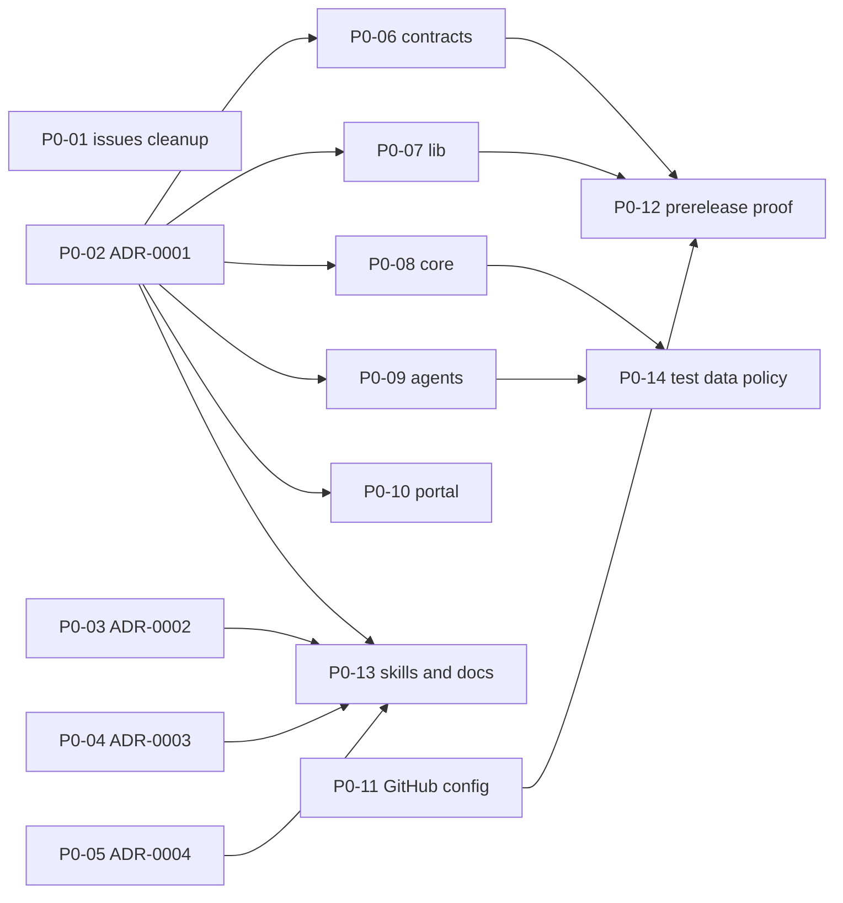

# Phase 0: Foundation

Goal: decisions recorded, every project buildable and testable in Docker, publishing to GitHub Packages proven, so phases 1-4 only add features. No feature code in this phase. Parent plan: [plan/README.md](./README.md). Rules: root [CLAUDE.md](../../CLAUDE.md) and `.claude/skills/esi-project-standards/SKILL.md`.

Task IDs `P0-NN` are drafts. When filed on GitHub, record the issue number in the "Issue" column. Project code `esi` means the whole repository (work that is not inside one project); the project codes are `core`, `agents`, `contracts`, `portal`, `lib` and `esi`.

## Task table

| ID | Project | Title | Needs | Produces | Issue |
|----|---------|-------|-------|----------|-------|
| P0-01 | esi | Clean up superseded GitHub issues | none | ESI-2..9 closed, ESI-12 retitled (done) | ESI-21 (closed) |
| P0-02 | esi | Review and accept ADR-0001 technology baseline | none | ADR-0001 Accepted with verified versions | ESI-22 (closed) |
| P0-03 | esi | Review and accept ADR-0002 A2UI and DSL storage | none | ADR-0002 Accepted | ESI-23 (closed) |
| P0-04 | esi | Review and accept ADR-0003 key management | none | ADR-0003 Accepted | ESI-24 (closed) |
| P0-05 | esi | Review and accept ADR-0004 SQL policy | none | ADR-0004 Accepted | ESI-25 (closed) |
| P0-06 | contracts | Scaffold contracts project | P0-02 | lint, breaking-change check, pack, Dockerfile | ESI-26 (closed) |
| P0-07 | lib | Scaffold Nx workspace and packages | P0-02 | five empty packages build, test, lint | ESI-27 (closed) |
| P0-08 | core | Scaffold core-backend with test SQL Server | P0-02 | API skeleton, migrations, compose with SQL Server | ESI-28 (closed) |
| P0-09 | agents | Scaffold ai-agents with eval harness | P0-02 | service skeleton, pytest, ruff, empty evals runner | ESI-29 (closed) |
| P0-10 | portal | Scaffold Angular portal and module boundaries | P0-02 | app shell, lazy `assistant` module, lint boundaries | ESI-30 (closed) |
| P0-11 | esi | Configure GitHub: registry access, secrets, branch protection | none | secrets and permissions documented, protection on `main` (deferred: not available on GitHub Free for private repos) | ESI-31 (closed; protection deferred) |
| P0-12 | esi | Prove publish and pin flow with a prerelease | P0-06, P0-07, P0-11 | one prerelease package published and installed by a consumer | ESI-32 (closed) |
| P0-13 | esi | Update skills and project docs after ADRs | P0-02..P0-05 | placeholders filled, DSL skills match ADR-0002 | ESI-33 (closed) |
| P0-14 | esi | Define test data policy | P0-08, P0-09 | shared understanding of fixtures per project | ESI-34 (in review) |

Parallel groups after P0-02: `P0-06..P0-10` can run in parallel (separate projects). `P0-01`, `P0-03..P0-05`, `P0-11` need no code and can start immediately.

## Task details

### P0-01 `[esi]` Clean up superseded GitHub issues
- Close ESI-2..ESI-9 with a comment "superseded by ESI-13..ESI-20" (ESI-3 mentions `@a2ui/react`, which was removed).
- Retitle ESI-12 `[assistant]` to `[portal]`; keep ESI-10 and ESI-11 open (phase 7).
- Update the status table in [UR-1](../requirements/UR-1-bi-ai-assistant-web-application.md) ("Filed issues") and [issue drafts](../requirements/UR-1-issue-drafts.md).
- Done when: GitHub shows 11 open sub-issues of #1 (ESI-10..ESI-20) and the docs match.

### P0-02..P0-05 `[esi]` Accept the ADRs
Same pattern for each: a human reviews the ADR in [architecture/](../architecture/README.md), answers its open questions, the status changes to `Accepted` in a PR.
- P0-02: [ADR-0001](../architecture/ADR-0001-technology-baseline.md) - verify every version in its table against official sources.
- P0-03: [ADR-0002](../architecture/ADR-0002-a2ui-dsl-adoption-and-storage.md) - decide whether core validates DSL.
- P0-04: [ADR-0003](../architecture/ADR-0003-connection-secret-key-management.md) - decide where wrapped keys are stored, name the master key variables.
- P0-05: [ADR-0004](../architecture/ADR-0004-sql-validation-and-execution-policy.md) - decide the function allow-list and log masking.

### P0-06 `[contracts]` Scaffold contracts project
- Files: `core-api/openapi.yaml` and `agents-api/openapi.yaml` (title, `info.version` `0.0.0`, no paths yet), shared `problem+json`, paging and error schemas, `.spectral.yaml`, `package.json` (`@dtnam0899/esi-contracts`), `.npmrc` (token from `NODE_AUTH_TOKEN`), `Dockerfile`, `.dockerignore`, `CHANGELOG.md`, `README`.
- Commands documented in `services/contracts/CLAUDE.md`: lint, breaking-change check against the last release, docker build that lints, checks and packs.
- CI: path filter on `services/contracts/**`; runs the Docker build.
- Done when: lint and pack pass in Docker; no paths are invented; `CLAUDE.md` placeholders replaced by verified commands.
- Out of scope: any real API operations (ESI-13).

### P0-07 `[lib]` Scaffold Nx workspace and packages
- Packages: `dsl-schema`, `dsl-core`, `dsl-renderer-angular`, `api-client`, `ui-tokens`, each with a manifest, a placeholder export and a unit test.
- Nx tags and `@nx/enforce-module-boundaries` as in `lib/CLAUDE.md` (`scope:schema` <- `scope:core` <- `scope:renderer`, `scope:tokens`, `scope:api`; `framework:angular`).
- `nx release` configured with independent versions and conventional commits, tags `lib-<package>@vX.Y.Z`, registry `https://npm.pkg.github.com`; `.npmrc` uses `${NODE_AUTH_TOKEN}`.
- `Dockerfile` builds and tests the workspace without other projects; `compose.yaml` if any local dependency exists.
- Done when: `nx run-many -t build test lint` passes in Docker; a deliberate forbidden import fails lint (add as a test); `nx release --dry-run` works.
- Out of scope: any DSL logic (ESI-14).

### P0-08 `[core]` Scaffold core-backend with test SQL Server
- Layout from ADR-0001: API project, domain/application layers (names TBD), tests project, `Directory.Build.props` `<Version>`, `CHANGELOG.md`.
- Health endpoint, structured logging with a redaction filter (seed for ADR-0003 tests), configuration through environment variables only, `dotnet user-secrets` for local.
- EF Core migrations folder and an app database (not the user's target database).
- `compose.yaml`: app database and a pinned SQL Server container that acts as the user's target database for integration tests.
- `Dockerfile`: `sdk` -> `aspnet`, non-root, `HEALTHCHECK`, `dotnet restore --locked-mode`.
- Done when: `dotnet build`, `dotnet test` and `docker compose up` work from `services/core-backend`; health returns 200 in the container.
- Out of scope: connections, consent, SQL execution (ESI-15, ESI-16).

### P0-09 `[agents]` Scaffold ai-agents with eval harness
- Python project from ADR-0001: `pyproject.toml` with lock file, package layout (agents, tools, prompts), health endpoint, config via environment variables, `pytest`, `ruff`.
- `evals/` runner skeleton: loads cases from files, runs a deterministic stub model, prints pass or fail per case, exits non-zero on failure. Cases themselves come in ESI-18.
- `Dockerfile` (slim image from the lock file), `compose.yaml` if needed.
- Done when: `pytest -q`, `ruff check . && ruff format --check .` and the Docker build pass; the eval runner executes with the stub model.
- Out of scope: prompts, SQL or DSL generation (ESI-18). Model provider is TBD in ADR-0001.
- Status 2026-10-18: scaffold on branch `feat/ESI-29-scaffold-ai-agents`; `uv sync --frozen`, pytest, ruff and the eval runner pass locally. Docker build and image health are verified only in CI (`.github/workflows/agents.yml`).

### P0-10 `[portal]` Scaffold Angular portal and module boundaries
- Angular version from ADR-0001 (21 or newer), app shell with `core` and `shared` folders and a lazy-loaded `assistant` feature module exposing only its routes.
- Lint rule restricting imports between feature folders (module rules in `web/esi-portal/CLAUDE.md`); a test or lint check fails if one feature imports another's internals.
- `.npmrc` for the registry, environment configuration injected at start (not at build), `Dockerfile` (Node build, static web server runtime), `compose.yaml`.
- Done when: `npm ci`, `npm test -- --watch=false --browsers=ChromeHeadless`, `npm run lint`, `npm run build` and the Docker build pass; the folder layout is written into `web/esi-portal/CLAUDE.md`.
- Out of scope: chat, connections, DSL rendering (ESI-19, ESI-20).
- Status 2026-10-18: scaffold on branch `feat/ESI-30-scaffold-portal`; `npm ci` and `npm run check` (lint, boundary test, 11 unit tests, build) pass locally. Angular 21 uses Vitest, so the test command is `npm test`, not the Karma `--browsers=ChromeHeadless` form above. Docker image, runtime config and health are verified only in CI (`.github/workflows/portal.yml`).

### P0-11 `[esi]` Configure GitHub
- Registry: confirm GitHub Packages permissions for `@dtnam0899` scope; define `ESI_PACKAGE_REGISTRY_URL`, `ESI_IMAGE_REGISTRY`, `NODE_AUTH_TOKEN` handling in CI (use `GITHUB_TOKEN`, PAT with `read:packages` locally). Document, never commit tokens.
- Branch protection on `main`: PR required, one approval, CI required, no force push.
- Labels `User Requirement` and `System Requirement` exist; issue and PR templates follow `ESI-<n> [PROJECT] <title>`.
- Master key for ADR-0003 is created only for deployment environments later; no value is stored in the repo.
- Done when: a test PR cannot be merged without approval and CI.
- Status (2026-10-18): registry, tokens and repository variables documented in [github-setup](../process/github-setup.md). Branch protection and rulesets are unavailable for this private repository on GitHub Free, so the merge rules are a convention and the test-PR criterion is deferred until the plan changes.

### P0-12 `[esi]` Prove publish and pin flow
- Publish a prerelease of `@dtnam0899/esi-contracts` and one `lib` package (`nx release --preid`), from CI.
- Install them at a pinned version in a throwaway consumer step in the portal and in a Docker build stage (as contracts consumers will do) without path references.
- Done when: the packages install by version from the registry in a clean container; the process is written down in the project `CLAUDE.md` files. The prerelease is then deprecated or removed.

### P0-13 `[esi]` Update skills and project docs
- Fill every `<placeholder>` in the project `CLAUDE.md` files with verified facts from ADR-0001 and the scaffolds.
- Update `.claude/skills/dsl-authoring/SKILL.md` and `dsl-renderer-parity/SKILL.md` to match ADR-0002 (A2UI basic catalog, stored `updateComponents`, no custom `table/chart/form` nodes).
- Create `docs/dsl/README.md` (component selection rules: table = `List` with template, KPI = `Card` + `Text`).
- Done when: `grep -rn "<verified command>\|<version>" */CLAUDE.md` finds no placeholders in scaffolded projects.
- Status 2026-10-18: stack lines (versions, framework, data store) filled from ADR-0001..0004, DSL skills and `docs/dsl/README.md` done. Commands, structure and config placeholders are filled by each scaffold task (P0-06..P0-10), which own their verified commands.

### P0-14 `[esi]` Define test data policy
- Core owns the SQL Server test container and a sample schema script (tables with relationships, one stored procedure to exercise "read definitions, never execute").
- Agents do not depend on core: their evals use a static schema metadata fixture file committed inside `services/ai-agents/evals/` and regenerated from the published contract.
- Portal uses mocked API responses generated from the contract examples.
- Done when: each project's `CLAUDE.md` states its fixture location; no project reads another project's files.

## Definition of done for every Phase 0 task
- Branch `type/ESI-<n>-short-description`, commit `type(project): subject` with `Refs: ESI-<n>`.
- Commands in the project `CLAUDE.md` work from the project directory and in Docker.
- No path, workspace or project references to another project (independence checklist in `esi-project-standards`).
- No secrets, `.env` files or invented versions committed.

## Phase 0 exit gate
- ADR-0001..0004 are `Accepted` (or consciously deferred with a note).
- Contracts, lib, core, agents and portal each build and test in Docker in CI.
- Prerelease publish and pinned install proven (P0-12).
- Placeholders replaced (P0-13). Then start ESI-13 and ESI-14.
