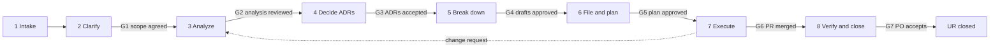

# From User Requirement to tasks: standard process

How every new UR is taken from a request to merged work. Distilled from UR-1. Follow the stages in order; do not skip a gate without writing the reason in the UR doc ("Decisions"). Templates are in [templates.md](./templates.md). Repo-wide rules stay in the root [CLAUDE.md](../../CLAUDE.md); branch, commit and PR names stay in the `esi-workflow` skill.

## Roles

A person can hold several roles; an AI agent can do the work of Analyst and Implementer but never approves a gate. Current staffing: `dtnam0899` holds every role (PO, tech lead, reviewer), so gates are self-approved. Each gate must still be recorded (a comment on the UR issue or a line in the UR doc) so the history is auditable and the process works unchanged when more people join. The one-approval PR rule means a second reviewer is needed once the team grows.

| Role | Does | Approves |
|------|------|----------|
| Product Owner (PO) | Writes the UR, answers questions, accepts the result | G1 (scope), G7 (acceptance) |
| Analyst (human or AI agent) | Clarifies, analyzes, writes UR doc, drafts issues | nothing |
| Tech lead | Reviews analysis, ADRs, breakdown and plan | G2, G3, G4, G5 |
| Implementer (human or AI agent) | Delivers one issue per PR | nothing |
| Reviewer | Reviews PRs (one approval required) | G6 |

## Overview

| # | Stage | Input | Output (where) | Gate to leave |
|---|-------|-------|----------------|---------------|
| 1 | Intake | An idea or request | UR issue, label `User Requirement` (GitHub) | UR meets the intake checklist |
| 2 | Clarify | UR issue | Questions answered; numbered Decisions (`docs/requirements/UR-<n>-<slug>.md`) | G1 PO confirms in/out of scope |
| 3 | Analyze | Decisions | SR list with acceptance criteria, flows, findings (same UR doc) | G2 tech lead reviews |
| 4 | Decide | Findings | ADRs (`docs/architecture/ADR-NNNN-*.md`) | G3 ADRs Accepted or consciously deferred |
| 5 | Break down | SRs and ADRs | Issue drafts (`docs/requirements/UR-<n>-issue-drafts.md`) | G4 tech lead approves drafts |
| 6 | File and plan | Approved drafts | GitHub issues as sub-issues of the UR; roadmap (`docs/plan/`) | G5 plan approved |
| 7 | Execute | Filed issues | Merged PRs, published artifacts | G6 CI green, one approval |
| 8 | Verify and close | Merged work | Integration evidence, docs status updated, issues closed | G7 PO accepts |

## Stage 1. Intake

- The PO (or anyone) opens an issue from the "User Requirement" template: title `ESI-<n> [UR] <title>`, label `User Requirement`.
- Intake checklist: the user or role is named, the problem or goal is stated in user terms, a rough scope exists, and the issue is not a duplicate. Wording may stay rough; the analysis improves it.
- Never edit the UR text during analysis. Corrections and decisions go into the UR doc and, if the PO agrees, a comment on the ticket.

## Stage 2. Clarify

Skill: `requirement-review` (read part). Goal: no guessing.

1. Read the UR and everything it links (read-only), and the existing docs (`docs/README.md`).
2. List every ambiguity that changes design, security, data, limits or scope. Group them (scope, behavior, security, data, limits, UX, operations).
3. Ask the PO in one batch with recommended answers, not one question at a time. Prefer multiple-choice with a recommended default.
4. Record each answer as a numbered Decision (date, who confirmed) in the UR doc. Unanswered items stay under "Open questions".
5. Check against `esi-project-standards`: does anything force a cross-project dependency, shared build or path link?

G1: PO has confirmed the scope (in scope, out of scope, phases). Open questions that block the MVP are resolved; the rest are listed with an owner.

## Stage 3. Analyze

Skill: `requirement-review`. Output is `docs/requirements/UR-<n>-<slug>.md` (template in [requirements/README.md](../requirements/README.md)).

1. Split the UR into SRs: one SR = one technical capability with testable acceptance criteria. SRs are analysis units numbered `SR-1..`; they are not issues yet.
2. Map each SR to projects (`core`, `agents`, `contracts`, `portal`, `lib`; `esi` for repo-wide) and to the contract and DSL impact.
3. Draw per feature: a swimlane flowchart and a sequence diagram (as-is and to-be), labelled with `METHOD /path` and the contract version when known.
4. Record findings (risks, conflicts with standards, security of untrusted AI output, secrets, auth), decisions, open questions.
5. Mark every unverified fact `TBD`. Do not invent routes, versions or package names.

G2: tech lead reviews the UR doc. Status in the doc header becomes "Reviewed".

## Stage 4. Decide (ADRs)

Write an ADR when a decision (a) touches more than one project, (b) is hard to reverse (data model, storage, security, key handling), (c) changes a contract or the DSL in a breaking way, or (d) picks a technology. Use the template in [architecture/README.md](../architecture/README.md); status starts at `Proposed`.

G3: each ADR needed by a task is `Accepted`, or the task carries a note that it proceeds on a `Proposed` ADR (tech lead approves that note). ADR numbers are never reused; superseding writes a new ADR.

## Stage 5. Break down

Output: `docs/requirements/UR-<n>-issue-drafts.md`. Drafts are `D1..Dk` and are referenced as `UR-<n>/D<k>`.

Breakdown rules:

- **One project per issue** (`esi-workflow`). Work that does not belong to one project uses the code `esi`.
- **One PR deliverable.** If a draft cannot be done in one reviewable PR, split it. Rule of thumb: about 1-3 working days.
- **Order follows releases:** `contracts` and `lib` first, then `core`, then `agents`, then `portal` (producer first, consumers pin the published version).
- **Each draft states:** covered SRs, depends on (draft IDs and ADR IDs), scope, out of scope, acceptance criteria as testable checkboxes, version impact (contract or DSL: minor or major).
- **Enabler tasks** (scaffolds, CI, registry, ADR acceptance) are listed in a foundation plan. The first UR creates it (`docs/plan/phase-0-foundation.md`); later URs add `E<k>` drafts only when something new is needed (new project, new pipeline).
- **Phases:** MVP first; later phases are drafted but filed when the MVP is stable.
- **Security and tests are part of each draft**, not a separate end phase. Evals, bypass corpora and owner-isolation tests belong in the issue that creates the behavior.
- Check for duplicates among open issues before drafting.

G4: tech lead approves the drafts (scope, order, dependencies, acceptance criteria).

## Stage 6. File and plan

1. Run the filing script in dry run, review the output, then `--apply` (see [Filing issues](#filing-issues)).
2. Issues are filed as sub-issues of the UR with label `System Requirement` (or `Foundation Task`), title `ESI-<n> [project] <title>`, and a body that ends with the footer from the templates.
3. Update the UR doc "Filed issues" table and the drafts' filing status immediately after filing.
4. Update `docs/plan/README.md`: phases, dependency graph, exit gates.

G5: tech lead approves the plan; the first executable issue is unblocked.

## Stage 7. Execute

Per issue, following `esi-workflow`:

1. Check "Depends on": producing issues are merged and published; ADRs are Accepted.
2. Branch `type/ESI-<n>-short-description`, commits `type(project): subject` with `Refs: ESI-<n>`.
3. Work inside one project directory; use its own `CLAUDE.md` commands; documented commands must work in Docker.
4. Tests come with the change: the acceptance criteria are the test list.
5. PR title `ESI-<n> [project] 
`; the PR links the issue and ticks the acceptance criteria; CI green; one approval; squash-merge.
6. The producer releases first; consumers bump the pinned version in a separate PR.
7. If the work reveals a wrong assumption, stop and use [Change handling](#change-handling) instead of silently diverging.

G6: PR merged with CI green and one approval.

## Stage 8. Verify and close

- Close an SR issue when its PR is merged and its acceptance criteria are checked.
- Run the end-to-end scenario for the UR (one scripted flow across the projects) once all MVP issues are merged.
- Update the UR doc: statuses, decisions that became ADRs, open questions that were answered.
- G7: the PO accepts the result against the UR. Then close the UR issue and mark the doc "Done".

## Change handling

Requirements change. When a change request, a new constraint or a structural decision arrives (UR-1 example: the assistant moved from a React app to an Angular portal module):

1. Record it as a new numbered Decision (with date) in the UR doc.
2. Update the affected SRs, flows and findings; update ADRs (a new ADR if an accepted one changes).
3. Find affected issues: `gh issue list --label "System Requirement" --state open`. Rewrite open ones; close obsolete ones with reason "not planned" and a comment pointing to the replacement. Never delete issues.
4. Re-file only what changed (the filing scripts skip drafts already filed, by their tag).
5. Update the drafts' filing status, the plan and the traceability table in the same PR.
6. Tell the PO what changed and which gate it re-opens (usually G2 or G4).

## Keeping GitHub and docs in sync

| Information | Source of truth | Copy in docs |
|-------------|-----------------|--------------|
| Wording of UR and SR tickets | GitHub issues | linked only, not copied |
| Issue status (open, closed) | GitHub | tables in the UR doc and plan |
| Analysis, decisions, flows, findings | `docs/requirements/` | none |
| Architecture decisions | `docs/architecture/` | none |
| Order and dependencies | `docs/plan/` | issue bodies state "Depends on" |
| API shape | `services/contracts` (published) | `docs/api/` summaries only |
| DSL shape | `lib/dsl-schema` (published) | `docs/dsl/` rules only |

Sync check (run at the start of every stage and before reporting status): list the UR's sub-issues (`gh api repos/<owner>/<repo>/issues/<n>/sub_issues`), compare them with the "Filed issues" table, and fix the docs. Docs that disagree with GitHub are a defect (UR-1 lesson: the docs said "not filed" while 19 issues existed, two sets of them duplicated).

## Filing issues

- Use the scripts in `scripts/` as the pattern: dry run by default, `--apply` to create, a `(<draft id>)` tag in the title so re-runs skip filed drafts, parent link as sub-issue, labels created if missing.
- Read the dry-run output before `--apply`. Duplicates are closed with a comment, never deleted.
- Use `scripts/file-issues.sh --file <tasks.md> --parent <UR issue> --label "<label>" [--apply]` for every new UR; do not write one script per UR. The tasks file format is in [templates.md](./templates.md#tasks-file-for-the-filing-script). The label must already exist.
- Legacy: `scripts/create-ur1-issues.sh` and `scripts/create-p0-issues.sh` are UR-1 specific. The UR-1 script lacks the tag-based skip; do not re-run it with `--apply`.

## Definition of ready (issue can start)

- Project code, one-PR size, acceptance criteria as testable checkboxes.
- Depends-on items are merged and published, or marked done in the plan.
- Needed ADRs are Accepted (or approved to proceed as Proposed).
- No open question tagged blocking.

## Definition of done (issue is finished)

- Acceptance criteria checked; tests included and passing in CI; documented commands work in Docker.
- No cross-project path, workspace or project reference; no secrets or `.env` committed.
- Docs updated: project `CLAUDE.md` if commands or structure changed, UR doc status, plan.
- Version and changelog follow the project's rules; contract or DSL breaking changes have an ADR.

## Working with AI agents

- Start every session at [docs/README.md](../README.md); pick the next issue from [docs/plan/README.md](../plan/README.md).
- Use the skill for the task: `requirement-review` (stages 2-3 and sync), `esi-workflow` (stage 7), `esi-project-standards` (independence, Docker, versioning), `api-contract-change` (contract compatibility, release and consumer adoption), `database-change` (schema/data migration lifecycle), `testing-strategy` (test levels and evidence), `portal-ui-design` (ESI portal screen hierarchy and visual verification), `frontend-accessibility` (web UI accessibility), `dsl-authoring` and `dsl-renderer-parity` (DSL), and stack skills for implementation conventions. `doc-generator` writes API reference docs only; `code-review-specialist` reviews diffs but does not implement fixes or replace a security audit.
- An agent may draft documents, ADRs and issue drafts, and may file issues only after G4 is approved and only through a dry-run-first script.
- An agent never closes the UR, accepts an ADR, changes ticket text, or approves a gate. It asks (in one batch) when a design decision is open.
- State what was verified (GitHub read, tests run) in every report; mark everything else `TBD`.
