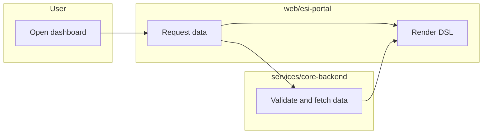
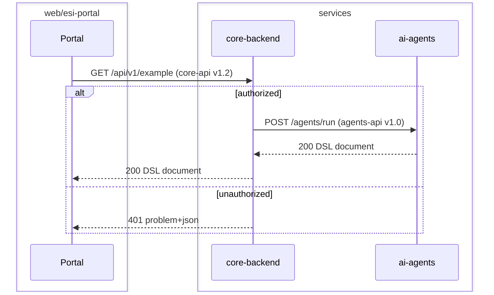

# Requirements

Reviewed summaries of the GitHub requirement tickets. The tickets are the source of truth for the wording; these docs hold the review results (affected projects, findings, decisions, open questions). Maintained by the `requirement-review` skill.

Hierarchy: **User Requirement (UR)** -> **System Requirement (SR)**. Each UR has a file `UR-<issue number>-<slug>.md`.

## Template for a UR file

```markdown
# UR-<n> <title>
Ticket: #<n> | Status: <open/closed> | Last reviewed: <date>

## System requirements
| SR | Title | Projects | Status |
|----|-------|----------|--------|
| #<n> | <title> | core, lib | <open/closed> |

## Flow (swimlane)
Who does what. Use one lane per actor/project; mark As-is vs To-be.



## API interaction (sequence)
Service calls, labelled with `METHOD /path` and the contract (`core-api` / `agents-api`, version).



## Findings
- <review finding, with the skill/rule it relates to>

## Decisions
- <decision, link to ADR in docs/architecture/ if any>

## Open questions
- <question for the product owner or team>
```

## Traceability

| UR | SRs | Projects | Review status |
|----|-----|----------|---------------|
| [UR-1](./UR-1-bi-ai-assistant-web-application.md) | SR-1..SR-9 analyzed; filed as ESI-13..ESI-20 (phase 1, done) and ESI-10..ESI-12 (charts, open, ADR-0009 accepted); ESI-2..ESI-9 closed as superseded; foundation tasks ESI-21..ESI-34 | portal, agents, core, contracts, lib | Phase 1 done; charts and production checklist open; open questions 1 and 4 remain. Last verified 2026-10-23 |
