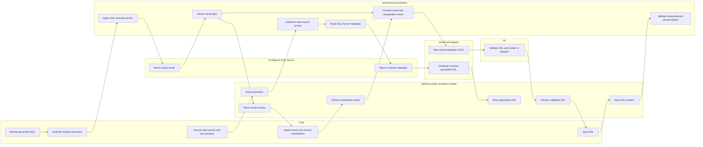
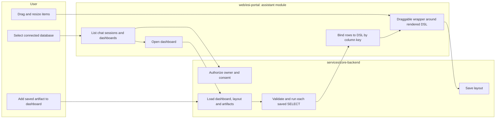
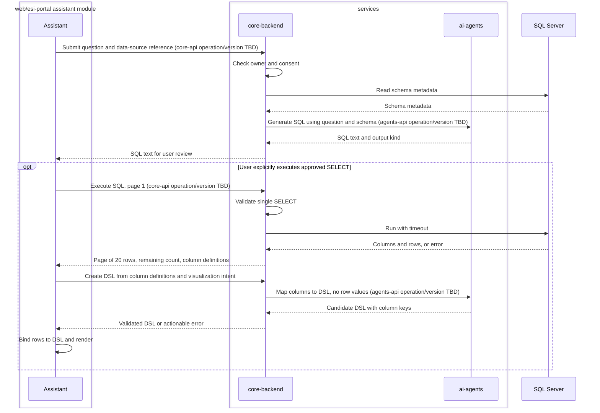
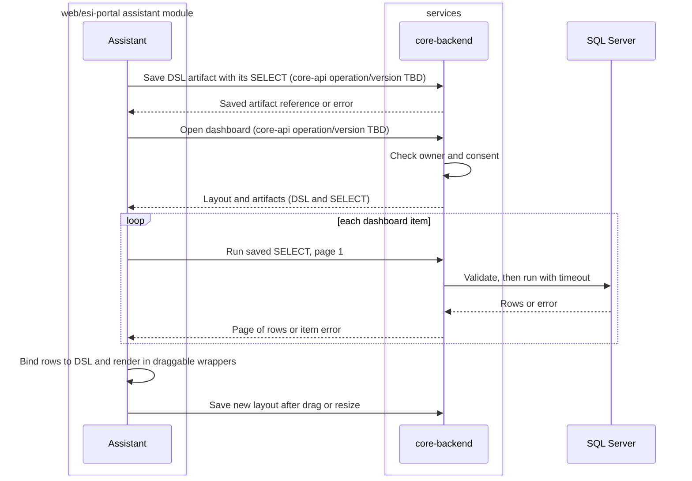

# UR-1 BI AI Assistant web application
Ticket: [#1](https://github.com/dtnam0899/edge-side-includes/issues/1) | Status: open | Last reviewed: 2026-10-23

> **Structure change (2026-10-18):** the AI assistant is no longer a separate React project (`web/esi-assistant`). It is an independent Angular feature module inside `web/esi-portal` (project code `portal`). Rules for such modules are in `web/esi-portal/CLAUDE.md`. Statements below that still say "assistant" mean this module.

> Status (verified against GitHub on 2026-10-23, `develop` at `c746f99`): phase 1 issues ESI-13..ESI-20 are done and closed; phase 5 (end-to-end, ESI-64) is done. Phase 6 work for the free demo is merged into `develop`: Auth0 sign-in (ESI-85..ESI-87), Gemini model (ESI-89), Postgres app database (ESI-94). Chart issues ESI-10..ESI-12 are open and wait for [ADR-0009](../architecture/ADR-0009-chart-component-and-library.md) (proposed). ESI-2..ESI-9 were an earlier set filed before the structure change and are closed as superseded; see "Filed issues" below. Phase 0 foundation tasks are ESI-21..ESI-34 ([plan](../plan/phase-0-foundation.md)). The SR sections and decisions are the product owner's analysis and are not yet approved as final.

## System requirements

SRs are analysis units; the filed issues are split by project, so one issue can cover several SRs.

| SR | Title | Projects | Filed in |
|----|-------|----------|----------|
| SR-1 | Configuring a SQL Server data source and discovering its schema | core, portal | ESI-13, ESI-15, ESI-16, ESI-19 |
| SR-2 | Asking database questions through the AI Assistant | portal, core, agents | ESI-13, ESI-17, ESI-19 |
| SR-3 | Generating SQL Server queries and stored-procedure SQL | agents, core, portal | ESI-18 |
| SR-4 | Running approved SQL and previewing result data | core, portal | ESI-13, ESI-16, ESI-19 |
| SR-5 | Converting query results into validated UI DSL (table, KPI) | agents, core, lib | ESI-14, ESI-18 |
| SR-6 | Rendering DSL in the portal | portal, lib | ESI-14, ESI-20 |
| SR-7 | Saving reusable DSL artifacts | portal, core | ESI-17, ESI-20 |
| SR-8 | Creating personalized dashboards from saved artifacts | portal, core | ESI-17, ESI-20 |
| SR-9 | Protecting connections, SQL execution, and user-owned assets | core, agents, portal | ESI-13, ESI-15 |

## Filed issues

All are sub-issues of #1 with the label `System Requirement`. Order of release: contracts and lib first, then core, then agents, then portal.

| Issue | Project | Title | Draft | Status |
|-------|---------|-------|-------|--------|
| ESI-13 | contracts | Define core-api and agents-api for the BI assistant | D1 | Done (closed) |
| ESI-14 | lib | Pin A2UI v0.9.1, add DSL validator and Angular renderer wrapper | D2 | Done (closed) |
| ESI-15 | core | Connections, consent and encrypted storage | D3 | Done (closed) |
| ESI-16 | core | Schema discovery and read-only SQL execution | D4 | Done (closed) |
| ESI-17 | core | Chat sessions, saved artifacts and dashboards | D5 | Done (closed) |
| ESI-18 | agents | SQL and DSL generation with safety rules and evals | D6 | Done (closed) |
| ESI-19 | portal | Chat, connection and consent UI, SQL review and paged results | D7 | Done (closed) |
| ESI-20 | portal | Render DSL, save artifacts and drag-and-drop dashboards | D8 | Done (closed) |
| ESI-2..ESI-9 | contracts, lib, core, agents, assistant | Earlier duplicates of D1..D8 (`[assistant]`, and ESI-3 said "React renderer") | - | Closed (not planned) on 2026-10-18, superseded by ESI-13..ESI-20 |
| ESI-10 | lib | Custom A2UI catalog with Chart.js chart component | D9 | Open; `[lib]` scope still valid (phase 7, needs ADR-0009) |
| ESI-11 | agents | Generate chart DSL with EsiChart | D10 | Open; still valid (phase 7, needs ADR-0009) |
| ESI-12 | portal | Render charts and view-as-table | D10 | Open; retitled from `[assistant]` on 2026-10-18 (phase 7, needs ADR-0009) |

## Interpretation

The ticket asks for a workflow spanning database metadata, natural-language SQL generation, result-to-DSL conversion, DSL rendering, saving, and personalized dashboards. The repository maps these responsibilities to independent projects: the assistant module of the Angular portal, AI agents, core API, shared DSL packages, and versioned API contracts. Dashboards are shown only inside the assistant module.

The ticket does not define SQL execution behavior, stored-procedure lifecycle, data refresh semantics, user/tenant ownership, or operational limits. The proposals below make the expected workflow testable while leaving those product decisions explicit. In particular, generated SQL should not be executed or deployed implicitly.

## Proposed SRs and acceptance criteria

### SR-1 — Configuring a SQL Server data source and discovering its schema

The system shall allow an authenticated user to add, test, update, and delete their own SQL Server connections (a connection to a live database of another system). Before a connection string can be added, the user must accept the security/consent terms. The core service shall test the connection and provide schema metadata to the AI workflow without exposing the connection string to the browser, AI response, or ordinary application logs.

**Acceptance criteria**
- Adding a connection is blocked until the user has accepted the current consent terms; the acceptance (user, terms version, time) is recorded.
- A user can list, edit, and delete only their own connections; other users cannot see or use them.
- The consent terms are versioned. The first version may be AI-drafted, but must be reviewed by an administrator (with legal advice as needed) before production release (applicable law and international norms, e.g. data-protection regulations). Until the production release, testing uses local databases and the terms may remain a draft.
- If the consent terms version changes, the user must re-accept before the connection is used again (to confirm).
- The user can withdraw consent for a specific database at any time. Withdrawal fully disables every feature for that database: schema discovery, chat, SQL execution, saved artifacts, and dashboards. The user can also no longer open that database's chat history in the assistant.
- Withdrawal hides the data tied to that database (chat history, saved scripts, artifacts, dashboards) without deleting it. If the user consents again, access is restored.
- The connection string is stored encrypted (see SR-9).
- A valid SQL Server connection can be tested and selected; a failed connection returns a useful, non-secret error.
- The AI workflow can receive metadata for available schemas, tables/views, columns, and SQL types before generating SQL.
- Connection credentials are not returned by API responses or included in client-visible errors.
- SQL Server is the only database engine in this scope; other engines are not implied by this ticket.

### SR-2 — Asking database questions through the AI Assistant

The assistant shall let a user submit a natural-language request against a selected data source and show the AI response, including generated SQL when applicable, progress, and actionable errors. Chat sessions are persisted per user and connection.

**Acceptance criteria**
- When the user selects a connected database in the UI, the assistant shows that user's chat session history for it and the list of dashboards rendered from DSL for it.
- A user can reopen a past session; sessions are visible only to their owner.
- A request is associated with the selected data source and submitted to the agent workflow.
- The UI distinguishes an in-progress request, a successful response, and a failed response.
- The user can inspect the returned SQL as text; the assistant does not represent generated SQL as executed unless it has actually been run.
- For a database whose consent was withdrawn, no session history or dashboards are listed or readable.

### SR-3 — Generating SQL Server queries and stored-procedure SQL

The agent shall use the selected database's discovered schema and generate SQL Server-compatible SQL for the user's request. It shall identify whether the output is a query or stored-procedure-related SQL and explain assumptions or schema references sufficiently for the user to review it.

**Acceptance criteria**
- Generated identifiers and types are grounded in metadata available for the selected data source; unsupported or missing schema information is surfaced rather than fabricated as fact.
- The response contains SQL text that the user can inspect and copy.
- Generation alone does not execute SQL, create/alter a stored procedure, or change database state.
- Stored-procedure SQL is aimed at statistics/aggregations across multiple tables; the response explains which tables and joins it uses.
- The AI may read the definitions of existing stored procedures as schema context, but must never execute them.
- Newly written stored procedures are scripts that only read data (no INSERT/UPDATE/DELETE/DDL/side effects in their body); this rule is part of the agent's instructions and is also checked on the generated script.
- A generated stored procedure is only ever provided as a script; the system never creates or alters it in the target database.
- The script is saved automatically to the user's library, and the user can delete it at any time.

### SR-4 — Running approved SQL and previewing result data

To support result-to-DSL conversion, the system shall provide a user-initiated execution path for an approved SELECT query and return column metadata, rows, and execution errors to the assistant. Stored procedures are never executed by the assistant, so DSL data comes from SELECT queries (a generated stored-procedure script is a deliverable, not a data source in this version).

**Acceptance criteria**
- Generated SQL is not run automatically; the UI requires an explicit user action to execute it.
- The user can inspect returned columns and rows before creating a visualization.
- Execution failures are shown as failures and do not produce success-shaped empty results.
- Execution is only allowed on a connection whose consent terms were accepted by its owner.
- Execution through the assistant is read-only. Before execution the backend parses/validates the statement: only a single SELECT statement is accepted; writes, DDL, `EXEC`/stored-procedure calls, multiple statements, and other side-effecting constructs are rejected. The check is enforced by the system rather than only by AI instructions.
- Each execution has a command timeout that is configurable (default 30s); a timeout is reported as an error.
- There is no cap on the total number of rows the query may return, because the user owns the database. The UI shows 20 rows per page with pagination and tells the user how many rows remain; the backend fetches page by page instead of loading the whole result.

### SR-5 — Converting query results into validated UI DSL

The system shall map result metadata/data, plus the user's visualization intent, into a DSL document for a supported table or KPI widget built from the A2UI basic catalog. Charts are not available in the basic catalog and are planned as a follow-up custom component. The DSL reuses A2UI protocol v0.9.1 (the current stable production release; a declarative component description built only from an approved catalog) with its basic catalog used as-is for now; ESI-specific components are added only where A2UI conflicts with a requirement and cannot express it. The DSL carries no row data, only keys/column names that are bound at render time to the rows returned by the query. The agent therefore needs only the column definitions (names/types), not the row values, to produce the DSL (proposed, so user data is not sent to the AI model). Forms are out of scope for this version and planned for a later one. The DSL is data, not executable code, and must conform to the published DSL schema before it is accepted for rendering or saving.

**Acceptance criteria**
- The conversion receives the result's column names/types and the requested presentation.
- A supported visualization produces a DSL document accepted by the canonical schema/validator.
- The DSL contains no row data; each component refers to result columns by key/name.
- If a referenced column is missing from the current query result (e.g. the table changed), the item shows a clear error instead of empty or wrong data. The user must start over with a new prompt; there is no automatic or assisted regeneration.
- The agent receives only column definitions (names/types), never row values.
- The DSL uses only components from the pinned A2UI v0.9.1 catalog, used as-is; an unknown component is rejected. ESI custom components are added later, and only when A2UI cannot meet a requirement, each justified in an ADR.
- If the user's request cannot be expressed with the available components (for example a chart type the catalog lacks), the assistant says so instead of producing a different visualization.
- The rules that choose a component from table/column definitions are documented in `docs/dsl/`, not left to free-form AI output.
- Tables use the basic catalog only: a `Column` with a header `Row` and a `List` whose template `Row` iterates the bound rows with relative column paths; no custom component is needed. KPI widgets use `Card`, `Text` and the `formatNumber`/`formatCurrency` functions.
- A request for a chart is answered as not yet supported until the chart component is added through the custom-catalog ADR; the assistant offers a table or KPI instead.
- The UI shows only the current page (20 rows) and how many rows remain; any aggregate shown comes from the query itself, not from the visible page.
- The DSL is validated with the A2UI v0.9.1 JSON Schema, then with ESI checks: unique component ids, a `root` component, every bound path refers to a column of the query result, no unknown component, no function outside the catalog.
- When validation fails, the error list is returned to the agent and generation is retried at most 2 times (configurable), then the user sees a clear failure and the invalid DSL is never rendered or saved.
- Unsupported or ambiguous mappings return validation/actionable feedback instead of an invalid DSL document.
- DSL changes, if needed, are versioned through `lib/dsl-schema`; consumers use published versions rather than cross-project source imports.
- A request for a form is answered as unsupported in this version rather than producing a partial DSL.

### SR-6 — Rendering DSL in the portal

The DSL (JSON data) is the core of the feature: the assistant module of `web/esi-portal` shall validate and render DSL documents bound to query results, both for previews in chat and for saved dashboards, through `lib/dsl-renderer-angular`, which wraps the maintained A2UI Angular renderer (`@a2ui/angular`) for v0.9.1. Angular is the only renderer, so renderer parity is not required; the DSL still stays framework-neutral so another renderer could be added later.

**Acceptance criteria**
- Invalid DSL is rejected before rendering.
- Supported nodes render without evaluating DSL values as HTML, scripts, or arbitrary code.
- Shared schema fixtures are covered by behavior-level tests in the Angular renderer.
- Data is bound to components from the query result by column key/name; row values are never interpreted as HTML or code.

### SR-7 — Saving reusable DSL artifacts

The user shall be able to save a selected DSL artifact to a personal library and find it again for dashboard use. The persisted artifact shall include the DSL (the A2UI `updateComponents` payload with its `catalogId` and protocol version, no row data), the SELECT it is bound to, the column definitions it expects, and a reference (never the secret) to the owner's connection, because data comes from a live database rather than a stored snapshot.

**Acceptance criteria**
- A user can explicitly save a generated DSL artifact and receive confirmation or a clear error.
- The saved item can be selected later by its owner.
- At render time the assistant builds the A2UI message sequence itself: `createSurface` with the stored `catalogId`, the stored `updateComponents`, then `updateDataModel` with the live rows at `/rows` and paging info (page, remaining) at `/page`. The surface and data model are never stored.
- Each artifact records the DSL schema version so that it can be migrated or rejected when the pinned A2UI version changes.
- One user's saved artifacts are not visible to another user unless sharing is explicitly supported.
- Connection secrets are not copied into the DSL or saved artifact.
- If the referenced connection is deleted or its consent is withdrawn, the artifact shows a clear unavailable state instead of stale data.

### SR-8 — Creating personalized dashboards from saved artifacts

The user shall be able to create a personal dashboard and add saved DSL artifacts to it. The dashboard shall persist its selected artifacts and render them when reopened.

**Acceptance criteria**
- A user can create and reopen a dashboard containing at least one saved artifact.
- Dashboards are private to their owner; sharing is not part of this version.
- A missing, deleted, or invalid artifact is surfaced clearly and does not prevent unrelated dashboard items from rendering.
- Opening a dashboard loads live data for each item through the owner's connection, under the same execution policy as SR-4; one failing item does not block others.
- Data is queried when the user opens the dashboard (not on a schedule); caching is not assumed.
- Dashboards are shown only inside the assistant module of the portal and are not shared with other portal modules at component level.
- The user can drag-and-drop dashboard items to change their position and resize them; the layout is persisted and restored when the dashboard is reopened.
- Drag-and-drop is provided by a wrapper component around the DSL-rendered component; layout (position/size) is stored with the dashboard, not inside the DSL document. Each dashboard item renders in its own A2UI surface, so one failing item does not affect the others.
- A dashboard of a database whose consent was withdrawn is not accessible.

### SR-9 — Protecting connections, SQL execution, and user-owned assets

All services shall enforce authorization for data sources, SQL execution, saved artifacts, and dashboards. AI-generated SQL and DSL shall be treated as untrusted input.

**Acceptance criteria**
- API operations verify that the authenticated user is authorized for the referenced connection and saved assets.
- No identity provider exists yet. For local testing the system assumes a single local user with the admin role; this stand-in must not reach production, and a real authentication/authorization mechanism is a production-release prerequisite. *(Update 2026-10-23: real authentication exists, Auth0 through OIDC per ADR-0006 (ESI-85..ESI-87); the local admin stand-in is accepted only in Development.)*
- Connection strings are encrypted at rest with envelope encryption: a per-secret data key (AES-256-GCM) is wrapped by a master key, and the master key is supplied to `core-backend` from a GitHub secret as an environment variable at deploy time. The master key is never stored in the database or repository, and key versions allow rotation without re-entering connection strings. Proposal pending an ADR: the GitHub secret holds only the master key, never users' connection strings. For production, reconsider a managed key store, because GitHub secrets give no per-use audit or managed rotation.
- Connection strings are decrypted only inside `core-backend` at the moment of use, and are never sent to the browser, the AI agent, or logs.
- Connections are not shared between users in this version.
- Executed SQL is written to the application log inline (user, connection id, time, duration, outcome, statement); there is no separate audit store in this version. Logs must not contain result data, connection strings, or the master key.
- SQL execution uses the statement validation and timeout described in SR-4; stored procedures are never executed by the assistant.
- DSL is validated against the pinned schema before rendering; the renderer does not execute scripts or raw HTML from DSL.

## Flow (swimlane)

### As-is

No implemented end-to-end behavior is established by UR-1 or the repository requirement docs.

### To-be: ask, inspect, generate, execute, and visualize

### To-be: reuse a saved artifact on a dashboard

## API interaction (sequence)

The contract specs are currently placeholders; no paths, payloads, or contract versions can be verified. The calls below are operation placeholders, not proposed literal routes. Define them in `services/contracts` before implementation and label/version them there.

### To-be: data question and visualization

### To-be: save and use dashboard

## Findings

- UR-1 is a single high-level feature spanning multiple independently released projects; implementation should be split into focused SR tickets/PRs by project and integrated through published contracts and packages.
- The ticket had no acceptance criteria; the criteria above were derived from product-owner answers. The SRs were filed as issues ESI-13..ESI-20 on 2026-10-18 (see "Filed issues"), but the criteria are still not formally approved.
- **Duplicate issues.** ESI-2..ESI-9 were filed on 2026-10-17 before the structure change and duplicate ESI-13..ESI-20 with the old `[assistant]` project code (ESI-3 even targets `@a2ui/react`). They were closed as superseded on 2026-10-18. Chart issues ESI-10..ESI-12 have no replacement; ESI-12 was retitled `[portal]`.
- **Read-only by statement validation only (risk).** The product owner chose statement checking as the sole guarantee. T-SQL parsing is hard to make complete (e.g. `SELECT ... INTO`, `OPENROWSET`/linked-server constructs, or functions with side effects inside a SELECT). Recommend an allow-list parser plus, as defense in depth, advising users to connect with a read-only database login. This is a recommendation, not a decision.
- **Stored procedures cannot be a DSL data source (confirmed).** Since the assistant never executes procedures and new ones are only scripts, DSL data comes from SELECT queries only. Procedure scripts are a deliverable for the user to run themselves. This differs from the ticket wording ("query/store procedure to DSL") and needs confirmation.
- **Consent drives lifecycle.** Per-database consent withdrawal disables chat history, artifacts and dashboards for that database; this crosses core and assistant and needs one authorization check in core-backend.
- **Legal text.** An AI-drafted consent text is acceptable for the first version only with a human legal review before release.
- **Charts limited to a page.** Charts use only the current 20-row page for now. The UI must say so, otherwise a chart could be mistaken for the whole data set.
- **GitHub secret scope.** It suits the master key for CI/CD deployment, but it is not a runtime key store; see SR-9.
- **A2UI renderer (verified).** The A2UI renderer page lists Angular as a maintained web renderer, marked stable for v0.8 and v0.9.1, and planned for v1.0. After the structure change this is the renderer in use (React is no longer needed).
- **Version wording.** The A2UI site labels v0.9 "Stable" and v0.9.1 "Current production release" (a patch release in the stable v0.9 family). This document pins v0.9.1.
- **Catalog checked (v0.9.1).** The basic catalog has 18 components: Text, Image, Icon, Video, AudioPlayer, Row, Column, List, Card, Tabs, Modal, Divider, Button, TextField, CheckBox, ChoicePicker, Slider, DateTimeInput, plus functions such as `formatNumber`, `formatCurrency`, `formatDate`, `pluralize`. It has **no Table, Chart or dashboard-layout component**. Tables can be composed from `List` with a template over bound rows (relative paths), and KPIs from `Card` + `Text`, so "use as-is" works for table and KPI. A chart needs a custom catalog component, which is the allowed exception.
- **Catalog id mismatch.** The v0.9.1 `catalog.json` carries a `catalogId` pointing at `.../specification/v0_9/catalogs/basic/catalog.json`, while the v0.9.1 spec examples use `.../v0_9_1/...`. Use the exact string from the catalog file we pin, and cover it with a test.
- **Package names and versions.** The Angular renderer is published as `@a2ui/angular` 0.13.0 (Apache-2.0) with peer dependencies on Angular `^21.2.5`; the portal must therefore run Angular 21 or newer (its version is still a placeholder in `web/esi-portal/CLAUDE.md`). The package version is not the protocol version; pin both and record the pair.
- **Vendoring vs depending.** The Apache-2.0 license allows copying with the license and notices kept and modifications marked. Preferred order: (1) depend on `@a2ui/angular` at a pinned version from inside `lib/dsl-renderer-angular`; (2) copy only if a patch is unavoidable, recording the upstream version/commit and keeping edits separate from upstream files so upgrades do not conflict.
- **A2UI fit.** The repo skills and `lib/` assumed a custom DSL (`table`, `chart`, `dashboard`, `form` nodes). Reusing A2UI changes that premise: `lib/dsl-schema` would derive from or adopt A2UI, and the `dsl-authoring` skill needs updating once an ADR is accepted. The A2UI protocol is stream-based (`createSurface`, `updateComponents`, `updateDataModel`), so how it fits the stored, versioned DSL document model needs an ADR.
- **One renderer.** `lib/dsl-renderer-react` and `web/esi-assistant` were removed, so renderer parity is not needed.
- **Module isolation.** The assistant must not import components from other portal modules, and no other module may import its components; shared needs go through `core`/`shared` (see portal module rules). Dashboards drag-and-drop therefore lives inside the assistant module.
- **No row data to the AI.** Because the DSL holds only column keys, the agent can work from column definitions alone, which keeps the user's data out of the model prompt (proposal).
- **No identity provider.** Authentication does not exist yet; local testing assumes an admin. Production needs a real mechanism.
- Network paths and contract versions must not be inferred from this ticket; the relevant API contracts need to be designed and versioned.

## Decisions

Confirmed by the product owner on 2026-10-17 (not yet ADRs):

1. **Consent before connecting.** A user must accept the security terms before adding a connection string, and again before the assistant connects to it.
2. **Connection ownership.** Each user manages (add/edit/delete) the connections they added; connections are private to the owner.
3. **Live data.** The data source is a live database of another system. Saved DSL artifacts and dashboards fetch live data; they are not snapshots.
4. **Stored procedures** are mainly for statistics/aggregations over multiple tables.
5. **DSL is the core.** The assistant module renders DSL JSON for previews and dashboards.
6. **Read-only execution.** The assistant may only read/SELECT. Standard command timeout; no row limit, since the user owns the database.
7. **Stored procedures are script-only.** They are never created in the target database. The script is saved automatically; the user can delete it.
8. **Entry point.** Selecting a connected database in the UI shows the user's chat session history and the list of dashboards rendered from DSL for it. Data is fetched when the user opens it.
9. **Consent.** Terms follow applicable law and international norms; the first version may be AI-drafted (with human review). Withdrawing consent for a database fully disables it, including access to its chat history.
10. **SQL policy.** Read-only enforced by statement validation. Timeout is configurable (default 30s). The AI may read existing procedure definitions but never execute them; new procedures are read-only scripts. Agent rule recorded in `services/ai-agents/CLAUDE.md`.
11. **Secrets.** Connection strings are encrypted and not shared between users; key management proposal in SR-9 (pending ADR).
12. **Results.** 20 rows per page with pagination and a remaining-row count. Charts are limited to the current page for now.
13. **Scope of this version.** Forms are deferred to a future version. Dashboards are not shared; users can drag-and-drop to move and resize items.
14. **Consent withdrawal.** Data is hidden, not deleted; consenting again restores it. An admin reviews the consent terms. Production release of the terms is deferred; until then testing uses local databases (kept for the release checklist).
15. **Read-only.** Both layers: statement validation in the backend and a recommendation to connect with a read-only database login.
16. **DSL mapping.** Data comes only from SELECT queries; the mapping to DSL follows the A2UI approach with ESI custom components.
17. **Key management.** The master key comes from a GitHub secret (see SR-9).
18. **A2UI first.** Reuse A2UI; add ESI custom components only when A2UI conflicts and cannot express the need.
19. **DSL has no data.** It carries only keys/column names mapped to query results.
20. **Assistant module only.** Dashboards are shown only inside the assistant module of the portal.
21. **Drag-and-drop** is a wrapper component around the rendered DSL; layout is stored with the dashboard, not in the DSL.
22. **Logging.** Executed SQL is logged inline in the application log; no audit store or extra rules for now.
23. **Auth for testing.** No Identity Server; local testing assumes an admin user. Real authentication is a production prerequisite.
24. **A2UI version and scope.** Pin the stable A2UI v0.9.1 and use its catalog as-is for now.
25. **Renderer.** Use the A2UI Angular renderer (`@a2ui/angular`) wrapped by `lib/dsl-renderer-angular`.
26. **Missing column.** Show an error; the user starts over with a new prompt. No regeneration offered.
27. **Agent input.** The agent receives only column definitions, not row values.
28. **First phase scope.** Basic catalog components only: table and KPI. Charts are a follow-up with a custom component.
29. **Renderer packaging.** The assistant module consumes `lib/dsl-renderer-angular`, which wraps the A2UI Angular renderer (a pinned dependency; copied from upstream only when necessary) so upstream version changes are absorbed in one place.
30. **Artifact storage and retry policy.** As described in SR-5 and SR-7 (store components + SELECT, rebuild the A2UI messages at render time; at most 2 validation retries).
31. **Chart library.** Charts use Chart.js, wrapped as an ESI custom component in a custom A2UI catalog. Proposed in [ADR-0009](../architecture/ADR-0009-chart-component-and-library.md): `EsiChart` with `bar`, `line` and `pie`, in an ESI catalog used only by chart documents.
32. **Vendoring.** `lib/dsl-renderer-angular` depends on `@a2ui/angular` at a pinned version; code is copied only when a patch is unavoidable.
33. **KPI totals** come from the SQL aggregate, not from the visible 20-row page.

34. **Issue split.** SRs are filed as one-project issues following `esi-workflow`: ESI-13..ESI-20 (phase 1) were filed on 2026-10-18 from `UR-1-issue-drafts.md`; ESI-2..ESI-12 are an earlier, partly superseded set (see "Filed issues").

35. **Structure change.** The assistant is an independent Angular module in `web/esi-portal`; `web/esi-assistant` and `lib/dsl-renderer-react` were removed. The portal gets module-isolation rules (no component-level dependency between feature modules); the folder layout is decided later.
36. **Drag-and-drop.** Use the Angular CDK drag-drop in a wrapper component inside the assistant module (proposal; the wrapper stays private to the module).

## Open questions

1. Release checklist before production: admin approval of the consent text, the read-only login recommendation shown in the UI, a key-management review, and replacing the assumed local admin with real authentication (done for the demo: Auth0, ADR-0006; the ADR still needs acceptance).
2. Confirm the chart proposal below (types, binding, accessibility). It is now written up as [ADR-0009](../architecture/ADR-0009-chart-component-and-library.md) (`Proposed`); its own open questions (series and pie limits, stacked bars, pattern fills, caption locale) remain.
3. Portal prerequisites: resolved. The portal and lib use Angular 21 and the assistant is a feature module of `web/esi-portal` (`web/esi-portal/CLAUDE.md`). Streaming chat answers are needed but planned for the next version (product owner, 2026-10-23); this version stays synchronous.
4. Which parts of the assistant (for example the connection list) may other portal modules reach, and through which `core` API? Still open (product owner, 2026-10-23: no answer yet).
5. Issue hygiene is done (ESI-2..ESI-9 closed, ESI-12 retitled, task ESI-21 closed). The file `scripts/create-ur1-issues.sh` was already applied for phase 1; do not re-run it with `--apply`, which would create duplicates.

## Chart proposal (follow-up phase, pending ADR)

- **Types:** `bar`, `line`, `pie`. Pie is limited to a single series and a small number of categories (suggested 8); otherwise the agent proposes a bar chart.
- **Component:** one custom catalog component (working name `EsiChart`) in a custom A2UI catalog that extends the basic catalog with its own `catalogId`. It wraps Chart.js inside `lib/dsl-renderer-angular`, as an Angular standalone component.
- **Properties:** `chartType` (`bar|line|pie`), `title`, `categoryKey` (column name for the x axis or pie labels), `series` (list of `{valueKey, label}`), and `data` bound to the rows with `{"path": "/rows"}`. No data values appear in the DSL.
- **Validation:** `categoryKey` and every `valueKey` must exist in the query's column definitions; each `valueKey` column must be numeric; pie allows exactly one series.
- **Data scope:** as decided, a chart uses the rows of the current page (20), and its caption states "first 20 of N rows". Aggregation should be done in the SQL.
- **Accessibility and safety:** the canvas has a text alternative (title plus summary) and a "view as table" toggle that renders the same rows with the basic catalog table; series must be distinguishable without color alone; colors come from `lib/ui-tokens`; labels are drawn as text, never as HTML.
