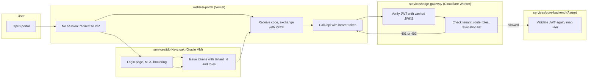
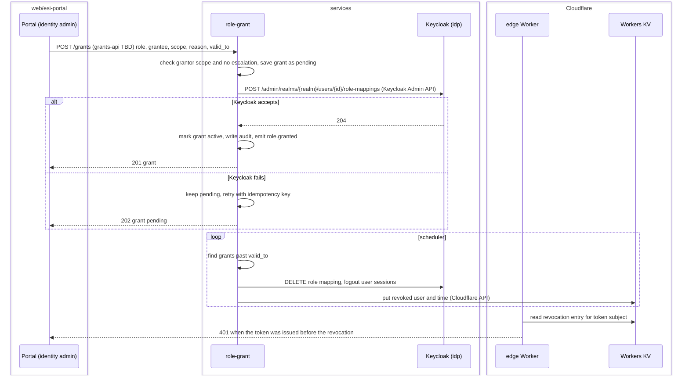

# UR-140 Keycloak identity provider for multi-system, multi-tenant SSO with rich role grants
Ticket: [#140](https://github.com/dtnam0899/edge-side-includes/issues/140) | Status: open | Last reviewed: 2026-10-24

> Status (verified against GitHub on 2026-10-24, `develop` at `d1d5cae`): analysis and ADR-0011..ADR-0013 (Proposed) written; gate G4 approved and recorded on #140; enablers E1..E5 filed as ESI-141..ESI-145 and drafts D1..D23 as ESI-146..ESI-168, all sub-issues of #140 and on the GitHub project "Edge Side Includes". First executable issue: ESI-141 (E1). The source requirements doc with the detailed requirement IDs (SSO-\*, MT-\*, RG-\*, IAM-\*, INT-\*, NFR-\*, OPS-\*) is the product owner's [system requirements doc](https://claude.ai/artifact/5BZdUjy9f3Lp5zPWgywo59) (Vietnamese); this file maps those IDs to SRs and drafts.

## Interpretation

The ticket asks for one identity platform that every ESI system, and later partner systems, sign in through. Three capabilities carry it: SSO with single logout, tenant isolation, and role grants richer than plain role assignment (time limits, approvals, delegation, audit). Today only the portal and core sign in, through Auth0 (ADR-0006), with no tenants or roles.

"ESI" in this repository is the platform name; it does not mean the Edge Side Includes caching technique. The source doc's Varnish fragment-assembly requirement (INT-05) is therefore dropped (Decision 2).

## System requirements

SRs are analysis units; issues are split by project, so one SR is usually filed as several issues.

| SR | Title | Projects | Source IDs | Drafts |
|----|-------|----------|------------|--------|
| SR-1 | SSO and single logout across ESI systems over OIDC | idp, edge, core, portal | SSO-01, 03, 04, 05, 06, 12 | D1, D2, D3, D4 |
| SR-2 | Tenant model and automated onboarding (shared realm + Organizations) | grants, idp, contracts, portal | MT-01, 02, 04, 05, 07, 08, 09, 10 | D6, D7, D8, D9 |
| SR-3 | Token claims and enforcement at the edge | idp, edge | MT-03, RG-30, 31, 33, INT-01, 03, 04 | D2, D7 |
| SR-4 | Role model and direct grants with no privilege escalation | grants, contracts, idp | RG-01..05, 10, 11, 16, 40, 41, 42, 45 | D10, D11 |
| SR-5 | Time-bound grants, expiry and fast revocation | grants, edge | RG-10, 17, 43, NFR-03 | D12, D13 |
| SR-6 | Grant requests, approvals, bulk grants and delegation | grants, contracts | RG-12, 13, 14, 15 | D10, D14, D15 |
| SR-7 | Delegated administration in the portal | portal | RG-20, 21, 22, MT-05 | D9, D18 |
| SR-8 | Consistency between Role Grant Service and Keycloak | idp, grants | RG-44, 46, 47, INT-08 | D16, D17 |
| SR-9 | Authentication hardening: MFA, step-up, password and brute-force policy | idp | IAM-03, 04, 06, 07 | D19 |
| SR-10 | Identity brokering (Google, Microsoft) and home-realm discovery | idp | SSO-09, 11 | D20 |
| SR-11 | Branding, languages and emails per organization | idp | MT-06, IAM-06, 11 | D21 |
| SR-12 | Replace Auth0 in core and portal | core, portal, esi | (Decision 4) | D3, D4, D5 |
| SR-13 | Free-tier hosting, backup, observability and runbook | esi, idp | NFR-04, 05, 10, 11, 13, OPS-01..10 | E5, D22 |

Not filed now (later or only when needed): SAML 2.0 for legacy systems (SSO-02), consent screen for third-party clients (SSO-08), dynamic client registration (SSO-07), token exchange and opaque-token introspection (SSO-12 part, INT-09), SCIM (IAM-09), passwordless magic link (IAM-05), anomaly alerts (IAM-10), just-in-time elevation (RG-13), Keycloak Authorization Services / ABAC (RG-32).

## Acceptance criteria per SR (summary)

- **SR-1:** signing in to the portal and opening a second registered client of the same tenant asks for no password; signing out in one client ends the session in the other within seconds; after a signing-key rotation, old tokens stay valid until they expire and new tokens use the new key.
- **SR-2:** one API call creates a tenant (Organization, domain, first admin invite, default roles and clients) with no manual console step; a tenant admin cannot read or change another tenant's users, roles or grants (tested).
- **SR-3:** tokens carry `tenant_id`, `roles` and the right audience; the Worker rejects an expired, wrong-audience, wrong-issuer or tampered token with 401 and a missing role with 403, without calling Keycloak per request; client-sent identity headers are removed.
- **SR-4:** a grant records grantor, grantee, role, scope, reason, validity and ticket reference; a grantor cannot grant a role outside their administrative scope or above their own rights; conflicting role pairs are refused.
- **SR-5:** an expired grant disappears from new tokens within the scan interval, and its user is denied at the edge within 5 minutes (demo target, NFR-03).
- **SR-6:** a sensitive role needs two approvers; bulk grants support dry-run; delegation cannot exceed the delegator's rights and ends at its end date.
- **SR-7:** the portal shows a user x role matrix with effective roles and where each comes from (direct, group, composite), and an approvals inbox.
- **SR-8:** a role assigned by hand in the Keycloak console is detected (event) and reported or reverted (reconciliation); every grant change emits an event and an audit record.
- **SR-9:** when a tenant turns on mandatory MFA, its users must enroll at the next sign-in; repeated failed passwords lock the account temporarily.
- **SR-10:** a user whose email domain belongs to a tenant with Microsoft sign-in is sent to that provider; first login links or creates the account by policy.
- **SR-11:** login pages and emails show the tenant's logo, colors and language (vi, en).
- **SR-12:** core and portal sign in through Keycloak; no Auth0 package, setting or doc remains; demo users are re-created in Keycloak.
- **SR-13:** the IdP stack runs on the Oracle Always Free VM from published images; daily database backup with a tested restore; health, metrics and logs with `tenant_id`.

## Flow (swimlane), To-be: sign-in and an API call

As-is: the portal signs in with Auth0 (`@auth0/auth0-angular`); Vercel rewrites `/api/*` to core on Azure Container Apps; core validates the Auth0 JWT (ADR-0006).

## API interaction (sequence), To-be: grant, expiry and revocation

`grants-api` is a new contract (Decision 7); paths are proposals and stay `TBD` until the contract issue (D6, D10) defines them.

## Findings

1. **Supersedes ADR-0006 (Auth0).** Core already uses only the standard JWT bearer handler (`ESI_CORE_Auth__Authority`, `ESI_CORE_Auth__Audience`), so the switch is configuration plus a user re-link. The portal's `AuthSession` abstraction (`src/app/core/auth/`) isolates the Auth0 SDK; only its implementation and `AppConfig.auth` change. ADR-0011.
2. **Keycloak does not fit Azure Container Apps free.** Keycloak must stay up (sessions, JWKS, login) and needs roughly 0.5-1 GB RAM (estimate, `TBD` measured); the ACA free grant is about 66 h a month at demo size (ADR-0005). Hence Oracle Always Free for the IdP stack only. ADR-0012.
3. **Oracle changed Always Free limits without notice in 2026** (A1 halved to 2 OCPU / 12 GB, reported by [InfoQ](https://www.infoq.com/news/2026/07/oracle-cloud-free-tier-limits/)); keep the stack runnable on a laptop through the same compose file as a fallback.
4. **Public hostname for Keycloak needs a DNS name.** A Cloudflare named tunnel or a TLS certificate both need a hostname; a domain usually costs a yearly fee, which conflicts with "free only". Resolved by Decision 10 (free DuckDNS hostname).
5. **Edge placement without a custom domain:** the portal's Vercel rewrite for `/api/*` can point at the Worker's `workers.dev` URL instead of core, so the Worker sits in front of core with no domain. Core keeps validating tokens (defense in depth, ADR-0012).
6. **Cloudflare Workers Free limits:** 100,000 requests a day and 10 ms CPU per request ([Cloudflare](https://developers.cloudflare.com/workers/platform/pricing/)); JWT verification with WebCrypto and a cached JWKS fits; the Worker must not call Keycloak per request.
7. **Workers KV is eventually consistent** (about a minute), which meets the 5-minute demo revocation target (NFR-03) but not a 1-minute production target.
8. **Core is user-scoped, not tenant-scoped.** Every owner check uses `ICurrentUser.UserId`. Adding a tenant dimension to core data is a separate change (Open question 2); this UR only puts `tenant_id` in tokens and enforces it at the edge.
9. **Two sources of truth need reconciliation.** Keycloak holds effective role mappings; Role Grant Service holds grant records. Writes go only through the service (pending -> Keycloak -> active), an event listener reports manual changes, and a reconciliation job is the safety net. ADR-0013.
10. **New projects** `services/idp` (Keycloak image, theme, Java event-listener SPI, realm config), `services/role-grant` (.NET) and `services/edge-gateway` (Cloudflare Worker, TypeScript) need scaffolds, CI, Docker and release tags like every project (root `CLAUDE.md` rules 1-4), and new project codes `idp`, `grants`, `edge`.
11. **Security:** tenant isolation is the highest-impact risk; every Role Grant Service query and every Admin API call is scoped by tenant and covered by cross-tenant tests. The service account that writes to Keycloak gets only the realm-management roles it needs.

## Decisions

1. 2026-10-24 (product owner): tenancy is one shared realm with Keycloak Organizations; a dedicated realm only for a tenant that needs strong isolation. ADR-0011.
2. 2026-10-24 (product owner): drop Varnish and Edge Side Includes fragment assembly; the Worker forwards to core and the portal directly.
3. 2026-10-24 (product owner): token checks run at the real edge in a Cloudflare Worker.
4. 2026-10-24 (product owner): Keycloak replaces Auth0; ADR-0011 supersedes ADR-0006.
5. 2026-10-24 (product owner): only the IdP stack (Keycloak, PostgreSQL, Role Grant Service) moves to an Oracle Cloud Always Free VM; core and agents stay on Azure Container Apps, the portal on Vercel (ADR-0005 unchanged). ADR-0012.
6. 2026-10-24 (product owner): no LDAP/AD user federation; the system is new and has no existing directory. A tenant on AD or Entra ID connects through OIDC/SAML brokering (SR-10).
7. 2026-10-24 (product owner): Role Grant Service is a separate .NET service with its own schema, writing role mappings to Keycloak through the Admin API, plus a thin Keycloak event-listener SPI. Its API is a design-first contract `grants-api` in `services/contracts`. ADR-0013.
8. 2026-10-24 (product owner): file issues for every phase now, not only the first one (deviation from "later phases are filed when the MVP is stable", `docs/process/README.md` stage 5).
9. SAML stays out of the filed scope; it is added only when a legacy system needs it.
10. 2026-10-24 (product owner): use a free hostname service for now. Keycloak is published as a DuckDNS subdomain (`<name>.duckdns.org`) with Caddy as reverse proxy on the VM, getting a Let's Encrypt certificate through the TLS-ALPN-01 challenge on port 443 (official Caddy image, no plugin); only port 443 is open. A Vercel rewrite was considered and rejected: the Vercel-to-VM leg would carry passwords and tokens without TLS, and the issuer hostname would depend on a static-hosting proxy. A Cloudflare quick tunnel was rejected: its hostname changes on every start and Cloudflare documents it as test-only. Moving to an own domain later changes the issuer URL (users and clients re-configure).

## Open questions

1. ~~Public hostname for Keycloak~~ Resolved 2026-10-24: free DuckDNS hostname with Caddy and Let's Encrypt (Decision 10).
2. Should core scope its data by tenant (connections, chats, dashboards per tenant), or stay per user? Not blocking this UR. Owner: product owner.
3. Exact Keycloak version to pin (latest 26.x at scaffold time, `TBD`), and whether Organizations need any feature flag in that version. Resolved in E2.
4. Which roles count as "sensitive" (two approvers) and who approves by default in a new tenant. Needed by D14. Owner: product owner.
5. Demo users: re-create by hand in Keycloak, or import? Needed by D5.

## Filed issues

All are sub-issues of #140 (verified 2026-10-24). Enablers have label `Foundation Task`, drafts `System Requirement`. Full tables with phase, priority, size and dependencies: [UR-140-issue-drafts.md](./UR-140-issue-drafts.md) (D1..D23 = ESI-146..ESI-168) and [UR-140-enabler-tasks.md](./UR-140-enabler-tasks.md) (E1..E5 = ESI-141..ESI-145).

| Phase | Issues |
|-------|--------|
| I1 Foundation | ESI-141 (E1), ESI-142 (E2), ESI-143 (E3), ESI-144 (E4), ESI-145 (E5) |
| I2 SSO baseline | ESI-146 (D1), ESI-147 (D2), ESI-148 (D3), ESI-149 (D4), ESI-150 (D5) |
| I3 Multi-tenant | ESI-151 (D6), ESI-152 (D7), ESI-153 (D8), ESI-154 (D9) |
| I4 Rich grants | ESI-155 (D10) .. ESI-163 (D18) |
| I5 Hardening | ESI-164 (D19), ESI-165 (D20), ESI-166 (D21) |
| I6 Operations | ESI-167 (D22), ESI-168 (D23) |
