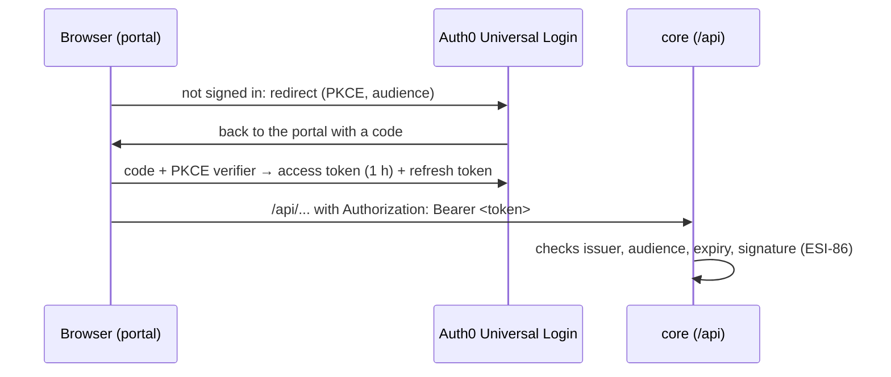

# Auth0 setup for the demo (step by step)

This guide sets up sign-in for the demo from [ADR-0006](../../docs/architecture/ADR-0006-authentication-provider.md) (Proposed): one Auth0 Free tenant, an **API** that stands for core, and a **Single Page Application** for the portal. It assumes no Auth0 experience. Auth0 Free needs no credit card (up to 25,000 monthly active users, checked 2026-10-18). Nothing here is a secret: the portal is a public client, and core only needs the issuer and audience.



## Before you start: what is ready and what is not

| Part | Status |
|------|--------|
| Parts 1–5 (tenant, API, application, invite-only, users) | Can be done now |
| Part 6 (portal settings) | Works once ESI-87 is on `develop`. Until core has its `Oidc` mode (ESI-86), core ignores the token, so signing in only gates the portal |
| Core settings (`ESI_CORE_Auth__Authority`, `ESI_CORE_Auth__Audience`) | Blocked until ESI-86; the values come from this guide |

## Words you will see

- **Tenant**: your own Auth0 space, with a domain such as `esi-demo.jp.auth0.com`. Everything below lives in one tenant.
- **API** (resource server): stands for core. Its **identifier**, also called the **audience**, is a name that tokens are issued for. It does not have to be a reachable URL.
- **Application** (client): stands for the portal. Its **Client ID** is public.
- **Universal Login**: the sign-in page Auth0 hosts. The portal never sees passwords.
- **PKCE**: the protection that lets a browser app use the authorization code flow without a client secret. The SDK does it for you.
- **Refresh token rotation**: every refresh returns a new refresh token and invalidates the old one, so a stolen one stops working quickly.
- **Callback / logout / web origin URLs**: the exact addresses Auth0 may send the browser back to. Anything else is refused.

## Part 1: Account and tenant

1. **Sign up** at <https://auth0.com/signup>. Choose the **Free** plan; no card is asked for.
2. **Create the tenant** when asked (or later: tenant menu at the top left → **Create tenant**):
   - Tenant domain: `esi-demo` (if taken, add something of your own, for example `esi-demo-nam`).
   - Region: the one closest to the Azure region of the demo. Core runs in `southeastasia` (Singapore, see [infra/azure](../azure/README.md)), so pick **Japan** or **Australia** if offered, otherwise the closest one. **The region cannot be changed later.**
   - Environment tag: Development.
3. Write down the **tenant domain** shown under the tenant name, for example `esi-demo.jp.auth0.com`. It has no `https://` and no trailing slash.

## Part 2: The API (core)

1. **Applications → APIs → Create API**.
   - Name: `ESI core`.
   - Identifier: `https://api.esi.demo`. This is the **audience**. It cannot be changed later; if you choose another, use it everywhere below.
   - JSON Web Token (JWT) profile: Auth0. Signing algorithm: **RS256**.
2. In the new API → **Settings**:
   - **Maximum Access Token Lifetime**: `3600` (1 hour). Leave the other lifetimes as they are.
   - **Access Settings → Allow Offline Access**: **on**. Without it Auth0 issues no refresh tokens and users are sent to the sign-in page every hour.
   - RBAC and permissions: leave off (no roles yet, ADR-0006).
   - **Save**.

Requesting tokens with this audience is mandatory: without it Auth0 issues opaque tokens that core cannot validate. The portal always sends it (from `ESI_DEMO_AUTH_AUDIENCE`).

## Part 3: The application (portal)

1. **Applications → Applications → Create Application**. Name: `ESI portal`. Type: **Single Page Web Applications**. **Create**. Skip the quick start.
2. On the **Settings** tab, copy the **Domain** and **Client ID** for part 6. There is a Client Secret field; the portal never uses it.
3. **Application URIs**, comma-separated, exactly as written (no trailing slash):
   - **Allowed Callback URLs**: `https://project-mgr2z.vercel.app, http://localhost:4200`
   - **Allowed Logout URLs**: `https://project-mgr2z.vercel.app/signed-out, http://localhost:4200/signed-out`
   - **Allowed Web Origins**: `https://project-mgr2z.vercel.app, http://localhost:4200`

   The portal sends users back to its origin after sign-in and to `/signed-out` after sign-out. `http://localhost:4200` covers `npm start` and `docker compose up` in `web/esi-portal`.
4. **Vercel previews** (optional). Previews of pull requests have addresses like `https://project-mgr2z-<hash>-<team>.vercel.app` and `https://project-mgr2z-git-<branch>-<team>.vercel.app`; copy one from a PR's `portal` job summary to check the prefix. Auth0 allows one wildcard in the leftmost part of the host name, with a prefix, so add to all three fields:
   - callback and web origin: `https://project-mgr2z-*.vercel.app`
   - logout: `https://project-mgr2z-*.vercel.app/signed-out`

   Auth0 advises against wildcards for production applications. Here they are acceptable because previews sit behind Vercel Authentication and the tenant only serves the demo. Leave them out if you do not need sign-in on previews; a preview then shows Auth0's "Callback URL mismatch" page.
5. **Refresh Token Rotation**: turn **Allow Refresh Token Rotation** on. Keep the rotation overlap period at `0` and the default refresh token expiration (absolute and inactivity) unless you have a reason to change them.
6. Scroll down → **Advanced Settings → Grant Types**: keep **Authorization Code** and **Refresh Token**, untick **Implicit**. **Save Changes**.
7. **Connections** tab: keep **Username-Password-Authentication** on and turn every social connection (for example `google-oauth2`) **off**. Auth0's developer keys for social logins are not meant for real use (ADR-0006).

## Part 4: Invite-only (no self sign-up)

1. **Authentication → Database → Username-Password-Authentication**.
2. Turn **Disable Sign Ups** on. **Save**.
3. Check: the Universal Login page now has no "Sign up" link, and a sign-up attempt is refused.

## Part 5: Inviting users

There is no self sign-up, so you create each demo user:

1. **User Management → Users → Create User**.
   - Connection: `Username-Password-Authentication`.
   - Email: the person's address.
   - Password: generate one (`openssl rand -base64 18`); it must meet the connection's password policy.
2. Tell the person to open the portal and use **Forgot password?** on the sign-in page to set their own password, so you never send the generated one. Auth0's built-in email provider is meant for testing and has a low sending limit; it is enough for a few demo users.
3. To remove access: open the user → **Block** (reversible) or **Delete**. Existing access tokens stay valid until they expire (at most 1 hour).

## Part 6: Connect the portal

On Vercel, the `portal` workflow writes `/config.json` from three repository variables (see [infra/vercel](../vercel/README.md)). Set them under GitHub → Settings → Secrets and variables → Actions → **Variables**, or with `gh`:

```bash
gh variable set ESI_DEMO_AUTH_DOMAIN --body "esi-demo.jp.auth0.com"
```

```bash
gh variable set ESI_DEMO_AUTH_CLIENT_ID --body "<Client ID from part 3>"
```

```bash
gh variable set ESI_DEMO_AUTH_AUDIENCE --body "https://api.esi.demo"
```

Set all three or none: with none, sign-in is off; with only some, the deploy fails. Then push to `develop` or re-run the latest `portal` workflow on `develop`.

Other ways to run the portal with sign-in:

- **Container** (`docker compose up` in `web/esi-portal`, or any host): `ESI_PORTAL_AUTH_DOMAIN`, `ESI_PORTAL_AUTH_CLIENT_ID`, `ESI_PORTAL_AUTH_AUDIENCE`. The container refuses to start with only some of them.
- **`npm start`**: add `"auth": { "domain": "…", "clientId": "…", "audience": "…" }` to `web/esi-portal/public/config.json` locally and do not commit it. Without `auth`, sign-in is off and the portal works against a core in `LocalAdmin` mode.

Core (once ESI-86 is done) uses `ESI_CORE_Auth__Authority=https://<tenant domain>/` (with the trailing slash) and `ESI_CORE_Auth__Audience=https://api.esi.demo`.

## Check that it works

1. Open <https://project-mgr2z.vercel.app>. You are sent to the Auth0 sign-in page, which has no "Sign up" link.
2. Sign in as a user from part 5. You return to the portal; the header shows your name and **Sign out**.
3. In the browser developer tools → Network, requests to `/api/...` carry `Authorization: Bearer …`; requests to other addresses do not.
4. **Sign out**: you land on "You are signed out". **Sign in** brings you back.

| What you see | Likely cause |
|--------------|--------------|
| Auth0 page "Callback URL mismatch" | The address is missing from Allowed Callback URLs (part 3), for example a preview |
| "Sign-in failed" page in the portal | Auth0 refused the sign-in; the page shows Auth0's reason, for example a blocked user |
| Every reload briefly passes through Auth0 | Expected: tokens are kept in memory only (ADR-0006), so a reload asks Auth0 again; with an Auth0 session this needs no password |
| core answers 401 (after ESI-86) | Audience or domain differ between the portal variables and core's settings |

## Remove everything

Tenant menu → **Settings** → **Advanced** → **Delete tenant**. Then delete the three `ESI_DEMO_AUTH_*` variables; the next deploy runs with sign-in off.
