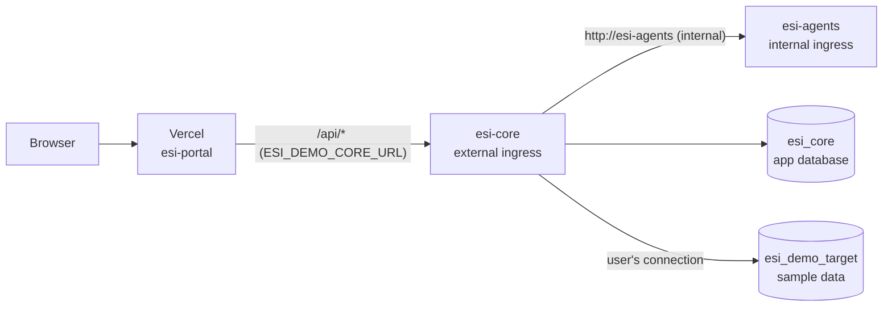

# Azure setup for the demo (step by step)

This guide sets up the Azure half of the demo from [ADR-0005](../../docs/architecture/ADR-0005-hosting-target.md) (Proposed): `esi-core` and `esi-agents` on Azure Container Apps and two Azure SQL free-offer databases. It assumes no Azure experience. Every step uses the free allowances only; the last step deletes everything.



## Before you start: what is ready and what is not

| Part | Status |
|------|--------|
| Parts 1–4 (account, resource group, budget, databases, Container Apps environment) | Can be done now |
| Part 5 (run the apps) | **Blocked** until: (a) CI publishes the `esi-core`, `esi-core-migrator` and `esi-agents` images to GHCR (no images are published yet), and (b) core supports `ESI_CORE_Auth__Mode=Oidc` ([ADR-0006](../../docs/architecture/ADR-0006-authentication-provider.md)). Core must not run here with `LocalAdmin`. |
| Model provider for agents | Not chosen; without it agents answer `model-unavailable` (503), the rest works |

Doing parts 1–4 now costs nothing while the apps do not exist.

## Words you will see

- **Subscription**: the billing container. Free allowances are counted per subscription.
- **Resource group**: a folder for resources. Deleting it deletes everything inside. Ours is `esi-demo`.
- **Region**: the data center. This guide uses `southeastasia` (Singapore), the closest to Vietnam.
- **Logical SQL server**: a name and login endpoint (`<name>.database.windows.net`) that holds databases. It costs nothing by itself.
- **Container Apps environment**: the shared network the apps run in. In consumption-only mode it has no fixed cost.
- **Ingress**: whether an app accepts traffic, and from where (external = internet, internal = only other apps in the environment).

## Part 1: Account and tools

1. **Create an Azure account** at <https://azure.microsoft.com/free>. A credit or debit card is required to verify identity, even for free services. Use a subscription that holds nothing but this demo, because the Container Apps free grant is shared by everything in the subscription.
2. **Install the Azure CLI** (macOS):
   ```bash
   brew install azure-cli
   ```
3. **Sign in** (opens the browser):
   ```bash
   az login
   ```
   If you have more than one subscription, pick the demo one:
   ```bash
   az account list -o table
   az account set --subscription "<subscription name or id>"
   ```
4. **Add the Container Apps CLI extension and register the services** (one time per subscription; registration can take a few minutes):
   ```bash
   az extension add --name containerapp --upgrade
   az provider register --namespace Microsoft.App --wait
   az provider register --namespace Microsoft.Sql --wait
   ```
5. **Set the names once** for this terminal session. The SQL server name must be unique in all of Azure, so add something of your own:
   ```bash
   RG=esi-demo
   LOCATION=southeastasia
   SQL_SERVER=esi-demo-sql-<your-suffix>      # lowercase letters, digits, hyphens
   ACA_ENV=esi-demo-env
   ```
   If you open a new terminal later, set these again.

## Part 2: Resource group and budget alert

1. **Create the resource group**:
   ```bash
   az group create --name "$RG" --location "$LOCATION"
   ```
2. **Budget alert** (free; it only sends email, it never stops anything). In the Azure portal: search "Cost Management" → **Budgets** → **Add**.
   - Scope: the `esi-demo` resource group.
   - Reset period: Monthly. Amount: `1` (USD).
   - Alert condition: Actual, 1 % of budget (that is 0.01 USD), to your email.

   Free usage never appears on the bill, so this email only fires if something is actually charged. Cost data can lag up to about a day.

## Part 3: Azure SQL (free offer)

1. **Create the logical server** with a SQL admin login. Generate a strong password and keep it in your password manager:
   ```bash
   SQL_ADMIN=esiadmin
   SQL_ADMIN_PASSWORD="$(openssl rand -base64 24)"; echo "$SQL_ADMIN_PASSWORD"   # save it now
   az sql server create --name "$SQL_SERVER" --resource-group "$RG" --location "$LOCATION" \
     --admin-user "$SQL_ADMIN" --admin-password "$SQL_ADMIN_PASSWORD"
   ```
2. **Firewall**: let Azure services in (Container Apps has no fixed IP), and your own IP for setup only:
   ```bash
   az sql server firewall-rule create --resource-group "$RG" --server "$SQL_SERVER" \
     --name AllowAzureServices --start-ip-address 0.0.0.0 --end-ip-address 0.0.0.0
   MY_IP=$(curl -s https://api.ipify.org)
   az sql server firewall-rule create --resource-group "$RG" --server "$SQL_SERVER" \
     --name SetupMyIp --start-ip-address "$MY_IP" --end-ip-address "$MY_IP"
   ```
   "Allow Azure services" means any Azure customer's traffic can reach the login page, so strong passwords matter. Remove `SetupMyIp` at the end of this part.
3. **Create the two free databases**. `--use-free-limit` turns on the free offer, `AutoPause` makes the database pause instead of billing when the monthly free amount runs out, and `--auto-pause-delay 15` (minutes, the minimum) pauses it soon after the last connection:
   ```bash
   for DB in esi_core esi_demo_target; do
     az sql db create --resource-group "$RG" --server "$SQL_SERVER" --name "$DB" \
       --edition GeneralPurpose --family Gen5 --capacity 2 --compute-model Serverless \
       --min-capacity 0.5 --auto-pause-delay 15 \
       --use-free-limit --free-limit-exhaustion-behavior AutoPause
   done
   ```
   Check that both show the free offer: in the portal, open each database → **Overview** shows "Free amount remaining". If the second database is refused as "free limit already used" (older CLI help text says one free database per subscription; the current offer allows ten), update the CLI (`brew upgrade azure-cli`) and retry; never create it without `--use-free-limit`.
4. **Create the database users.** Open each database in the portal → **Query editor (preview)** → sign in with `esiadmin` and the password. Generate two more passwords first (`openssl rand -base64 24`) and save them.

   In **esi_core** (core's own login; `db_owner` because the migration job creates tables):
   ```sql
   CREATE USER esi_core_app WITH PASSWORD = '<core app password>';
   ALTER ROLE db_owner ADD MEMBER esi_core_app;
   ```
   In **esi_demo_target** (the read-only login a demo user enters in the portal; `VIEW DEFINITION` lets core read the schema):
   ```sql
   CREATE USER esi_demo_reader WITH PASSWORD = '<demo reader password>';
   ALTER ROLE db_datareader ADD MEMBER esi_demo_reader;
   GRANT VIEW DEFINITION TO esi_demo_reader;
   ```
5. **Load the sample data**: still in the Query editor of **esi_demo_target**, paste the content of [`demo-target.sql`](./demo-target.sql) and run it, removing the `GO` lines first (the Query editor does not understand them; they are for `sqlcmd`). Check: `SELECT COUNT(*) FROM dbo.Orders;` returns 10.
6. **Close the Query editor tab and remove your IP**. An open connection keeps the database awake and uses the free seconds:
   ```bash
   az sql server firewall-rule delete --resource-group "$RG" --server "$SQL_SERVER" --name SetupMyIp
   ```
7. **Write down the connection strings** (keep them in the password manager; they go into Container Apps secrets in part 5). `Connection Timeout=60` gives a paused database time to resume:
   ```text
   esi_core (for core):
   Server=tcp:<SQL_SERVER>.database.windows.net,1433;Database=esi_core;User ID=esi_core_app;Password=<core app password>;Encrypt=True;TrustServerCertificate=False;Connection Timeout=60;

   esi_demo_target (entered by a demo user in the portal, not configured in Azure):
   Server=tcp:<SQL_SERVER>.database.windows.net,1433;Database=esi_demo_target;User ID=esi_demo_reader;Password=<demo reader password>;Encrypt=True;TrustServerCertificate=False;Connection Timeout=60;
   ```

## Part 4: Container Apps environment and master key

1. **Create a consumption-only environment** without a log workspace (no Log Analytics cost; you can still stream logs live, see part 6):
   ```bash
   az containerapp env create --name "$ACA_ENV" --resource-group "$RG" --location "$LOCATION" \
     --environment-mode ConsumptionOnly --logs-destination none
   ```
   If your CLI rejects `--environment-mode`, use `--enable-workload-profiles false` instead (older extension versions).
2. **Generate the connection-secret master key** ([ADR-0003](../../docs/architecture/ADR-0003-connection-secret-key-management.md)): 32 random bytes, base64. Save it in the password manager; losing it makes every stored connection unreadable, and it must never be committed:
   ```bash
   openssl rand -base64 32
   ```

Parts 1–4 are done. Nothing here costs money while no app runs.

## Part 5: Run the apps (after the prerequisites above)

Set the image version you want to run (a published release, never `latest`):
```bash
CORE_VERSION=<x.y.z>
AGENTS_VERSION=<x.y.z>
```

1. **Agents** (internal only; Container Apps maps port 80 to the target port, so core reaches it at `http://esi-agents`):
   ```bash
   az containerapp create --name esi-agents --resource-group "$RG" --environment "$ACA_ENV" \
     --image "ghcr.io/dtnam0899/esi-agents:$AGENTS_VERSION" \
     --ingress internal --target-port 8000 \
     --cpu 0.25 --memory 0.5Gi --min-replicas 0 --max-replicas 1
   ```
   The model API key is added with the model-provider ADR (`--secrets` plus an `ESI_AGENTS_*` variable).
2. **Migration job** (creates or updates core's tables; run it before every core update):
   ```bash
   az containerapp job create --name esi-core-migrate --resource-group "$RG" --environment "$ACA_ENV" \
     --trigger-type Manual --replica-timeout 600 --replica-retry-limit 0 \
     --image "ghcr.io/dtnam0899/esi-core-migrator:$CORE_VERSION" \
     --cpu 0.5 --memory 1Gi \
     --secrets "appdb=<esi_core connection string>" \
     --env-vars "ESI_CORE_AppDb__ConnectionString=secretref:appdb"
   az containerapp job start --name esi-core-migrate --resource-group "$RG"
   az containerapp job execution list --name esi-core-migrate --resource-group "$RG" -o table   # wait for Succeeded
   ```
3. **Core** (external, but every request needs an Auth0 token once ADR-0006 is implemented; the Auth0 values come from your Auth0 tenant):
   ```bash
   az containerapp create --name esi-core --resource-group "$RG" --environment "$ACA_ENV" \
     --image "ghcr.io/dtnam0899/esi-core:$CORE_VERSION" \
     --ingress external --target-port 8080 \
     --cpu 0.5 --memory 1Gi --min-replicas 0 --max-replicas 1 \
     --secrets "appdb=<esi_core connection string>" "master-key-v1=<master key>" \
     --env-vars \
       "ESI_CORE_AppDb__ConnectionString=secretref:appdb" \
       "ESI_CORE_Encryption__ActiveKeyVersion=1" \
       "ESI_CORE_Encryption__MasterKeys__1=secretref:master-key-v1" \
       "ESI_CORE_Auth__Mode=Oidc" \
       "ESI_CORE_Auth__Authority=https://<auth0-tenant-domain>/" \
       "ESI_CORE_Auth__Audience=<auth0 api identifier>" \
       "ESI_CORE_Agents__BaseUrl=http://esi-agents/" \
       "ESI_CORE_Agents__TimeoutSeconds=90" \
       "ESI_CORE_Visualization__MaxRetries=1"
   ```
   The 90 s timeout and one retry keep a slow chat answer under Vercel's 120 s limit (ADR-0005).
4. **Check core** (the first call wakes the database and can take about a minute):
   ```bash
   CORE_URL="https://$(az containerapp show --name esi-core --resource-group "$RG" --query properties.configuration.ingress.fqdn -o tsv)"
   echo "$CORE_URL"
   curl -s --max-time 120 "$CORE_URL/health/ready"
   ```
5. **Connect the portal**: in GitHub → Settings → Secrets and variables → Actions → Variables, set `ESI_DEMO_CORE_URL` to the `CORE_URL` value, then re-run the latest `portal` workflow on `develop` ([infra/vercel](../vercel/README.md)). `/api/health/ready` on the Vercel URL then answers through core.
6. **Try the demo**: sign in on the Vercel URL, accept the consent terms, add a connection with the `esi_demo_target` connection string from part 3, and ask a question about orders.

## Part 6: Everyday use

The demo stays **off** between uses (ADR-0005).

```bash
# demo up: allow traffic, then wake everything (database resume can take about a minute)
az containerapp ingress enable --name esi-core --resource-group "$RG" --type external --target-port 8080 --transport auto
curl -s --max-time 120 "$CORE_URL/health/ready"

# demo down: no traffic can reach core, so core and agents scale to zero; the databases pause after 15 minutes idle
az containerapp ingress disable --name esi-core --resource-group "$RG"
```

Enabling ingress again keeps the same URL, so `ESI_DEMO_CORE_URL` does not change.

Useful checks:
```bash
az containerapp logs show --name esi-core --resource-group "$RG" --follow        # live logs (needs a running replica)
az containerapp replica list --name esi-core --resource-group "$RG" -o table      # empty = scaled to zero, costs nothing
```
Free amounts left: portal → each SQL database → **Overview** ("Free amount remaining"); portal → Cost Management → **Cost analysis** for `esi-demo` (should stay at 0.00).

Updating to a new version later: run the migration job with the new migrator image (`az containerapp job update --image …` then `job start`), then `az containerapp update --name esi-core --resource-group "$RG" --image ghcr.io/dtnam0899/esi-core:<new>`; the same `update --image` for agents.

## Part 7: Delete everything

When the demo period ends:
```bash
az group delete --name "$RG" --yes
```
This removes the apps, the environment, the SQL server and both databases with their data. Also delete `ESI_DEMO_CORE_URL` in GitHub, and keep or destroy the master key and passwords in your password manager.

## Troubleshooting

| Symptom | Likely cause | Fix |
|---------|--------------|-----|
| First request times out, the next one works | database resuming or core starting from zero | normal; run the demo-up `curl` before showing the demo |
| Core does not start, logs say the app database connection string is missing or the master key is invalid | secret or variable name typo | `az containerapp show -n esi-core -g "$RG" --query properties.template.containers[0].env` and compare with part 5 |
| Chat answers 503 `agents-unavailable` | agents not reachable or no model provider yet | check `esi-agents` exists with internal ingress; model provider is still open |
| Database never pauses, free seconds drop fast | an open connection (Query editor tab, SSMS, Azure Data Studio) | close it; core's connections close when core scales to zero |
| Login to the database fails from the Query editor | your IP is not in the firewall | add `SetupMyIp` again (part 3, step 2), remove it afterwards |
