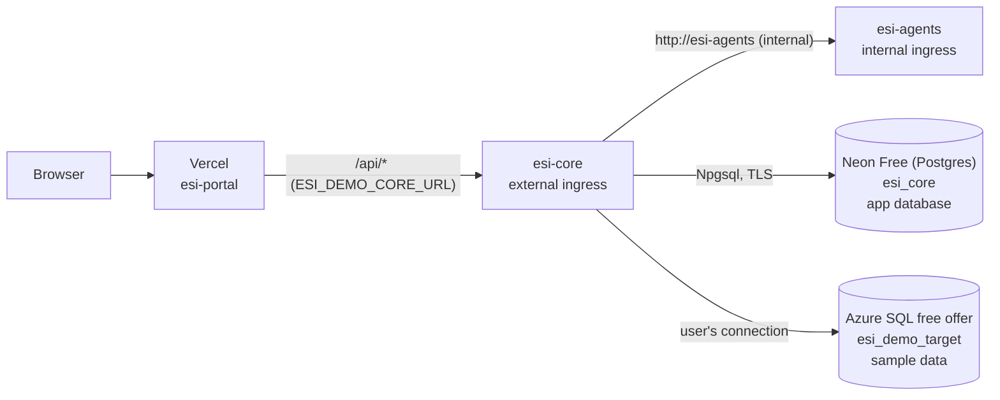

# Azure setup for the demo (step by step)

This guide sets up the Azure half of the demo from [ADR-0005](../../docs/architecture/ADR-0005-hosting-target.md) (Proposed): `esi-core` and `esi-agents` on Azure Container Apps, core's own app database `esi_core` on **Neon Free** (PostgreSQL, [ADR-0008](../../docs/architecture/ADR-0008-app-database-postgresql.md), Proposed), and the sample target database `esi_demo_target` on the Azure SQL free offer (target databases stay SQL Server). It assumes no Azure or Neon experience. Every step uses the free allowances only; the last step deletes everything.



## Before you start: what is ready and what is not

| Part | Status |
|------|--------|
| Parts 1–5 (account, resource group, budget, databases, Container Apps environment) | Can be done now |
| Part 6 (run the apps) | **Blocked** until: (a) CI publishes the `esi-core`, `esi-core-migrator` and `esi-agents` images to GHCR (no images are published yet), (b) core supports `ESI_CORE_Auth__Mode=Oidc` ([ADR-0006](../../docs/architecture/ADR-0006-authentication-provider.md)), and (c) the core release you run has the app database on PostgreSQL (ESI-94); older core versions expect SQL Server for `esi_core`. Core must not run here with `LocalAdmin`. |
| Model provider for agents | Not chosen; without it agents answer `model-unavailable` (503), the rest works |

Doing parts 1–5 now costs nothing while the apps do not exist.

## Words you will see

- **Subscription**: the billing container. Free allowances are counted per subscription.
- **Resource group**: a folder for resources. Deleting it deletes everything inside. Ours is `esi-demo`.
- **Region**: the data center. This guide uses `southeastasia` (Singapore), the closest to Vietnam.
- **Logical SQL server**: a name and login endpoint (`<name>.database.windows.net`) that holds databases. It costs nothing by itself.
- **Neon project**: a free managed PostgreSQL service outside Azure. A project has a **branch** (`main`) with a **compute** (the running Postgres) that suspends when idle; databases and **roles** (logins) live on the branch.
- **Container Apps environment**: the shared network the apps run in. In consumption-only mode it has no fixed cost.
- **Ingress**: whether an app accepts traffic, and from where (external = internet, internal = only other apps in the environment).

## Part 1: Account and tools

1. **Create an Azure account** at <https://azure.microsoft.com/free>. A credit or debit card is required to verify identity, even for free services. Use a subscription that holds nothing but this demo, because the Container Apps free grant is shared by everything in the subscription.
2. **Install the Azure CLI** (macOS):
   ```bash
   brew install azure-cli
   ```
3. **Sign in** (opens the browser):
   ```bash
   az login
   ```
   If you have more than one subscription, pick the demo one:
   ```bash
   az account list -o table
   az account set --subscription "<subscription name or id>"
   ```
4. **Add the Container Apps CLI extension and register the services** (one time per subscription; registration can take a few minutes):
   ```bash
   az extension add --name containerapp --upgrade
   az provider register --namespace Microsoft.App --wait
   az provider register --namespace Microsoft.Sql --wait
   ```
5. **Set the names once** for this terminal session. The SQL server name must be unique in all of Azure, so add something of your own:
   ```bash
   RG=esi-demo
   LOCATION=southeastasia
   SQL_SERVER=esi-demo-sql-<your-suffix>      # lowercase letters, digits, hyphens
   ACA_ENV=esi-demo-env
   ```
   If you open a new terminal later, set these again.

## Part 2: Resource group and budget alert

1. **Create the resource group**:
   ```bash
   az group create --name "$RG" --location "$LOCATION"
   ```
2. **Budget alert** (free; it only sends email, it never stops anything). In the Azure portal: search "Cost Management" → **Budgets** → **Add**.
   - Scope: the `esi-demo` resource group.
   - Reset period: Monthly. Amount: `1` (USD).
   - Alert condition: Actual, 1 % of budget (that is 0.01 USD), to your email.

   Free usage never appears on the bill, so this email only fires if something is actually charged. Cost data can lag up to about a day.

## Part 3: App database on Neon (free, PostgreSQL)

Core's own data (users, connections, consent, chat, saved SQL, artifacts, dashboards) lives in `esi_core` on Neon Free ([ADR-0008](../../docs/architecture/ADR-0008-app-database-postgresql.md)). Neon Free has no time limit and needs no credit card. Free limits (checked on 2026-10-20 on [neon.com/pricing](https://neon.com/pricing) and the [Free plan limits](https://neon.com/faqs/free-plan-limits-and-quotas)):

| Limit | Neon Free | What happens at the limit |
|-------|-----------|---------------------------|
| Compute | 100 CU-hours per project and month (about 400 hours at 0.25 CU) | compute suspended until next month; never billed |
| Storage | 1 GB per project | writes that grow storage fail |
| Public network transfer | 5 GB per project and month | compute suspended until next month |
| Scale to zero | after 5 minutes idle, cannot be turned off | the next connection wakes it (a few seconds) |
| Restore history | 6 hours | older changes cannot be restored |

1. **Create a Neon account** at <https://neon.com> (sign up with email or GitHub; choose the **Free** plan).
2. **Create the project**: Neon Console → **New project**.
   - Project name: `esi-demo`.
   - Postgres version: **17** (the same major version as core's local `postgres:17.10-alpine` compose service).
   - Cloud and region: **AWS Asia Pacific (Singapore)** (`aws-ap-southeast-1`), next to `southeastasia`.
   - Leave the default database (`neondb`) and its owner role; core does not use them.
3. **Keep the compute small**: project → **Branches** → `main` → compute → **Edit** → set both minimum and maximum size to **0.25 CU**. A fixed 0.25 CU makes the 100 CU-hours last about 400 hours a month; autoscaling up to 2 CU would use them up to 8 times faster. Scale to zero stays at 5 minutes (fixed on Free).
4. **Create core's own role**: project → **Roles** (branch `main`) → **New role** → name `esi_core_app`. Neon generates the password and shows it once: save it in your password manager now. Core never uses the default owner role.
5. **Create the database owned by that role**: project → **Databases** → **New database** → name `esi_core`, owner `esi_core_app`. As the database owner, `esi_core_app` can create tables in the `public` schema, which the migration job needs; it has no rights on `neondb`.
6. **Write down the connection string**: project dashboard → **Connect** → branch `main`, database `esi_core`, role `esi_core_app`, and turn **Connection pooling off** (the direct host, without `-pooler`). Neon recommends the direct host for schema migrations, and core keeps its own small pool with one replica, so both use it. Build the Npgsql connection string from the shown host and keep it in the password manager; it becomes the Container Apps secret for `ESI_CORE_AppDb__ConnectionString` in part 6:
   ```text
   esi_core (for core and the migration job):
   Host=<ep-…>.ap-southeast-1.aws.neon.tech;Port=5432;Database=esi_core;Username=esi_core_app;Password=<core app password>;SSL Mode=Require;
   ```
   `SSL Mode=Require` encrypts the connection (Neon refuses unencrypted connections; ADR-0008). Neon's own .NET example uses `SSL Mode=VerifyFull;Channel Binding=Require`, which also checks the server certificate and works too.

Neon's endpoint is reachable from the internet, so the generated password is the main protection: never reuse it and never commit it. Close the Neon **SQL Editor** tab when you are done; an open session keeps the compute awake and uses CU-hours.

## Part 4: Target database on Azure SQL (free offer)

Only the demo's sample target database lives on Azure SQL: users' target databases are SQL Server (ADR-0004), and the Azure SQL free offer has no time limit.

1. **Create the logical server** with a SQL admin login. Generate a strong password and keep it in your password manager:
   ```bash
   SQL_ADMIN=esiadmin
   SQL_ADMIN_PASSWORD="$(openssl rand -base64 24)"; echo "$SQL_ADMIN_PASSWORD"   # save it now
   az sql server create --name "$SQL_SERVER" --resource-group "$RG" --location "$LOCATION" \
     --admin-user "$SQL_ADMIN" --admin-password "$SQL_ADMIN_PASSWORD"
   ```
2. **Firewall**: let Azure services in (Container Apps has no fixed IP), and your own IP for setup only:
   ```bash
   az sql server firewall-rule create --resource-group "$RG" --server "$SQL_SERVER" \
     --name AllowAzureServices --start-ip-address 0.0.0.0 --end-ip-address 0.0.0.0
   MY_IP=$(curl -s https://api.ipify.org)
   az sql server firewall-rule create --resource-group "$RG" --server "$SQL_SERVER" \
     --name SetupMyIp --start-ip-address "$MY_IP" --end-ip-address "$MY_IP"
   ```
   "Allow Azure services" means any Azure customer's traffic can reach the login page, so strong passwords matter. Remove `SetupMyIp` at the end of this part.
3. **Create the free database**. `--use-free-limit` turns on the free offer, `AutoPause` makes the database pause instead of billing when the monthly free amount runs out, and `--auto-pause-delay 15` (minutes, the minimum) pauses it soon after the last connection:
   ```bash
   az sql db create --resource-group "$RG" --server "$SQL_SERVER" --name esi_demo_target \
     --edition GeneralPurpose --family Gen5 --capacity 2 --compute-model Serverless \
     --min-capacity 0.5 --auto-pause-delay 15 \
     --use-free-limit --free-limit-exhaustion-behavior AutoPause
   ```
   Check that it shows the free offer: in the portal, open the database → **Overview** shows "Free amount remaining". If it is refused as "free limit already used", update the CLI (`brew upgrade azure-cli`) and retry; never create it without `--use-free-limit`.
4. **Create the database user.** Open the database in the portal → **Query editor (preview)** → sign in with `esiadmin` and the password. Generate one more password first (`openssl rand -base64 24`) and save it.

   In **esi_demo_target** (the read-only login a demo user enters in the portal; `VIEW DEFINITION` lets core read the schema):
   ```sql
   CREATE USER esi_demo_reader WITH PASSWORD = '<demo reader password>';
   ALTER ROLE db_datareader ADD MEMBER esi_demo_reader;
   GRANT VIEW DEFINITION TO esi_demo_reader;
   ```
5. **Load the sample data**: still in the Query editor of **esi_demo_target**, paste the content of [`demo-target.sql`](./demo-target.sql) and run it, removing the `GO` lines first (the Query editor does not understand them; they are for `sqlcmd`). Check: `SELECT COUNT(*) FROM dbo.Orders;` returns 10.
6. **Close the Query editor tab and remove your IP**. An open connection keeps the database awake and uses the free seconds:
   ```bash
   az sql server firewall-rule delete --resource-group "$RG" --server "$SQL_SERVER" --name SetupMyIp
   ```
7. **Write down the connection string** (keep it in the password manager; a demo user enters it in the portal in part 6). `Connection Timeout=60` gives a paused database time to resume:
   ```text
   esi_demo_target (entered by a demo user in the portal, not configured in Azure):
   Server=tcp:<SQL_SERVER>.database.windows.net,1433;Database=esi_demo_target;User ID=esi_demo_reader;Password=<demo reader password>;Encrypt=True;TrustServerCertificate=False;Connection Timeout=60;
   ```

## Part 5: Container Apps environment and master key

1. **Create a consumption-only environment** without a log workspace (no Log Analytics cost; you can still stream logs live, see part 7):
   ```bash
   az containerapp env create --name "$ACA_ENV" --resource-group "$RG" --location "$LOCATION" \
     --environment-mode ConsumptionOnly --logs-destination none
   ```
   If your CLI rejects `--environment-mode`, use `--enable-workload-profiles false` instead (older extension versions).
2. **Generate the connection-secret master key** ([ADR-0003](../../docs/architecture/ADR-0003-connection-secret-key-management.md)): 32 random bytes, base64. Save it in the password manager; losing it makes every stored connection unreadable, and it must never be committed:
   ```bash
   openssl rand -base64 32
   ```

Parts 1–5 are done. Nothing here costs money while no app runs.

## Part 6: Run the apps (after the prerequisites above)

Set the image version you want to run (a published release, never `latest`):
```bash
CORE_VERSION=<x.y.z>
AGENTS_VERSION=<x.y.z>
```

1. **Agents** (internal only; Container Apps maps port 80 to the target port, so core reaches it at `http://esi-agents`):
   ```bash
   az containerapp create --name esi-agents --resource-group "$RG" --environment "$ACA_ENV" \
     --image "ghcr.io/dtnam0899/esi-agents:$AGENTS_VERSION" \
     --ingress internal --target-port 8000 \
     --cpu 0.25 --memory 0.5Gi --min-replicas 0 --max-replicas 1
   ```
   The model API key is added with the model-provider ADR (`--secrets` plus an `ESI_AGENTS_*` variable).
2. **Migration job** (creates or updates core's tables in `esi_core` on Neon; run it before every core update). The `appdb` secret is the Neon connection string from part 3, step 6:
   ```bash
   az containerapp job create --name esi-core-migrate --resource-group "$RG" --environment "$ACA_ENV" \
     --trigger-type Manual --replica-timeout 600 --replica-retry-limit 0 \
     --image "ghcr.io/dtnam0899/esi-core-migrator:$CORE_VERSION" \
     --cpu 0.5 --memory 1Gi \
     --secrets "appdb=<esi_core Neon connection string>" \
     --env-vars "ESI_CORE_AppDb__ConnectionString=secretref:appdb"
   az containerapp job start --name esi-core-migrate --resource-group "$RG"
   az containerapp job execution list --name esi-core-migrate --resource-group "$RG" -o table   # wait for Succeeded
   ```
3. **Core** (external, but every request needs an Auth0 token once ADR-0006 is implemented; the Auth0 values come from your Auth0 tenant):
   ```bash
   az containerapp create --name esi-core --resource-group "$RG" --environment "$ACA_ENV" \
     --image "ghcr.io/dtnam0899/esi-core:$CORE_VERSION" \
     --ingress external --target-port 8080 \
     --cpu 0.5 --memory 1Gi --min-replicas 0 --max-replicas 1 \
     --secrets "appdb=<esi_core Neon connection string>" "master-key-v1=<master key>" \
     --env-vars \
       "ESI_CORE_AppDb__ConnectionString=secretref:appdb" \
       "ESI_CORE_Encryption__ActiveKeyVersion=1" \
       "ESI_CORE_Encryption__MasterKeys__1=secretref:master-key-v1" \
       "ESI_CORE_Auth__Mode=Oidc" \
       "ESI_CORE_Auth__Authority=https://<auth0-tenant-domain>/" \
       "ESI_CORE_Auth__Audience=<auth0 api identifier>" \
       "ESI_CORE_Agents__BaseUrl=http://esi-agents/" \
       "ESI_CORE_Agents__TimeoutSeconds=90" \
       "ESI_CORE_Visualization__MaxRetries=1"
   ```
   `appdb` is the same Neon connection string as in the migration job. The 90 s timeout and one retry keep a slow chat answer under Vercel's 120 s limit (ADR-0005).
4. **Check core** (`/health/ready` also checks the app database on Neon; the first call starts core from zero and can take up to a minute):
   ```bash
   CORE_URL="https://$(az containerapp show --name esi-core --resource-group "$RG" --query properties.configuration.ingress.fqdn -o tsv)"
   echo "$CORE_URL"
   curl -s --max-time 120 "$CORE_URL/health/ready"
   ```
5. **Connect the portal**: in GitHub → Settings → Secrets and variables → Actions → Variables, set `ESI_DEMO_CORE_URL` to the `CORE_URL` value, then re-run the latest `portal` workflow on `develop` ([infra/vercel](../vercel/README.md)). `/api/health/ready` on the Vercel URL then answers through core.
6. **Try the demo**: sign in on the Vercel URL, accept the consent terms, add a connection with the `esi_demo_target` connection string from part 4, and ask a question about orders.

## Part 7: Everyday use

The demo stays **off** between uses (ADR-0005).

```bash
# demo up: allow traffic, then wake everything (core starts from zero, Neon wakes in a few seconds; Azure SQL resumes on the first demo query, up to a minute)
az containerapp ingress enable --name esi-core --resource-group "$RG" --type external --target-port 8080 --transport auto
curl -s --max-time 120 "$CORE_URL/health/ready"

# demo down: no traffic can reach core, so core and agents scale to zero; Neon suspends 5 minutes and Azure SQL 15 minutes after the last connection
az containerapp ingress disable --name esi-core --resource-group "$RG"
```

Enabling ingress again keeps the same URL, so `ESI_DEMO_CORE_URL` does not change.

Useful checks:
```bash
az containerapp logs show --name esi-core --resource-group "$RG" --follow        # live logs (needs a running replica)
az containerapp replica list --name esi-core --resource-group "$RG" -o table      # empty = scaled to zero, costs nothing
```
Free amounts left: Neon Console → project `esi-demo` → **Usage** (CU-hours, storage and network transfer this month); portal → `esi_demo_target` → **Overview** ("Free amount remaining"); portal → Cost Management → **Cost analysis** for `esi-demo` (should stay at 0.00). Neon is not on the Azure bill and never bills on Free: at a monthly limit it suspends the compute until next month, and core's `/health/ready` then fails.

Updating to a new version later: run the migration job with the new migrator image (`az containerapp job update --image …` then `job start`), then `az containerapp update --name esi-core --resource-group "$RG" --image ghcr.io/dtnam0899/esi-core:<new>`; the same `update --image` for agents.

## Part 8: Delete everything

When the demo period ends:
```bash
az group delete --name "$RG" --yes
```
This removes the apps, the environment, the SQL server and `esi_demo_target` with its data. Then delete the Neon project: Neon Console → project `esi-demo` → **Settings** → **Delete project** (this deletes `esi_core` with all users' data). Also delete `ESI_DEMO_CORE_URL` in GitHub, and keep or destroy the master key and passwords in your password manager.

## Troubleshooting

| Symptom | Likely cause | Fix |
|---------|--------------|-----|
| First request times out, the next one works | core starting from zero, or Azure SQL resuming | normal; run the demo-up `curl` before showing the demo |
| Core does not start, logs say the app database connection string is missing or the master key is invalid | secret or variable name typo | `az containerapp show -n esi-core -g "$RG" --query properties.template.containers[0].env` and compare with part 6 |
| Chat answers 503 `agents-unavailable` | agents not reachable or no model provider yet | check `esi-agents` exists with internal ingress; model provider is still open |
| Database never pauses, free seconds or CU-hours drop fast | an open connection (Query editor or Neon SQL Editor tab, SSMS, Azure Data Studio, psql) | close it; core's connections close when core scales to zero |
| Login to the database fails from the Query editor | your IP is not in the firewall | add `SetupMyIp` again (part 4, step 2), remove it afterwards |
| Migration job or `/health/ready` fails with a Postgres connection error | wrong Neon host or password, a `-pooler` host, or `SSL Mode=Require` missing | compare the `appdb` secret with part 3, step 6; fix it with `az containerapp secret set` (and `az containerapp job secret set` for the job), then restart |
| `/health/ready` fails mid-month although nothing changed | Neon Free CU-hours or network transfer used up; compute suspended until next month | check Neon **Usage**; keep the compute at 0.25 CU and close idle sessions |
