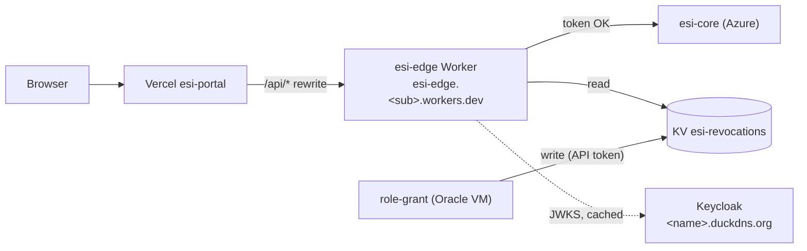

# Cloudflare setup for the edge Worker (step by step)

This guide sets up the Cloudflare side of [ADR-0012](../../docs/architecture/ADR-0012-idp-hosting-and-edge.md) (Proposed): the `esi-edge` Worker that checks tokens in front of core, the Workers KV namespace that holds revoked users, and the API tokens CI and Role Grant Service need. Everything uses the Workers **Free** plan and needs no domain. The order across all guides is in [docs/onboarding/idp-setup.md](../../docs/onboarding/idp-setup.md).



## Before you start: what is ready and what is not

| Part | Status |
|------|--------|
| Parts 1-4 (account, workers.dev subdomain, API tokens, KV namespace) | Can be done now |
| Part 5 (GitHub secrets) | Can be done now; used once the `edge` deploy workflow exists (ESI-144) |
| Part 6 (point the portal at the Worker) | **Blocked** until the Worker verifies tokens (ESI-147) and core and portal use Keycloak (ESI-148, ESI-149); done in ESI-150 |

Free plan limits checked on 2026-10-24: 100,000 requests a day, 10 ms CPU per request, 128 MB memory ([Cloudflare pricing](https://developers.cloudflare.com/workers/platform/pricing/), [limits](https://github.com/cloudflare/cloudflare-docs/blob/production/src/content/docs/workers/platform/limits.mdx)). The daily quota resets at 00:00 UTC; above it, requests fail until the reset.

## Words you will see

- **Account ID**: identifies your Cloudflare account; not a secret, but CI needs it.
- **workers.dev subdomain**: your free hostname for Workers, `<sub>.workers.dev`; each Worker is `<worker>.<sub>.workers.dev`.
- **KV namespace**: a small key-value store that Workers read fast; writes take about a minute to reach every location.
- **API token**: a scoped secret for CI or a service. Never use the Global API Key.
- **wrangler**: Cloudflare's CLI for Workers; it is a dev dependency of `services/edge-gateway`, run with `npx`.

## Part 1: Account

1. Sign up at <https://dash.cloudflare.com/sign-up> (free, no card needed for the Workers Free plan).
2. Turn on two-factor authentication: **My Profile > Authentication**.
3. Copy the **Account ID**: **Workers & Pages > Overview**, right-hand column. Keep it for Part 5.

## Part 2: workers.dev subdomain

1. **Workers & Pages > Overview > Your subdomain > Change**, choose a name, for example `esi-demo` -> `esi-demo.workers.dev`.
2. The Worker will be `https://esi-edge.esi-demo.workers.dev` after its first deploy. Nothing else is needed here: no zone, no DNS.

## Part 3: wrangler login on your laptop (only for manual checks)

```bash
cd services/edge-gateway      # exists after ESI-144
npm ci
npx wrangler login            # opens the browser
npx wrangler whoami           # shows the account
```

## Part 4: API tokens and the KV namespace

1. **Deploy token for CI**: **My Profile > API Tokens > Create Token > Edit Cloudflare Workers** template. Account resources: your account only; zone resources: none needed. Create, copy once. This is `CLOUDFLARE_API_TOKEN` in Part 5.
2. **KV namespace for revocations** (from `services/edge-gateway`):
   ```bash
   npx wrangler kv namespace create esi-revocations
   ```
   Copy the printed `id`; ESI-158 puts it into the Worker's `wrangler.toml` as the binding `REVOCATIONS`. Namespace ids are not secrets.
3. **KV write token for Role Grant Service**: **Create Token > Create Custom Token**, name `esi-role-grant-kv`, permission **Account > Workers KV Storage > Edit**, account: yours. Copy once and put it on the Oracle VM as `ESI_GRANTS_CLOUDFLARE_API_TOKEN` in `~/esi-idp/.env` ([infra/oracle](../oracle/README.md) Part 6). Role Grant Service also needs the Account ID and the namespace id (variable names `TBD` in ESI-143/ESI-157).
4. Write down where each token lives; rotate a token by creating a new one, updating its place, then deleting the old one.

## Part 5: GitHub environment secrets for the deploy workflow

1. GitHub repository **Settings > Environments > New environment** `edge-demo` (the name the ESI-144 workflow uses; adjust if it differs).
2. Add secrets `CLOUDFLARE_API_TOKEN` (Part 4 step 1) and `CLOUDFLARE_ACCOUNT_ID` (Part 1 step 3).
3. Worker settings that are not secrets (the core origin URL, the Keycloak issuer `https://<name>.duckdns.org/realms/esi`, audience `esi-core`) live in `wrangler.toml` `[vars]` or as GitHub variables, as ESI-144 and ESI-147 define them. Nothing secret goes into `wrangler.toml`.

## Part 6: Put the Worker in front of core (ESI-150)

1. Check the Worker answers: `curl -i https://esi-edge.esi-demo.workers.dev/health` (route defined in ESI-147).
2. Check a call without a token is stopped at the edge: `curl -i https://esi-edge.esi-demo.workers.dev/connections` -> `401` problem+json.
3. Change the GitHub variable `ESI_DEMO_CORE_URL` (used by `infra/vercel/build-output.sh`) from the core URL to the Worker URL, and move the core URL into the Worker's origin setting. Redeploy the portal.
4. Sign in on the portal; requests to `/api/*` now pass the Worker. In the Cloudflare dashboard, **Workers & Pages > esi-edge > Metrics** shows the requests.

## Checking usage

**Workers & Pages > esi-edge > Metrics** shows requests and CPU time; the account overview shows today's total against 100,000. If the demo gets close to the limit, the Worker returns errors until 00:00 UTC.

## Teardown

```bash
npx wrangler delete esi-edge
npx wrangler kv namespace delete --namespace-id <id>
```
Delete both API tokens under **My Profile > API Tokens**, and restore `ESI_DEMO_CORE_URL` to the core URL if the demo continues without the edge.
