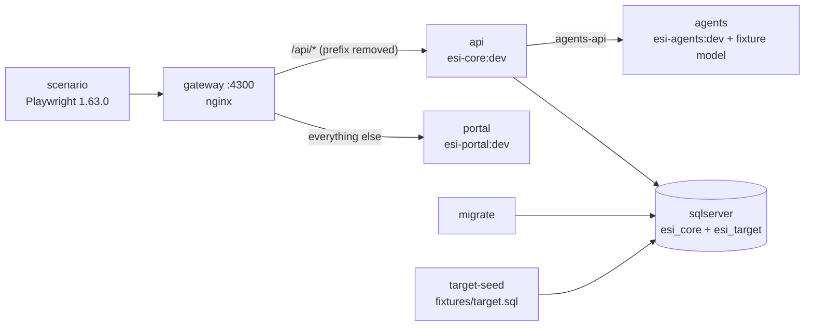

# End-to-end scenario (phase 5)

The phase 5 exit gate of the [build plan](../../docs/plan/README.md): one scripted scenario from connection to dashboard, through the real portal, core, agents and SQL Server. This folder only wires already-built images (root `CLAUDE.md`, rule 3); it never builds from project sources.

## What runs



| Piece | Why |
|-------|-----|
| `gateway/nginx.conf` | The portal image serves only static files and core has no CORS, so the browser needs one origin with `/api` routed to core (the same rewrite as the portal's dev `proxy.conf.json`). A deployment needs the same routing. |
| `agents/fixture_model.py`, `agents/model-fixtures.json` | No model provider is chosen yet (ADR-0001). The launcher starts the real agents app (`create_app`) with a model that answers from fixture rules, so prompts, SQL policy, schema grounding, DSL validation and retries are real; only the model text is scripted. One rule (`sql-refuse-delete`) answers with a `DELETE` on purpose: the agent must reject it. |
| `fixtures/target.sql` | The user's database, owned here (test data policy): 25 customers in 5 countries, customer *n* has revenue 10·*n* + 25, total 3875, a read-only login `e2e_reader` (`db_datareader`) and one procedure whose definition is schema context only. Recreated on every run. |
| `scenario/` | The Playwright project and its image. |

## The scenario

`scenario/tests/connection-to-dashboard.spec.ts`, one serial test with these steps:

1. Accept the consent terms; add a connection with the read-only login (the read-only notice is shown).
2. Test the connection; the API never returns the connection string.
3. Ask "Show revenue by customer"; review the generated SELECT (nothing runs yet); run it; page 1 shows rows 1–20 with 5 more, page 2 shows rows 21–25.
4. Visualize as a table (preview bound to the current page) and save it.
5. Ask for the total revenue, run it, visualize as a KPI (3,875) and save it.
6. "Delete all customers": no runnable SQL comes back; a direct `DELETE` to the executions API is 422 `sql-rejected`; the customers are still there.
7. Create a dashboard and add both saved visualizations; each item loads live data.
8. Move the KPI with the keyboard; "Layout saved"; after a reload the layout and data are back.
9. The dashboard API returns two items and no row values or secrets.

## Run it

Build the four images first, each from its own project directory with its documented command (needs `NODE_AUTH_TOKEN` for the portal, see `docs/process/github-setup.md`):

```bash
export NODE_AUTH_TOKEN=$(gh auth token)
(cd services/core-backend && docker build --target runtime -t esi-core:dev . && docker build --target migrator -t esi-core-migrator:dev .)
(cd services/ai-agents && docker build --target runtime -t esi-agents:dev .)
(cd web/esi-portal && docker build --secret id=npm_token,env=NODE_AUTH_TOKEN --target runtime -t esi-portal:dev .)
```

Then, from this folder:

```bash
./run.sh
```

It removes any previous stack, starts a fresh one, runs the scenario and removes the stack again; the exit code is the scenario's. `ESI_E2E_KEEP=1 ./run.sh` leaves the stack up (portal on http://localhost:4300). Results go to `results/` (git-ignored): `report/` (HTML), `dashboard.png`, and on failure the trace, video and `services.log`.

Other images: `ESI_E2E_CORE_IMAGE`, `ESI_E2E_CORE_MIGRATOR_IMAGE`, `ESI_E2E_AGENTS_IMAGE`, `ESI_E2E_PORTAL_IMAGE`. Port: `ESI_E2E_PORT`.

Resources: SQL Server is amd64 only and needs about 2 GB; on Apple silicon enable Rosetta in Docker Desktop and give the VM 4 GB or more. Stop other SQL Server containers first (for example core's own compose stack) or the VM runs out of memory.

## Known gaps found by the scenario

- Query result cells lose the decimal scale in the portal: core returns `275.00`, the table shows `275` (JSON numbers parsed in the browser). The DSL views are not affected because they format with `formatNumber`.
- `web/esi-portal/compose.yaml` defaults `ESI_PORTAL_API_BASE_URL` to `/api`, which only works behind a gateway like the one here; on its own the container has no `/api`.
- Real model quality is not tested: evals against a real provider come with the provider ADR.
