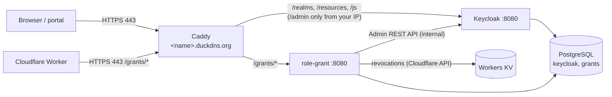

# Oracle Cloud setup for the IdP stack (step by step)

This guide sets up the IdP half of the demo from [ADR-0012](../../docs/architecture/ADR-0012-idp-hosting-and-edge.md) (Proposed): one Oracle Cloud **Always Free** ARM VM that runs Keycloak, Role Grant Service and PostgreSQL with `docker compose`, published under a free **DuckDNS** hostname behind **Caddy** with a Let's Encrypt certificate (UR-140 Decision 10). It assumes no Oracle experience. The order across all guides is in [docs/onboarding/idp-setup.md](../../docs/onboarding/idp-setup.md).



## Before you start: what is ready and what is not

| Part | Status |
|------|--------|
| Parts 1-5 (account, network, VM, Docker, DuckDNS, Caddy test page) | Can be done now |
| Part 6 (run the IdP stack) | **Blocked** until CI publishes `ghcr.io/dtnam0899/esi-idp` (ESI-142) and `ghcr.io/dtnam0899/esi-role-grant` (ESI-143) for arm64. The final `compose.yaml` arrives with ESI-145; the one below is the template it follows |
| Part 7 (backup) | Can be prepared now; runs once Part 6 is up |

Facts checked on 2026-10-24 (third-party reports, confirm on Oracle's pages): the Always Free Ampere A1 allowance is 1,500 OCPU-hours and 9,000 GB-hours a month, which is about **2 OCPU and 12 GB RAM** running all month; it was halved in 2026 without notice, and instances above it can be stopped or terminated ([InfoQ](https://www.infoq.com/news/2026/07/oracle-cloud-free-tier-limits/)). Block storage: 200 GB in total, boot volume 50 GB by default.

## Words you will see

- **Tenancy**: your Oracle account. **Compartment**: a folder for resources (ours: `esi-idp`).
- **Home region**: chosen at sign-up, cannot change; Always Free compute runs only there.
- **VCN**: your private network in Oracle. **Security list**: its firewall.
- **Shape**: VM size. `VM.Standard.A1.Flex` is the ARM shape of Always Free.
- **DuckDNS**: free service that gives you `<name>.duckdns.org` pointing at your IP.
- **Caddy**: a web server that gets and renews HTTPS certificates by itself.

## Part 1: Account

1. Sign up at <https://www.oracle.com/cloud/free/>. A card is needed to verify identity. Pick a **home region** close to Vietnam with A1 capacity (for example Singapore `ap-singapore-1`); you cannot change it later.
2. Stay on the **Always Free** account type. Do not upgrade to Pay As You Go unless you accept possible charges.
3. In the console, open **Identity & Security > Compartments > Create compartment**, name `esi-idp`. Create everything below inside it.
4. Optional but recommended: **Billing > Budgets > Create budget** for the compartment, amount 1 (your currency), alert at 1% actual spend, to your email.

## Part 2: Network

1. **Networking > Virtual cloud networks > Start VCN Wizard > Create VCN with Internet Connectivity**. Name `esi-idp-vcn`, compartment `esi-idp`, defaults for the CIDR blocks. Create.
2. Open the VCN > **Security Lists > Default Security List** > **Add Ingress Rules**:
   - Source `0.0.0.0/0`, TCP, destination port `443` (HTTPS).
   - Edit the existing SSH rule (port `22`): change source from `0.0.0.0/0` to **your own public IP** `/32` (find it at <https://ifconfig.me>).
3. Do **not** open port 80 or 8080. Caddy gets certificates over port 443 (TLS-ALPN challenge).

## Part 3: The VM

1. **Compute > Instances > Create instance**, name `esi-idp-vm`, compartment `esi-idp`.
2. **Image**: Canonical Ubuntu 24.04 (the `aarch64` build is selected automatically for ARM).
3. **Shape**: Change shape > Ampere > `VM.Standard.A1.Flex`, **2 OCPU, 12 GB** (or less; never more than the current allowance).
4. **Networking**: `esi-idp-vcn`, public subnet, **Assign a public IPv4 address**: yes.
5. **SSH keys**: upload your public key (`~/.ssh/id_ed25519.pub`; create one with `ssh-keygen -t ed25519` if needed).
6. **Boot volume**: default 50 GB. Create.
7. "Out of capacity" is common for A1. Retry later, or try another availability domain in the same region.
8. Copy the **public IP** from the instance page and connect:
   ```bash
   ssh ubuntu@<public-ip>
   ```
9. Ubuntu images on Oracle ship their own iptables rules that block everything but SSH. Open 443 on the VM too:
   ```bash
   sudo iptables -I INPUT 6 -m state --state NEW -p tcp --dport 443 -j ACCEPT
   sudo netfilter-persistent save
   ```
10. Updates and time zone:
    ```bash
    sudo apt update && sudo apt -y upgrade
    sudo timedatectl set-timezone Asia/Ho_Chi_Minh
    sudo reboot
    ```

Note: Oracle may reclaim Always Free instances that stay almost idle for days (policy for free accounts; check the current wording in Oracle's Always Free docs). Keycloak with real use keeps the VM active; the backup in Part 7 covers a reclaim.

## Part 4: Docker

1. Install Docker Engine and the compose plugin from Docker's official script, then let `ubuntu` use it without sudo:
   ```bash
   curl -fsSL https://get.docker.com | sudo sh
   sudo usermod -aG docker ubuntu
   exit   # log in again so the group applies
   ```
2. Check:
   ```bash
   ssh ubuntu@<public-ip>
   docker version && docker compose version
   ```
3. Create the working folder (outside any git checkout; nothing here is committed):
   ```bash
   mkdir -p ~/esi-idp && cd ~/esi-idp
   ```

## Part 5: DuckDNS hostname and Caddy test page

1. Sign in at <https://www.duckdns.org> (GitHub or Google login). Add a subdomain, for example `esi-auth` -> `esi-auth.duckdns.org`. Set its **current ip** to the VM's public IP and click **update ip**. The VM's public IP stays the same while the instance exists, so no updater job is needed. Keep the DuckDNS token private.
2. Check DNS from your laptop:
   ```bash
   dig +short esi-auth.duckdns.org   # must print the VM's public IP
   ```
3. On the VM, create `~/esi-idp/.env` (secrets live only here; `chmod 600`):
   ```bash
   cat > .env <<'EOF'
   ESI_IDP_HOST=esi-auth.duckdns.org
   ESI_ADMIN_IP=<your public IP>
   EOF
   chmod 600 .env
   ```
4. Test Caddy alone with a placeholder page. Create `Caddyfile`:
   ```caddyfile
   {$ESI_IDP_HOST} {
     respond "esi-idp: TLS works" 200
   }
   ```
   and run the official image (pin the exact version you use; check <https://hub.docker.com/_/caddy> for the current tag):
   ```bash
   docker run --rm -d --name caddy-test --env-file .env -p 443:443 \
     -v "$PWD/Caddyfile:/etc/caddy/Caddyfile:ro" -v caddy_data:/data caddy:2
   ```
5. From your laptop: `curl https://esi-auth.duckdns.org` prints `esi-idp: TLS works`. If not, read `docker logs caddy-test`: a certificate error usually means DNS is not pointing at the VM yet or port 443 is closed (Part 2 step 2, Part 3 step 9).
6. Stop the test: `docker stop caddy-test`. Keep the `caddy_data` volume (it holds the certificate).

## Part 6: Run the IdP stack (blocked until the images exist)

1. Add the secrets to `~/esi-idp/.env` (generate each password with `openssl rand -base64 24`):
   ```bash
   POSTGRES_PASSWORD=...
   KC_DB_PASSWORD=...
   GRANTS_DB_PASSWORD=...
   KC_BOOTSTRAP_ADMIN_USERNAME=bootstrap-admin
   KC_BOOTSTRAP_ADMIN_PASSWORD=...
   ESI_IDP_VERSION=<idp release, e.g. 0.1.0>
   ESI_GRANTS_VERSION=<role-grant release>
   # filled after docs/onboarding/idp-setup.md part 4 and infra/cloudflare part 4:
   ESI_GRANTS_KEYCLOAK_CLIENT_SECRET=
   ESI_GRANTS_CLOUDFLARE_API_TOKEN=
   ```
2. `init-db.sql` creates one database and user per service:
   ```sql
   \set kc_pw `echo "$KC_DB_PASSWORD"`
   \set gr_pw `echo "$GRANTS_DB_PASSWORD"`
   CREATE USER keycloak PASSWORD :'kc_pw';
   CREATE DATABASE keycloak OWNER keycloak;
   CREATE USER grants PASSWORD :'gr_pw';
   CREATE DATABASE grants OWNER grants;
   ```
3. `Caddyfile` for the real stack (the Keycloak admin console only from your IP; the management port 9000 is never published):
   ```caddyfile
   {$ESI_IDP_HOST} {
     @admin {
       path /admin*
       not remote_ip {$ESI_ADMIN_IP}
     }
     respond @admin 403
     handle_path /grants/* {
       reverse_proxy role-grant:8080
     }
     reverse_proxy keycloak:8080
   }
   ```
4. `compose.yaml` template (ESI-145 delivers the final file; Role Grant variable names come from ESI-143 and are `TBD` until then):
   ```yaml
   services:
     postgres:
       image: postgres:17          # pin the exact version
       restart: unless-stopped
       environment:
         POSTGRES_PASSWORD: ${POSTGRES_PASSWORD}
         KC_DB_PASSWORD: ${KC_DB_PASSWORD}
         GRANTS_DB_PASSWORD: ${GRANTS_DB_PASSWORD}
       volumes:
         - pgdata:/var/lib/postgresql/data
         - ./init-db.sql:/docker-entrypoint-initdb.d/init-db.sql:ro
       healthcheck:
         test: ["CMD", "pg_isready", "-U", "postgres"]
     keycloak:
       image: ghcr.io/dtnam0899/esi-idp:${ESI_IDP_VERSION}
       restart: unless-stopped
       command: start --optimized
       environment:
         KC_DB: postgres
         KC_DB_URL: jdbc:postgresql://postgres:5432/keycloak
         KC_DB_USERNAME: keycloak
         KC_DB_PASSWORD: ${KC_DB_PASSWORD}
         KC_HOSTNAME: https://${ESI_IDP_HOST}
         KC_HTTP_ENABLED: "true"
         KC_PROXY_HEADERS: xforwarded
         KC_BOOTSTRAP_ADMIN_USERNAME: ${KC_BOOTSTRAP_ADMIN_USERNAME}
         KC_BOOTSTRAP_ADMIN_PASSWORD: ${KC_BOOTSTRAP_ADMIN_PASSWORD}
         JAVA_OPTS_KC_HEAP: "-XX:MaxRAMPercentage=50"
       mem_limit: 2g
       depends_on:
         postgres: { condition: service_healthy }
     role-grant:
       image: ghcr.io/dtnam0899/esi-role-grant:${ESI_GRANTS_VERSION}
       restart: unless-stopped
       environment:               # names TBD in ESI-143
         ESI_GRANTS_ConnectionStrings__Grants: Host=postgres;Database=grants;Username=grants;Password=${GRANTS_DB_PASSWORD}
         ESI_GRANTS_Keycloak__BaseUrl: http://keycloak:8080
         ESI_GRANTS_Keycloak__ClientSecret: ${ESI_GRANTS_KEYCLOAK_CLIENT_SECRET}
         ESI_GRANTS_Cloudflare__ApiToken: ${ESI_GRANTS_CLOUDFLARE_API_TOKEN}
       mem_limit: 512m
       depends_on:
         postgres: { condition: service_healthy }
     caddy:
       image: caddy:2              # pin the exact version
       restart: unless-stopped
       ports: ["443:443"]
       env_file: .env
       volumes:
         - ./Caddyfile:/etc/caddy/Caddyfile:ro
         - caddy_data:/data
   volumes:
     pgdata:
     caddy_data:
       external: true
   ```
5. Start and watch:
   ```bash
   docker compose up -d
   docker compose logs -f keycloak    # wait for "Keycloak ... started"
   ```
6. Check from your laptop:
   ```bash
   curl -s https://esi-auth.duckdns.org/realms/master/.well-known/openid-configuration | head -c 200
   ```
   and from another network (phone hotspot) that `https://esi-auth.duckdns.org/admin/` answers 403.
7. Continue with [docs/onboarding/idp-setup.md](../../docs/onboarding/idp-setup.md) part 3 (first admin, realm).
8. Upgrades: change `ESI_IDP_VERSION` or `ESI_GRANTS_VERSION` in `.env`, take a backup (Part 7), then `docker compose pull && docker compose up -d`.

## Part 7: Daily backup

1. Install `rclone` and configure a remote for free object storage, either Cloudflare R2 or OCI Object Storage (both S3-compatible; follow `rclone config` for the provider):
   ```bash
   sudo apt -y install rclone
   rclone config      # remote name: esi-backup
   ```
2. `~/esi-idp/backup.sh`:
   ```bash
   #!/usr/bin/env bash
   set -euo pipefail
   cd ~/esi-idp
   stamp=$(date +%F)
   for db in keycloak grants; do
     docker compose exec -T postgres pg_dump -U postgres -Fc "$db" > "/tmp/$db-$stamp.dump"
     rclone copy "/tmp/$db-$stamp.dump" "esi-backup:esi-idp-backups/$stamp/"
     rm "/tmp/$db-$stamp.dump"
   done
   rclone delete --min-age 30d esi-backup:esi-idp-backups/
   ```
   `chmod +x backup.sh`, then `crontab -e` and add `30 2 * * * ~/esi-idp/backup.sh >> ~/esi-idp/backup.log 2>&1`.
3. Restore test (do it once after setup and after each Keycloak upgrade): copy a dump back, `docker compose exec -T postgres pg_restore -U postgres -d <db> --clean < file.dump` into a throwaway stack, start Keycloak and sign in.

## Fallback: run on a laptop

If Oracle stops the VM, the same folder (`.env`, `Caddyfile`, `compose.yaml`) runs on any Docker host. Point the DuckDNS subdomain at the new host's public IP (or forward port 443 on your router), restore the latest dumps, `docker compose up -d`.

## Teardown

```bash
cd ~/esi-idp && docker compose down -v      # deletes data; take a backup first
```
Then in the console: terminate the instance (delete the boot volume), delete the VCN, delete the compartment. Delete the DuckDNS subdomain.
